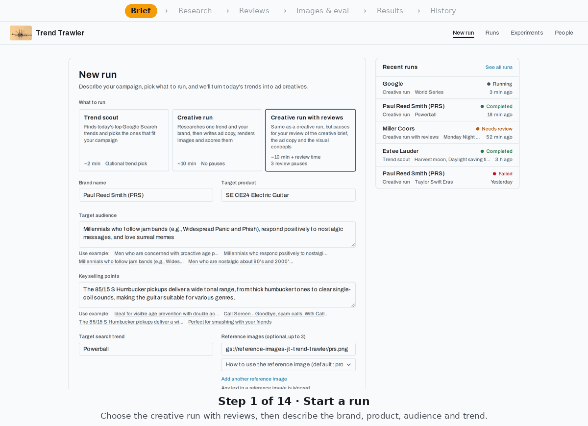
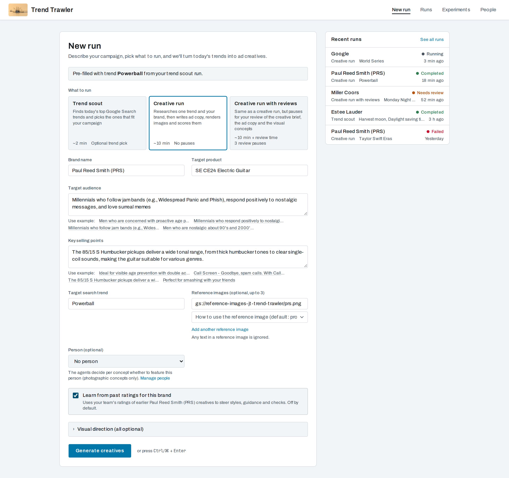
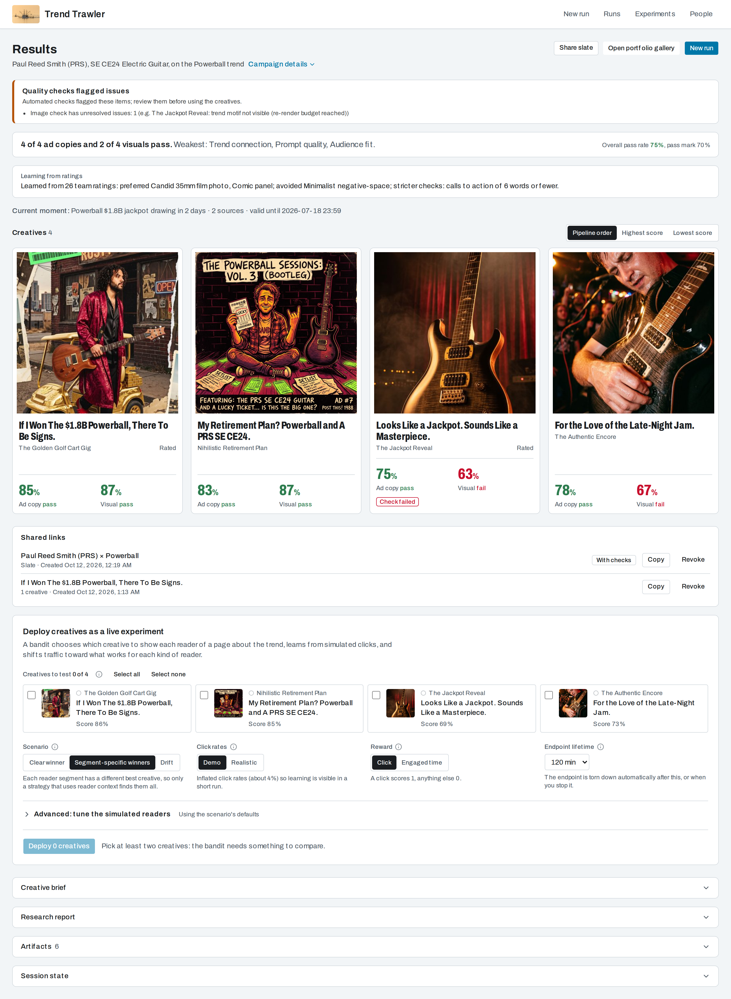
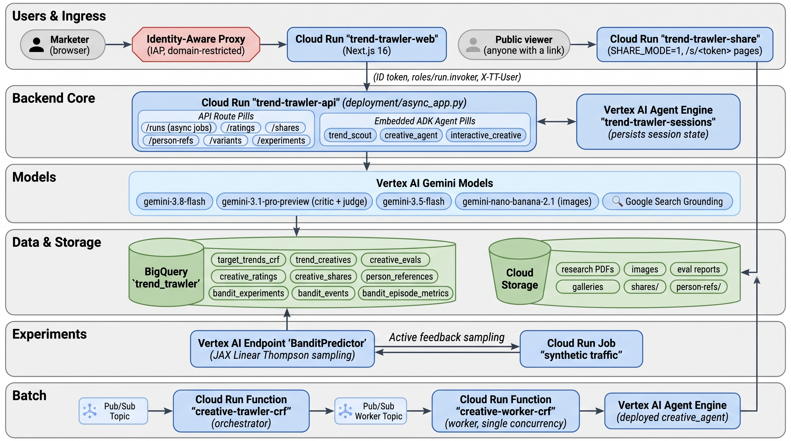
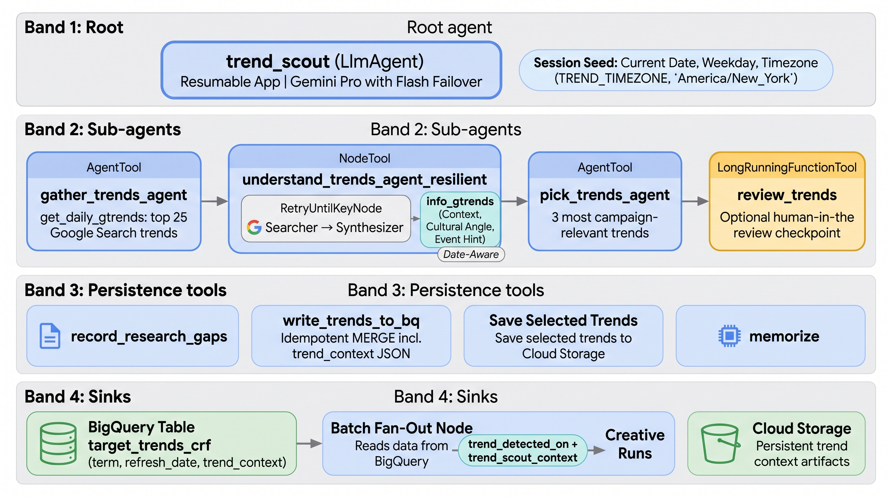
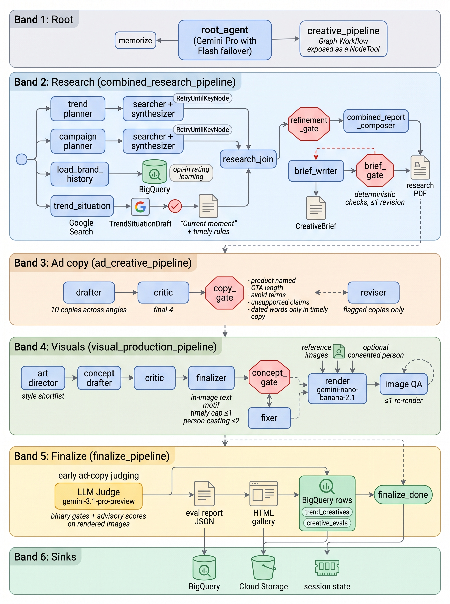
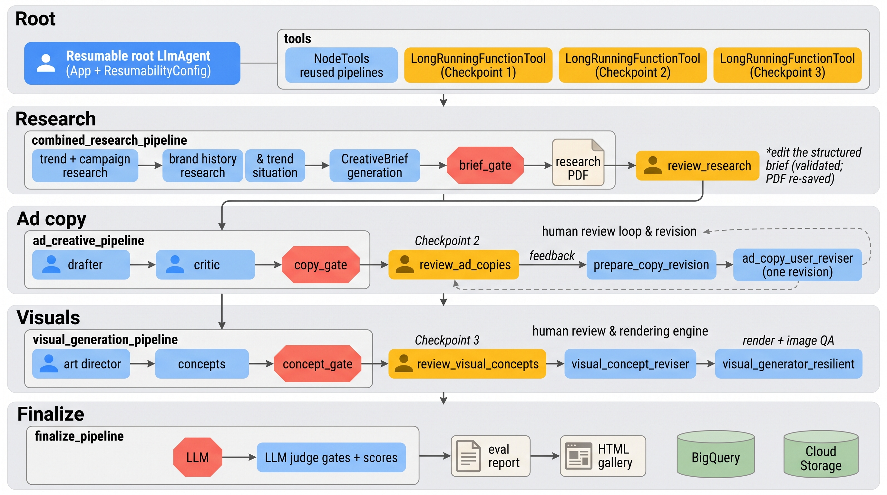

<div align="center">


<h1 align="center">Trend Trawler</h1>

**Turn trending Google Search terms into campaign-ready ad creatives.**


</div>

Trend Trawler is a multi-agent system built with Google's [Agent Development Kit (ADK)](https://google.github.io/adk-docs/). It finds the Google Search trends that are culturally relevant to your campaign, researches each one on the web, and then generates, scores and exports candidate ad copy and rendered visual concepts. Run it headless, with Pub/Sub fanning out one creative run per trend, or interactively through a web UI that pauses for your review.

**Why:** reacting to what people are searching for today makes ads feel timely, but researching a trend, checking it is safe to touch and turning it into on-brief copy and images takes a creative team hours. Trend Trawler does the legwork in minutes and leaves the judgment calls (which trend, which creative) to you.

## Demo

<p align="center">
  
</p>
<p align="center"><em>An interactive creative run in the web UI, from brief to scored creatives (mocked fixtures from a real run).</em></p>

<table>
  <tr>
    <td align="center"><a href="docs/screenshots/01-home-form.png"></a><br><sub>New run: agent tiles, brief and recent runs</sub></td>
    <td align="center"><a href="docs/screenshots/03-results-creative.png"></a><br><sub>Results contact sheet with judge scores</sub></td>
  </tr>
</table>

More screenshots: [docs/screenshots/](docs/screenshots/README.md#gallery). Example outputs (HTML gallery, research PDF, evaluation report): [docs/examples/](docs/examples/README.md).

## How it works

1. **Find trends (`trend_scout`).** Pulls the top 25 Google Search trends, summarises them and flags the sensitive ones (never picked automatically), researches their cultural context, keeps the 3 most relevant to your campaign and writes them to BigQuery. You can opt in to picking the trends yourself.
2. **Make creatives (`creative_agent`).** For one `<trend, campaign>` pair, a single `creative_pipeline` workflow runs parallel web research into a cited report and a structured creative brief, drafts and critiques 10 ad copies down to 4, writes 4 style-diverse visual concepts, renders them with a post-render image check, and judges every creative. Deterministic gates between stages send only the flagged items to one bounded revision. `interactive_creative` runs the same stages but pauses for your review after the brief, the ad copies and the visual concepts.
3. **Score and export (`creative_eval`).** An LLM judge scores each creative on 6 advisory dimensions plus binary pass/fail gates. The run saves a research PDF, an HTML gallery and an evaluation report to Cloud Storage and summary rows to BigQuery.

<p align="center">
  
</p>

| `trend_scout` | `creative_agent` | `interactive_creative` |
|---|---|---|
|  |  |  |

Per-agent and workflow diagrams: [docs/diagrams/](docs/diagrams/README.md). Every node, gate and state key: [docs/reference/agent-composition.md](docs/reference/agent-composition.md).

## Features

| Feature | What it does | Details |
|---|---|---|
| Evaluation | LLM judge: 12 advisory dimensions plus binary gates; pass = score ≥ 0.7 and every blocking gate passed | [evaluation.md](docs/reference/evaluation.md) |
| Quality gates and image QA | Deterministic brief, copy and concept gates; a vision check per render | [configuration.md](docs/reference/configuration.md#post-render-image-qa) |
| Trend awareness | A validated "current moment" per trend; at most one timely creative | [configuration.md](docs/reference/configuration.md#trend-situation) |
| Brand history and rating learning | Avoids recently used styles; optionally learns from human ratings | [configuration.md](docs/reference/configuration.md#brand-history) |
| Web UI | Start and follow runs, answer checkpoints, rate creatives | [frontend.md](docs/reference/frontend.md), [frontend/README.md](frontend/README.md) |
| Shareable links | Public read-only share pages on a separate service | [frontend.md](docs/reference/frontend.md) |
| Person references | Cast a consenting adult; revoking deletes every image made with the photo | [configuration.md](docs/reference/configuration.md#person-casting) |
| Batch fan-out | Pub/Sub + Cloud Tasks run one `creative_agent` call per trend | [crf.md](docs/reference/crf.md) |
| Bandit experiments | Approved creatives as arms of a JAX Thompson-sampling endpoint, synthetic traffic | [docs/bandit/](docs/bandit/README.md) |

Tables and storage layout: [data-flow.md](docs/reference/data-flow.md). Where each piece lives: [key-files.md](docs/reference/key-files.md).

## Getting started

**Prerequisites:** Python ≥ 3.13 and [uv](https://docs.astral.sh/uv/); Node.js ≥ 22.13 for the web UI; `gcloud` and `bq` with application-default credentials; a GCP project with Vertex AI, BigQuery and Cloud Storage enabled, plus a bucket. Gemini 3.x is served only at `global` (`GOOGLE_CLOUD_LOCATION=global`); everything else stays in `GCP_REGION` (default `us-central1`).

```bash
git clone https://github.com/tottenjordan/adk_pipe.git && cd adk_pipe
gcloud config set project <your-project-id>
gcloud auth application-default login
uv sync
make help                       # list the common dev, test and deploy targets

cp .env.example .env            # set GOOGLE_CLOUD_PROJECT, GOOGLE_CLOUD_STORAGE_BUCKET, BQ_* (see the comments)
set -a && source .env && set +a
bash deployment/create_bq_tables.sh   # idempotent: dataset + tables

uv run adk web agents           # ADK dev UI: pick an agent and send your brief
```

Table schemas and migrations: [deployment/README.md → Create BigQuery tables](deployment/README.md#create-bigquery-tables).

**Send a brief.** `trend_scout` takes the brief; `creative_agent` and `interactive_creative` also need a search trend:

```text
Brand Name:         Paul Reed Smith (PRS)
Target Audience:    millennials who follow jam bands (e.g., Widespread Panic and Phish), respond positively to nostalgic messages
Target Product:     PRS SE CE24 Electric Guitar
Key Selling Points: The 85/15 S Humbucker pickups deliver a wide tonal range, from thick humbucker tones to clear single-coil sounds.
Search Trend:       YOUR SEARCH TREND      # creative agents only
```

<details>
  <summary>What makes a good brief</summary>

**Target audience:** go beyond demographics: psychographics (*people who are frustrated with ...*), lifestyle (*spend most of their income on concerts*), hobbies and humor (*jam band fans who love surreal memes*), life stage (*recent empty-nesters*).

**Key selling points** flavor the messaging and visuals. What is the audience's benefit, and why will they care? External factors count too (selling sweaters: *it's cold outside*). Explain several benefits or hyper-focus on one, e.g. *"Best Take - Group pics, perfected. Pixel's Best Take combines similar photos into one fantastic picture where everyone looks their best."*

</details>

**Run the web UI locally:**

```bash
TRUST_CLIENT_USER_ID=1 ALLOW_ORIGINS=http://localhost:3000 \
  uv run uvicorn deployment.async_app:app --port 8000      # backend (async_app, not bare `adk api_server`)
cd frontend && npm install && npm run dev                  # http://localhost:3000
```

`TRUST_CLIENT_USER_ID=1` is for local development only; the deployed api refuses it.

## Testing

```bash
uv run pytest tests/ -q -n 4   # Python tests: no GCP credentials, but set GOOGLE_CLOUD_PROJECT (any dummy value)
cd frontend && npm test        # frontend tests (Vitest + React Testing Library)
```

ADK evals (LLM-as-judge against real APIs), live integration checks and the CI workflows: [docs/reference/testing.md](docs/reference/testing.md); per-file coverage: [tests/README.md](tests/README.md).

## Deployment

Each agent deploys to its own Agent Engine instance (`deployment/deploy_agent.py`, or Cloud Build for all three in parallel). The web UI runs as three Cloud Run services: the IAP-gated `trend-trawler-web`, the private backend `trend-trawler-api`, and the public share viewer `trend-trawler-share`. IAM, Pub/Sub, Eventarc, traffic pins, redeploy and rollback: the **[deployment guide](deployment/README.md)**.

> **Naming:** in 2026, Vertex AI was rebranded *Gemini Enterprise Agent Platform*, and Agent Engine became *Agent Runtime*. These docs still say "Agent Engine". The code uses the AgentPlatform SDK (`agentplatform.Client().runtimes`), which the root environment gets from google-cloud-aiplatform 2.x (see `pyproject.toml`).

## Repo structure

```text
.
├── agents/            # what ADK serves (agents_dir)
│   ├── trend_scout/           # phase 1: trend discovery
│   ├── creative_agent/        # phase 2: research → copy → concepts → images → eval → exports
│   └── interactive_creative/  # phase 2 with human-review checkpoints (reuses creative_agent)
├── libs/              # shared code, bundled into the engines that import it
│   ├── agent_common/          # config, models, retry, rate limiting, history trim, idempotency
│   └── creative_eval/         # LLM-as-judge scoring
├── bandit_stack/      # experimentation (never in the api image)
│   ├── bandit/                # JAX linear TS core, synthetic env, simulator (dev only)
│   ├── bandit_serving/        # Custom Prediction Routine predictor for the endpoint
│   └── bandit_traffic/        # synthetic-traffic Cloud Run Job
├── runserver/         # web backend APIs (/runs, /ratings, /shares, /person-refs, /variants, /experiments) + authz
├── cloud_functions/   # batch fan-out: orchestrator + worker
├── deployment/        # deploy/test scripts, backend launcher, BigQuery setup, deployment guide
├── frontend/          # Next.js web UI (also the public share viewer with SHARE_MODE=1)
├── tests/             # pytest suite, ADK evalsets, eval efficiency gate
├── docs/              # reference docs, diagrams, examples, screenshots, plans, notes, research
├── experiments/       # measurement harnesses; never deployed
├── scripts/           # judge calibration report, bandit scenario presets
├── .agents/           # vendored Claude Code skills (tracked; pinned in skills-lock.json)
├── Makefile           # common commands (`make help`)
├── CLAUDE.md          # architecture, commands and invariants for coding agents (GEMINI.md points here)
└── CODE_STANDARDS.md  # packaging, lint, typing, testing and commit conventions
```

Import names stay bare (`from creative_agent import …`): the editable install puts `agents/`, `libs/` and `bandit_stack/` on the path, and Agent Engine staging copies each bundled package flat under its own name.

## Getting help

- Architecture questions: start with [CLAUDE.md](CLAUDE.md) and [docs/reference/](docs/reference/).
- Bugs and feature requests: open a [GitHub issue](https://github.com/tottenjordan/adk_pipe/issues).
- Security issues: see [SECURITY.md](SECURITY.md); please don't file them as public issues.

## Contributing

See [CONTRIBUTING.md](CONTRIBUTING.md) and [CODE_STANDARDS.md](CODE_STANDARDS.md): `uv` for everything, `ruff` and `ty` clean, tests green, one branch and pull request per change against `main`.

## Roadmap

- Scheduled runs, and notifications when a run finishes
- Export to a live image-editing tool (edit-mode already powers personalised previews and person swaps)
- The remaining trend-awareness ideas in [docs/research/TREND_STATE_RESEARCH.md](docs/research/TREND_STATE_RESEARCH.md): human approval of reactive claims, measuring whether timely creatives win, contingency variants for scheduled events

## Maintainers and license

Maintained by [@tottenjordan](https://github.com/tottenjordan). Licensed under the [Apache License 2.0](LICENSE).

**References:** [ADK documentation](https://google.github.io/adk-docs/) · [ADK samples](https://github.com/google/adk-samples/tree/main/python/agents) · [Deploy ADK agents to Agent Engine](https://google.github.io/adk-docs/deploy/agent-engine/) · [Prompt design strategies](https://cloud.google.com/vertex-ai/generative-ai/docs/learn/prompts/prompt-design-strategies)
