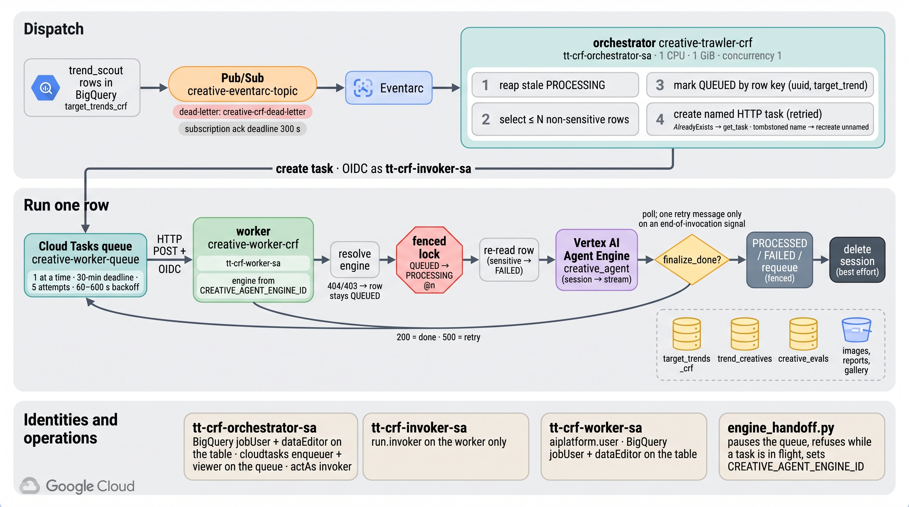
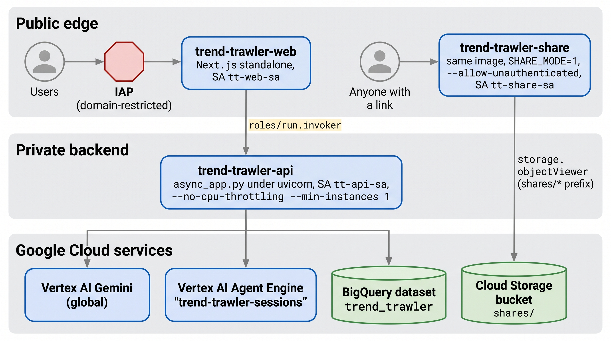

# Deployment

Operational guide for deploying **Trend Trawler**. For what the system does and how to run it locally,
see the [main README](../README.md).

## Contents
- [Prerequisites](#prerequisites)
- [Required environment](#required-environment)
- [Create BigQuery tables](#create-bigquery-tables)
- [Deploying Agents to Agent Engine](#deploying-agents-to-agent-engine)
- [Deploying engines with Cloud Build](#deploying-engines-with-cloud-build)
- [Cloud Run Functions Fan-out Pattern](#cloud-run-functions-fan-out-pattern)
- [Frontend + api_server on Cloud Run](#frontend--api_server-on-cloud-run)
- [Bandit experiments](#bandit-experiments)
- [Creative ratings (judge calibration)](#creative-ratings-judge-calibration)
- [Shareable links](#shareable-links)
- [Person references](#person-references)
- [Personalised variants](#personalised-variants)
- [Trend state (date, current moment, timely slot)](#trend-state-date-current-moment-timely-slot)
- [Creative quality: migrations + knobs](#creative-quality-migrations--knobs)
- [Trend digest cache](#trend-digest-cache)
- [Eval CI (WIF)](#eval-ci-wif)

## Prerequisites

- A populated `.env` (copy from [.env.example](../.env.example)) — project, `GOOGLE_CLOUD_LOCATION=global`,
  `GCP_REGION=us-central1`, GCS bucket, Pub/Sub topics, Cloud Run Function names, and BigQuery IDs.
- `gcloud` authenticated (`gcloud auth application-default login`) and the project set.
- BigQuery dataset + tables created — see [Create BigQuery tables](#create-bigquery-tables) below.

## Required environment

Nothing in the code hardcodes a GCP project: every identifier comes from the
environment (the repo `.env` for local scripts; `--set-env-vars` for deployed
Cloud Run Functions, which do **not** read `.env`). All vars are documented in
[.env.example](../.env.example).

| Variable | Used by | Required? | Default |
|---|---|---|---|
| `GOOGLE_CLOUD_PROJECT` | CRF orchestrator + worker, `deploy_agent.py`, `test_deployment.py`, `integration_test.py`, `create_session_engine.py` | **Yes** — the CRFs raise `RuntimeError` at first use if unset (imports stay side-effect-free) | none |
| `GOOGLE_CLOUD_PROJECT_NUMBER` | CRF orchestrator (worker topic path; the default Cloud Tasks invoker SA) + worker (Reasoning Engine path); `deploy_agent.py --delete` | CRFs: optional; deploy scripts: yes | CRFs fall back to `GOOGLE_CLOUD_PROJECT` (both APIs accept the ID) |
| `GCP_REGION` | CRFs (Agent Engine client), all deploy scripts | No | `us-central1` |
| `CREATIVE_WORKER_TOPIC_NAME` | CRF orchestrator (publishes to it on the `pubsub` transport) | No | `creative-worker-queue-topic` |
| `CRF_WORKER_TRANSPORT` | CRF orchestrator: how it reaches the worker, `pubsub` (worker topic + Eventarc) or `tasks` (Cloud Tasks HTTP tasks, see [§3 Cloud Tasks queue](#3-deploy-the-functions-the-orchestrator-trigger-and-the-cloud-tasks-queue)); `tasks` without a usable `CRF_WORKER_URL` or invoker SA → ERROR + `pubsub` | No | `pubsub` |
| `CRF_WORKER_URL` | CRF orchestrator, `tasks` transport: the worker's `https://` Cloud Run URL (task target + OIDC audience) | With `tasks`: **yes** | none |
| `CRF_TASKS_QUEUE` / `CRF_TASKS_LOCATION` | CRF orchestrator, `tasks` transport | No | `creative-worker-queue` / `GCP_REGION` |
| `CRF_TASKS_INVOKER_SA` | CRF orchestrator, `tasks` transport: the identity of the tasks' OIDC token (needs `run.invoker` on the worker) | No | `<GOOGLE_CLOUD_PROJECT_NUMBER>-compute@developer.gserviceaccount.com` |
| `CRF_TASK_DISPATCH_DEADLINE_SECS` | CRF orchestrator, `tasks` transport: how long Cloud Tasks waits for the worker's response | No | `CRF_WORKER_TIMEOUT_SECS` (1800), clamped 15–1800 |
| `CREATIVE_AGENT_ENGINE_ID` | CRF worker (the creative engine it runs: the full `projects/<number>/locations/<GCP_REGION>/reasoningEngines/<id>` name, as `.env` stores it, or the bare id; another project/region or a malformed value is ignored with an ERROR); also `test_deployment.py` / `integration_test.py` (see below) | Worker: **yes** — while unset or invalid it logs an ERROR per message and leaves the row `QUEUED` (no lock taken). Set by `engine_handoff.py apply --update-worker` | none |
| `AGENT_WORKER_USER_ID` | CRF worker (Agent Engine session owner, `<id>_<hash(uuid, target_trend)>`, else `<id>_<row index>`) | No | `crf_worker` |
| `BQ_DATASET_ID` / `BQ_TABLE_TARGETS` | CRFs (SQL identifier allow-list) | No | `trend_trawler` / `target_trends_crf` |
| `CRF_EXTRA_ALLOWED_TABLES` | CRFs (extra allow-listed tables) | No | empty |
| `REAP_STALE_PROCESSING_MINUTES` / `MAX_PROCESSING_ATTEMPTS` | CRF orchestrator (stale-PROCESSING reaper; the threshold must be ≥ the worker timeout) | No | `ceil(CRF_WORKER_TIMEOUT_SECS/60)+15` = `45` / `3` |
| `CRF_MAX_ROWS_PER_RUN` | CRF orchestrator (max rows one trigger dispatches, oldest first, clamped 1–100; a message's `max_rows` can only lower it) | No | `3` |
| `<PREFIX>_AGENT_ENGINE_ID` (`SCOUT_`, `CREATIVE_`, `INTERACTIVE_`) | `test_deployment.py`, `integration_test.py` (written by `deploy_agent.py --create`) | Yes, per tested agent | none |

`create_session_engine.py` also accepts `--project` / `--region` flags, which
override the env vars. Agent Engine resource IDs are never constants: pass them via
`--resource_id` (`deploy_agent.py --delete`) or the `*_AGENT_ENGINE_ID` env vars. The
CRF worker reads its engine from its own `CREATIVE_AGENT_ENGINE_ID` env var (since
2026-10-14); the Pub/Sub messages no longer carry it, and a legacy
`agent_resource_id` in a message is ignored (a WARNING when it differs).

---

## Create BigQuery tables

Trend Trawler uses one BigQuery dataset (`BQ_DATASET_ID`) with three tables. Create them once,
before running `trend_scout` (which writes the target trends), `creative_agent` /
`interactive_creative` (which write a creative row and an evaluation row per run), or the
fan-out (which reads and locks the target trends).

| Table (env var) | Written by | Contents |
|---|---|---|
| `target_trends_crf` (`BQ_TABLE_TARGETS`) | `trend_scout` (`trend_scout/tools.py`); the CRF worker sets `processed_status` / `processing_*` | The selected trends plus campaign metadata; the fan-out queue |
| `trend_creatives` (`BQ_TABLE_CREATIVES`) | `creative_agent` / `interactive_creative` (`creative_agent/bq_tools.py`) | One row per creative run: campaign metadata, trend and the `creative_gcs` folder |
| `creative_evals` (`BQ_TABLE_EVALS`) | same (`EVAL_COLUMN_TYPES` in `creative_agent/bq_tools.py`) | One evaluation summary per run; `creative_uuid` joins `trend_creatives.uuid` |
| `trend_digest` (`BQ_TABLE_TREND_DIGEST`, default `trend_digest`) | `trend_scout` (`trend_scout/digest.py`) | The daily trend digest cache: one row per (refresh date, trend list); see [Trend digest cache](#trend-digest-cache) |

The idempotent helper script skips anything that already exists:

```bash
set -a && source .env && set +a
bash deployment/create_bq_tables.sh     # BQ_LOCATION defaults to US
```

Or run the commands yourself:

```bash
bq --location=US mk --dataset $BQ_PROJECT_ID:$BQ_DATASET_ID

# selected search trends
bq mk \
 -t \
 $BQ_PROJECT_ID:$BQ_DATASET_ID.$BQ_TABLE_TARGETS \
 uuid:STRING,processed_status:STRING,target_trend:STRING,refresh_date:DATE,trawler_date:DATE,entry_timestamp:TIMESTAMP,trawler_gcs:STRING,brand:STRING,target_audience:STRING,target_product:STRING,key_selling_point:STRING,research_gaps:STRING,processing_started_at:TIMESTAMP,processing_attempts:INTEGER

# target-trend creatives
bq mk \
 -t \
 $BQ_PROJECT_ID:$BQ_DATASET_ID.$BQ_TABLE_CREATIVES \
 uuid:STRING,target_trend:STRING,datetime:DATETIME,creative_gcs:STRING,brand:STRING,target_audience:STRING,target_product:STRING,key_selling_point:STRING

# creative evaluation summaries (one row per run; links to trend_creatives.uuid)
bq mk \
 -t \
 $BQ_PROJECT_ID:$BQ_DATASET_ID.$BQ_TABLE_EVALS \
 uuid:STRING,creative_uuid:STRING,datetime:DATETIME,target_trend:STRING,brand:STRING,target_product:STRING,overall_pass_rate:FLOAT,total_ad_copies:INTEGER,ad_copies_passed:INTEGER,avg_ad_copy_score:FLOAT,total_visual_concepts:INTEGER,visual_concepts_passed:INTEGER,avg_visual_score:FLOAT,weakest_dimensions:STRING,eval_report_gcs_uri:STRING,research_gaps:STRING,weakest_dimension_labels:STRING,gates_pass_rate:FLOAT
```

These schemas already include every later column. Tables created before those columns
existed need the additive migrations instead: `processing_started_at` /
`processing_attempts`, `weakest_dimension_labels` and `gates_pass_rate`, all under
[3. Deploy the functions, the orchestrator trigger and the Cloud Tasks queue](#3-deploy-the-functions-the-orchestrator-trigger-and-the-cloud-tasks-queue).
The nightly eval CI uses an isolated dataset cloned from these schemas (see
[Eval CI (WIF)](#eval-ci-wif)). The script also creates the three `bandit_*` tables used by
deployed-creative experiments (see [Bandit experiments](#bandit-experiments)) and the
`creative_ratings` table behind the results-page human ratings (see
[Creative ratings (judge calibration)](#creative-ratings-judge-calibration)) and the
`creative_shares` table behind shareable links (see [Shareable links](#shareable-links))
and the `person_references` consent registry (see [Person references](#person-references))
and the `trend_digest` cache (see [Trend digest cache](#trend-digest-cache)).

---

## Deploying Agents to Agent Engine

Deploying Agents to separate Agent Engine instances...

> [Agent Engine](https://google.github.io/adk-docs/deploy/agent-engine/) is a fully managed auto-scaling service on Google Cloud specifically designed for deploying, managing, and scaling AI agents built with frameworks such as ADK.

<p align="center">
  
</p>


```bash
# deploy `trend_scout` agent to Agent Engine
uv run python deployment/deploy_agent.py --version=v1 --agent=trend_scout --create

# deploy `creative_agent` agent to Agent Engine
uv run python deployment/deploy_agent.py --version=v1 --agent=creative_agent --create

# deploy `interactive_creative` agent (human-in-the-loop variant) to Agent Engine
uv run python deployment/deploy_agent.py --version=v1 --agent=interactive_creative --create

# list existing Agent Engine instances
uv run python deployment/deploy_agent.py --list

# delete an Agent Engine Runtime (a numeric ID or full resource name; refuses the
# trend-trawler-sessions engine and any engine .env still names unless --allow_protected)
uv run python deployment/deploy_agent.py --resource_id=<RESOURCE_ID> --delete

# opt-in Cloud Trace for a new engine (off by default)
uv run python deployment/deploy_agent.py --version=v1 --agent=creative_agent --create --enable_tracing
```

> **Cloud Trace (opt-in).** `--enable_tracing` ships
> `GOOGLE_CLOUD_AGENT_ENGINE_ENABLE_TELEMETRY=true` in the engine's env vars, which turns
> on span export to Cloud Trace. `AdkApp(enable_tracing=...)` is deliberately left unset:
> passing `True` would also force prompt/response content capture into the spans. The flag
> also ships `ADK_CAPTURE_MESSAGE_CONTENT_IN_SPANS=false`, because ADK's own spans otherwise
> carry the full `gcp.vertex.agent.llm_request`/`llm_response`. The
> Reasoning Engine service agent
> (`service-$PROJECT_NUMBER@gcp-sa-aiplatform-re.iam.gserviceaccount.com`) needs
> `roles/cloudtrace.agent`, and `cloudtrace.googleapis.com` must be enabled.

> The local packages bundled into each engine are derived from a single
> `AGENT_EXTRA_PACKAGES` map in `deployment/deploy_agent.py` (from the real import
> graph — e.g. `creative_agent` → `creative_eval` + `agent_common`), so a
> cross-package dependency can't be silently left out of a deploy.
> The SDK tars each package dir unfiltered, so `deploy_agent.py` stages a filtered copy
> (no hidden entries such as a local `adk web` run's `.adk/` session.db + renders, no
> `__pycache__` / `*.pyc`) in a temp dir, refuses to deploy if any local-only path got
> staged, and runs `runtimes.create` from there. Requirements are passed as a list with
> `uv export`'s comments and `# via` annotations stripped.

* Once agent is deployed to Agent Engine, the agent's resource ID will be added to your `.env` file (unless `--nowrite_env`; `--output_json=<path>` also writes it as JSON and prints an `ENGINE_ID agent=<agent> id=<resource name>` line — the non-interactive mode the [Cloud Build deploy](#deploying-engines-with-cloud-build) uses) (`SCOUT_AGENT_ENGINE_ID`, `CREATIVE_AGENT_ENGINE_ID` or `INTERACTIVE_AGENT_ENGINE_ID`). And this will be used later by the `test_deployment.py` / `integration_test.py` scripts
* The deploy/test scripts use the AgentPlatform SDK: `agentplatform.Client().runtimes` and `agentplatform.frameworks.AdkApp` (google-cloud-aiplatform 2.x, via the `[tool.uv]` override in `pyproject.toml`)

### Test deployment

**Interact with the deployed agents using the `test_deployment.py` script...**

*Note: the `test_deployment.py` script will source the `BRAND`, `TARGET_AUDIENCE`, `TARGET_PRODUCT`, `KEY_SELLING_POINT`, and `TARGET_SEARCH_TREND` from your `.env` file.*

**[1] Kickoff the `trend_scout` agent workflow.**  

> *This will insert a row into your BigQuery table for each recommended trend*

```bash
export USER_ID='ima_user'
uv run python deployment/test_deployment.py --agent=trend_scout --user_id=$USER_ID

Found agent with resource ID: ...
Created session for user ID: ...
...

INFO - Deleted session for user ID: ima_user
```

**[2] Next, invoke the deployed `creative_agent` workflow:**

> *This will insert a row into your BigQuery table with the Cloud Storage location of all trend and creative assets*

```bash
export USER_ID='ima_user'
uv run python deployment/test_deployment.py --agent=creative_agent --user_id=$USER_ID

Found agent with resource ID: ...
Created session for user ID: ...
...

INFO - Deleted session for user ID: ima_user
```


**View logs for an agent**

To view log entries in the [Logs Explorer](https://cloud.google.com/logging/docs/view/logs-explorer-interface), run the query below

```bash
resource.type="aiplatform.googleapis.com/ReasoningEngine"
resource.labels.location="GCP_REGION"
resource.labels.reasoning_engine_id="YOUR_AGENT_ENGINE_ID"
```

---

## Deploying engines with Cloud Build

`deployment/cloudbuild.agents.yaml` runs the same `deploy_agent.py --create` as above, but from
a **fresh clone** of a GitHub ref, on **pinned Python 3.13** (uv 0.12.19 image, tag + digest),
with an **explicit environment**, and deploys the selected engines **in parallel**. It removes
the laptop hazards: stale exported `*_AGENT_ENGINE_ID` / `GOOGLE_CLOUD_STORAGE_BUCKET` /
`BUCKET` / `PERSON_SAFE_STYLES` in the deployer shell (each deploy starts from `env -i`), env
values baked into the pickles from whatever the shell had (only the committed profile
`deployment/deploy.env` is sourced), worktrees defaulting to Python 3.14 (a step fails the
build unless the venv is 3.13, matching the engine's py313 runtime), and parallel deploys
clobbering `.env` (the build never writes `.env`; it hands the IDs off as JSON).

```bash
gcloud builds submit --no-source --project=hybrid-vertex --region=us-central1 \
  --config=deployment/cloudbuild.agents.yaml \
  --substitutions=_REF=main,_CREATIVE_VERSION=v37,_INTERACTIVE_VERSION=v33,_SCOUT_VERSION=v18
# one engine + the end-to-end smoke test against it:
gcloud builds submit --no-source --project=hybrid-vertex --region=us-central1 \
  --config=deployment/cloudbuild.agents.yaml \
  --substitutions=_AGENTS=creative_agent,_CREATIVE_VERSION=v37,_SMOKE=true
```

To deploy **two** engines in one build, use gcloud's alternate delimiter, because
`--substitutions` is comma-separated and `_AGENTS` itself contains a comma:

```bash
gcloud builds submit --no-source --project=hybrid-vertex --region=us-central1 \
  --config=deployment/cloudbuild.agents.yaml \
  "--substitutions=^;^_REF=$(git rev-parse origin/main);_AGENTS=interactive_creative,trend_scout;_INTERACTIVE_VERSION=v36;_SCOUT_VERSION=v19"
```

`--no-source`: nothing is uploaded from your checkout; the build clones `_REF`, so **push
first** (a local-only commit can't be deployed).

| Substitution | Default | Meaning |
|---|---|---|
| `_AGENTS` | `creative_agent,interactive_creative,trend_scout` | Engines to deploy (comma-separated subset) |
| `_CREATIVE_VERSION` / `_INTERACTIVE_VERSION` / `_SCOUT_VERSION` | empty | Version namespace per selected agent (required when selected): display name `<agent display>-<version>`, staging dir `adk-pipe/<sub>/<version>/staging` |
| `_REF` | `main` | Branch, tag or **full** 40-char commit SHA (short SHAs can't be fetched) |
| `_ENABLE_TRACING` | `true` | Adds `--enable_tracing` (Cloud Trace; see above) |
| `_SMOKE` | `false` | `true` runs `integration_test.py --check smoke --agent creative_agent` against the **new** creative engine (~8 min; skipped when `creative_agent` isn't selected) |
| `_DEPLOY_ENV` | `deployment/deploy.env` | Deploy profile in the checkout |
| `_REPO` / `_ARTIFACTS_BUCKET` / `_UV_IMAGE` | `tottenjordan/adk_pipe` / `trend-trawler-deploy-ae` / pinned uv image | Rarely changed |

**Steps:** `clone` (partial + sparse: `git fetch --depth 1 --filter=blob:none <_REF>` with `docs/`, `experiments/`,
`frontend/` and `imgs/` left out of the checkout, ~2 s instead of ~20 s; refuses a checked-in `.env`) → `sync`
(`uv sync --frozen --no-dev`, system Python only, no interpreter downloads) → `python-313`
(asserts the venv is 3.13, validates `_AGENTS`) → `deploy-creative_agent` /
`deploy-interactive_creative` / `deploy-trend_scout` **in parallel** (each skips itself when
not selected; `deployment/cloudbuild_env.sh` runs `deploy_agent.py --create --nowrite_env
--output_json=/workspace/engine_ids/<agent>.json` from `env -i` + the profile, after checking
the profile's `GOOGLE_CLOUD_PROJECT` is the build's project and that it sets no engine ID /
`BUCKET` / `GCS_BUCKET_NAME`) → `collect`, and in parallel `smoke` (optional), which reads the
new engine from `/workspace/engine_ids/creative_agent.json` and so starts as soon as
`deploy-creative_agent` ends rather than after every deploy.

**Deploy profile (`deployment/deploy.env`).** Committed and non-secret: project, number,
regions, bucket, BigQuery names, and every knob read at agent import (every `ENV_VAR_DICT`
key plus `CRITIC_FALLBACK_MODEL`, `MODEL_REQUEST_TIMEOUT_SECONDS`, `MODEL_ARMOR_*` (off),
`CAMPAIGN_RESEARCH_PLACEMENT`, `EVAL_*`, `IMAGE_SIZE` ...), at today's defaults. Change an
engine knob by editing this file in a PR, then redeploy. Nothing secret is needed (auth is the
build's service account through the metadata server); if a secret is ever needed, add it via
Secret Manager + `availableSecrets` / `secretEnv`, never to the profile. A drift test
(`tests/test_cloudbuild_agents.py`) fails when an `ENV_VAR_DICT` key is missing from it.

**Outputs.** Each deploy step prints `ENGINE_ID agent=<agent> id=<resource name>` as soon as
its engine exists. `collect` merges the records into `/workspace/engine_ids.json`
(`{"commit": ..., "engines": {"<agent>": {"resource_name", "env_key", "version",
"display_name", "enable_tracing", "previous"}}}`), uploads it to
`gs://trend-trawler-deploy-ae/adk-pipe/cloudbuild/<BUILD_ID>/engine_ids.json`, and prints
`agent: old -> new` (old = the newest other engine with the same display-name prefix, best
effort) plus the `.env` lines. The deploy steps have `allowFailure: true` so `collect` still
records the engines that were created; it then **fails the build** if a selected agent has no
record. To find an engine created by a step that failed afterwards:
`gcloud builds log <BUILD_ID> --region=us-central1 | grep 'ENGINE_ID '`.

**Hand-off (manual).**

```bash
BUILD_ID=<id from the submit output>
gcloud storage cp gs://trend-trawler-deploy-ae/adk-pipe/cloudbuild/$BUILD_ID/engine_ids.json /tmp/engine_ids.json
# 1) local .env (prints old -> new per key; same dotenv writer as deploy_agent)
uv run python deployment/engine_handoff.py apply --ids /tmp/engine_ids.json --env-file .env
# 2) CRF worker: --update-worker also sets creative-worker-crf's CREATIVE_AGENT_ENGINE_ID
#    (gcloud run services update --update-env-vars; a new revision). It first counts
#    PROCESSING rows in BQ_PROJECT_ID.BQ_DATASET_ID.BQ_TABLE_TARGETS (from .env) and
#    refuses ("worker busy", exit 1, nothing written) while a run is in flight, because
#    the new revision would kill it; --force skips the check, --worker-service <name>
#    targets another service. No creative_agent record -> .env only, worker untouched.
#    The worker is traffic-pinned (traffic on a named revision, not "latest"), so the
#    update alone leaves the new revision at 0% (and gcloud's success line names the OLD
#    revision). --update-worker therefore also reads the new revision
#    (status.latestCreatedRevisionName), checks it is Ready and carries the new
#    CREATIVE_AGENT_ENGINE_ID, runs `gcloud run services update-traffic
#    creative-worker-crf --to-revisions <new>=100` (explicit revision, keeping the pin;
#    skipped when it already serves 100%) and verifies status.traffic. Any failed
#    check exits 1 and prints the manual update-traffic fix and the rollback command
#    (the revisions that served before).
uv run python deployment/engine_handoff.py apply --ids /tmp/engine_ids.json --env-file .env --update-worker
#    (the trigger message needs no engine id any more)
NEW_ID=$(jq -r '.engines.creative_agent.resource_name' /tmp/engine_ids.json)
# 3) optional, NOT applied: keep the current IDs as Secret Manager versions
#    (gcloud secrets create creative-agent-engine-id --replication-policy=automatic  # once)
#    printf %s "$NEW_ID" | gcloud secrets versions add creative-agent-engine-id --data-file=-
```

The api runs the agents in-process and does not read engine IDs, so nothing else changes.

**Rollback / cleanup.** Engines are created, never updated, so the old engines keep running:
roll back by pointing `.env` and the CRF worker at the previous ID again (`previous` in
`engine_ids.json`, or the old value `apply` printed): `gcloud run services update
creative-worker-crf --region us-central1 --update-env-vars
CREATIVE_AGENT_ENGINE_ID=<previous resource name>` (while no row is `PROCESSING`), then pin
the traffic to that new revision (`gcloud run services update-traffic creative-worker-crf
--region us-central1 --to-revisions <revision>=100`; the update alone lands at 0%), or simply
re-pin the previously serving revision, which still carries the old ID. Delete old engines manually once the new
ones are verified: `uv run python deployment/deploy_agent.py --resource_id=<numeric id> --delete`
(`--list` shows them all). It looks the engine up first and refuses the sessions engine or an
engine a `*_AGENT_ENGINE_ID` in your env/.env still points at (stale shell exports count too:
run `apply` first, or `env -u` them) unless you pass `--allow_protected`.

### IAM prerequisites

`gcloud builds get-default-service-account --project hybrid-vertex` →
`934903580331@cloudbuild.gserviceaccount.com` (the legacy Cloud Build SA). Checked read-only
2026-10-12, it already has everything the build needs, so **no grant is missing** for the
default:

| Need | Permission | Granted via |
|---|---|---|
| create / list / get engines, sessions + query (smoke) | `aiplatform.reasoningEngines.*` | `roles/aiplatform.admin` (project) |
| staging uploads + `engine_ids.json` on `gs://trend-trawler-deploy-ae` | `storage.objects.create/get/list/delete` | `roles/cloudbuild.builds.builder` (project-level storage object perms) |
| build logs | `logging.logEntries.create` | `roles/cloudbuild.builds.builder` |
| act as the engine runtime SA | `iam.serviceAccounts.actAs` | not needed: `deploy_agent.py` sets no `service_account`, so engines run as the Reasoning Engine service agent `service-934903580331@gcp-sa-aiplatform-re.iam.gserviceaccount.com` |

Recommended instead (least privilege; new projects no longer get the legacy SA as the
build default): a dedicated deployer SA, passed with `--service-account` (the config already
uses `CLOUD_LOGGING_ONLY`, which a user-specified SA requires). Commands for the operator
(**not applied**):

```bash
PROJECT=hybrid-vertex
SA=tt-engine-deployer@$PROJECT.iam.gserviceaccount.com
gcloud iam service-accounts create tt-engine-deployer --project=$PROJECT \
  --display-name="Trend Trawler Agent Engine deployer (Cloud Build)"
gcloud projects add-iam-policy-binding $PROJECT --member=serviceAccount:$SA --role=roles/aiplatform.user
gcloud projects add-iam-policy-binding $PROJECT --member=serviceAccount:$SA --role=roles/logging.logWriter
gcloud storage buckets add-iam-policy-binding gs://trend-trawler-deploy-ae \
  --member=serviceAccount:$SA --role=roles/storage.objectAdmin
# only if deploy_agent.py ever sets a custom engine service_account=<RUNTIME_SA>:
# gcloud iam service-accounts add-iam-policy-binding <RUNTIME_SA> \
#   --member=serviceAccount:$SA --role=roles/iam.serviceAccountUser
# the submitter must be able to act as the deployer SA:
gcloud iam service-accounts add-iam-policy-binding $SA \
  --member=user:<you>@jordantotten.altostrat.com --role=roles/iam.serviceAccountUser
# then submit with:  gcloud builds submit ... --service-account=projects/$PROJECT/serviceAccounts/$SA
```

---

## Cloud Run Functions Fan-out Pattern

Event-based triggers dispatch one creative run per recommended trend.

<p align="center">
  
</p>

**objectives**
* create `Agent Orchestrator` to check BQ for trends recommended by the `trawler agent`; enqueue one Cloud Tasks task (or, on the `pubsub` rollback transport, publish one Pub/Sub message) per recommendation
* create `Agent Worker` to process each task dispatched by the `Orchestrator`, invoking the Agent Engine Runtime to generate ad copy and creatives for each `<trend, campaign>` pair (i.e., row in BQ table)
* handle at-least-once delivery ([Cloud Tasks](https://cloud.google.com/tasks/docs/common-pitfalls#duplicate_execution) and [Pub/Sub](https://cloud.google.com/pubsub/docs/subscription-overview#default_properties) both may deliver twice): the BigQuery row lock makes a duplicate a no-op
* serialise the long-running worker runs (one task in flight, 30-minute dispatch deadline) without bouncing deliveries


<details>
  <summary>Why two deployments?</summary>

*The need for two separate deployments stems from the fact that the `Orchestrator` and the `Worker` respond to two different event sources:*

1. Orchestrator Deployment: Listens to the `$CREATIVE_TRIGGER_NAME` (the one that signals "start the job"). It executes the `crf_entrypoint` function (a CloudEvent).
2. Worker Deployment: Receives the single-row payloads from the Cloud Tasks queue `creative-worker-queue` as HTTP POSTs. It executes the `agent_worker_task` function (`FUNCTION_SIGNATURE_TYPE=http`). On the `pubsub` rollback transport it instead listens to `$CREATIVE_WORKER_TOPIC_NAME` and executes `agent_worker_entrypoint` (a CloudEvent).


Each Cloud Run function service runs exactly one entry point, so you **deploy the image twice**, each service with its own `FUNCTION_TARGET` (and signature type).

</details>


### 1. Grant service account required permissions


*The orchestrator's Eventarc trigger runs as `$SERVICE_ACCOUNT` (here the default compute SA): it needs the Eventarc Event Receiver role and permission to invoke the orchestrator. The worker is reached by Cloud Tasks instead; its IAM (`cloudtasks.enqueuer`, `iam.serviceAccountUser`, `run.invoker`) is in [§3.4](#3-deploy-the-functions-the-orchestrator-trigger-and-the-cloud-tasks-queue).*


```bash
export SERVICE_ACCOUNT=$GOOGLE_CLOUD_PROJECT_NUMBER-compute@developer.gserviceaccount.com

# grant Eventarc Event Receiver role allows trigger to receive events from event providers
gcloud projects add-iam-policy-binding $GOOGLE_CLOUD_PROJECT \
  --member serviceAccount:$SERVICE_ACCOUNT \
  --role=roles/eventarc.eventReceiver


# Cloud Run invoker role allows it to invoke the function
gcloud projects add-iam-policy-binding $GOOGLE_CLOUD_PROJECT \
  --member serviceAccount:$SERVICE_ACCOUNT \
  --role=roles/run.invoker

# APIs: Cloud Run, Eventarc, Pub/Sub (orchestrator trigger) and Cloud Tasks (worker)
gcloud services enable run.googleapis.com eventarc.googleapis.com \
  pubsub.googleapis.com cloudtasks.googleapis.com
```

<details>
  <summary> Optional: grant yourself admin access to ignore IAM best practices</summary>

```bash
gcloud projects add-iam-policy-binding $GOOGLE_CLOUD_PROJECT \
    --member="user:YOUR_EMAIL_ADDRESS" \
    --role="roles/pubsub.admin"
```
</details>


### 2. Create the orchestrator's Pub/Sub topic


```bash
gcloud pubsub topics create $CREATIVE_TOPIC_NAME
```

That is the only topic the `tasks` transport needs (plus the orchestrator
trigger's dead-letter topic `creative-crf-dead-letter`, created in §3). The worker
topic `$CREATIVE_WORKER_TOPIC_NAME` (`creative-worker-queue-topic`) served only
the `pubsub` rollback transport after the Cloud Tasks cutover (2026-10-14) and was
deleted on 2026-10-15; a fresh project doesn't create it (see
[Rollback to Pub/Sub](#rollback-to-pubsub-one-release-only) to re-create it).


### 3. Deploy the functions, the orchestrator trigger and the Cloud Tasks queue


* **One image, two services.** Both functions run the same container image,
  built from [`cloud_functions/creative_fanout/Dockerfile`](../cloud_functions/creative_fanout/Dockerfile)
  by the root [`cloudbuild.yaml`](../cloudbuild.yaml) (`build-crf` step, package
  `creative-fanout-crf` in `cloud-run-source-deploy`, cached like the api/web builds).
  Each service picks its entry point with the env var `FUNCTION_TARGET`; the image
  has no default, so a service without it fails to start instead of running the
  other function. `FUNCTION_SIGNATURE_TYPE` picks the signature (default
  `cloudevent`; the Cloud Tasks worker sets `http`).
* `CRF_ENTRYPOINT` / `CREATIVE_WORKER_ENTRYPOINT`: the `FUNCTION_TARGET` values,
  `crf_entrypoint` (orchestrator) and `agent_worker_task` (worker, with
  `FUNCTION_SIGNATURE_TYPE=http`); `agent_worker_entrypoint` (CloudEvent) is the
  worker's Pub/Sub rollback entry point.
* `BASE_IMAGE`: no longer used. The functions used to deploy with
  `--source . --function … --base-image python313` (a buildpack build per service,
  with **automatic base-image updates**). The Dockerfile image does not get those
  (accepted trade-off: rebuild + redeploy to pick up OS/Python patches), and the
  first `--image` deploy of an existing service must pass `--clear-base-image` to
  drop the setting.
* [optional] if `--min-instances=1`, service **always on**
* **Worker completion check** (`cloud_functions/creative_fanout/completion.py`):
  the worker marks a row `PROCESSED` only when the engine session reached
  `finalize_done`, never on a clean stream end alone (spike 2026-10-13: a
  `499 CANCELLED` failed `creative_pipeline` and the root ended the stream
  cleanly). A stream timeout or cut leads into a session poll while the run is
  still appending events (a client disconnect does not stop the run server-side;
  a 780 s stream was not cut by the documented 10-min `streamQuery` limit). A
  run gets ONE retry message on the same session (runserver's
  `AUTO_RETRY_MESSAGE`; the root re-calls `creative_pipeline`) **only on a
  positive end-of-invocation signal**: the session's last content event is the
  root agent's final text (no function call or response, not partial), every
  function call since the last user message has a response, and that holds on
  two reads one poll apart. Quiet time alone never retries (the render node and
  the paced judge write no event for minutes, so a quiet run may still be going
  server-side); a run with no end signal and no new events for `CRF_IDLE_SECS`
  is given up as `FAILED` (`reason=stalled`). Then `FAILED` unless finalized
  (the error log carries `status`, `reason`, `retried`, `secs`).

  **Time budget.** The deadline is taken at **request start** (Cloud Run's
  timeout counts from there, not from the row lock): start +
  `CRF_WORKER_TIMEOUT_SECS` − `CRF_BUDGET_SAFETY_SECS`. Each session read is
  bounded by `min(CRF_SESSION_READ_TIMEOUT_SECS, remaining)` and the budget is
  re-checked after every read; the session delete is best effort (bounded by
  `CRF_SESSION_DELETE_TIMEOUT_SECS` ≤ 30 s, logged, never raised, so a failed
  delete can't turn a finished run into `FAILED`). Optional worker/orchestrator
  env vars (all clamped; an unset or invalid value uses the default; read by
  `config.load_config()` into one frozen `CrfConfig`):

  | Var | Default (clamp) | Meaning |
  | --- | --- | --- |
  | `CRF_WORKER_TIMEOUT_SECS` | 1800 (300–3600) | must match the worker's `--timeout`; the budget starts at request start |
  | `CRF_BUDGET_SAFETY_SECS` | 150 (30–600) | kept back for one session read + the delete + one status write; raised to their sum if lower (or, if that won't fit in half the worker timeout, all four fall back to their defaults), with an ERROR log |
  | `CRF_STREAM_TIMEOUT_SECS` | 1500 (60–3600) | bound on one `async_stream_query` (also clamped to the remaining budget) |
  | `CRF_POLL_INTERVAL_SECS` | 30 (5–300) | session poll interval |
  | `CRF_IDLE_SECS` | 600 (600–3600) | give-up fallback only: no end signal and no new events for this long → `FAILED` (never a retry) |
  | `CRF_SESSION_READ_TIMEOUT_SECS` | 60 (5–120) | bound on one session read |
  | `CRF_SESSION_DELETE_TIMEOUT_SECS` | 30 (1–30) | bound on the best-effort session delete |
  | `CRF_BQ_QUERY_TIMEOUT_SECS` | 60 (5–600) | bound on each BigQuery status query/DML |
  | `CRF_ROOT_AGENT_NAME` | `root_agent` | the engine's root agent (author of the end signal) |
  | `REAP_STALE_PROCESSING_MINUTES` | `ceil(CRF_WORKER_TIMEOUT_SECS/60)+15` = 45 (1–1440) | below the worker timeout → ERROR log + the default |
  | `MAX_PROCESSING_ATTEMPTS` | 3 (1–10) | reaper: FAILED instead of re-queued after this many locks |
  | `CRF_MAX_ROWS_PER_RUN` | 3 (1–100) | orchestrator row limit |
  | `CRF_WORKER_TRANSPORT` | `pubsub` (`pubsub`, `tasks`) | orchestrator → worker delivery; `tasks` needs an `https://` `CRF_WORKER_URL` and an invoker SA (else ERROR + `pubsub`) |
  | `CRF_WORKER_URL` | none | the worker's `https://` URL (task target + OIDC audience) |
  | `CRF_TASKS_QUEUE` / `CRF_TASKS_LOCATION` | `creative-worker-queue` / `GCP_REGION` | the Cloud Tasks queue |
  | `CRF_TASKS_INVOKER_SA` | the compute SA (`<project number>-compute@…`) | the tasks' OIDC identity |
  | `CRF_TASK_DISPATCH_DEADLINE_SECS` | `CRF_WORKER_TIMEOUT_SECS` (15–1800) | how long Cloud Tasks waits for the worker |

  A retry costs a whole second pipeline run, so a run that fails twice can take
  most of the 1800 s budget; the retry is skipped with < 300 s left. Session
  user ids name the row (`<AGENT_WORKER_USER_ID>_<sha256(uuid, target_trend)[:12]>`,
  the `stable_row_id` framing) when the message carries `uuid` + `target_trend`,
  else `<AGENT_WORKER_USER_ID>_<index>`.
* see [gcloud reference doc](https://cloud.google.com/sdk/gcloud/reference/run/deploy)


**3.0 Schema migration — `processing_started_at` + `processing_attempts`** (stale-PROCESSING reaper)

*Only for tables created before these columns existed; fresh tables from
[Create BigQuery tables](#create-bigquery-tables) already have them (and `weakest_dimension_labels`).*

The orchestrator reaps rows a worker stranded in `PROCESSING` by hard-crashing
after acquiring its lock (OOM / the 1800s Cloud Run timeout kill / segfault).
The worker's lock stamps `processing_started_at` + bumps `processing_attempts`;
the orchestrator re-queues rows older than `REAP_STALE_PROCESSING_MINUTES`
(default `ceil(CRF_WORKER_TIMEOUT_SECS/60)+15` = 45, always ≥ the worker timeout) under `MAX_PROCESSING_ATTEMPTS`
(default 3), failing them over the cap. Both are env-configurable.

Run the additive migration **FIRST, before deploying the code that writes these
columns** — a DML naming a missing column fails (same ordering rule as the
`research_gaps` migration in `docs/plans/archive/2026-07-15-trend-scout-degradation-surfacing.md`):

```sql
-- 1. Additive migration (idempotent; preserves all rows):
ALTER TABLE `<BQ_PROJECT_ID>.<BQ_DATASET_ID>.target_trends_crf`
  ADD COLUMN IF NOT EXISTS processing_started_at TIMESTAMP,
  ADD COLUMN IF NOT EXISTS processing_attempts INT64;

-- 2. One-time cleanup of any PRE-EXISTING stranded rows. Their
--    processing_started_at is NULL, so the recurring reaper (which compares
--    `< TIMESTAMP_SUB(...)`) will never catch them. Run ONLY when no run is in
--    flight (serialized single worker + no live users makes this trivial):
UPDATE `<BQ_PROJECT_ID>.<BQ_DATASET_ID>.target_trends_crf`
  SET processed_status = 'QUEUED'
  WHERE processed_status = 'PROCESSING' AND processing_started_at IS NULL;
```

**Redeploy order (the reaper spans both functions):** migration → **worker**
`$CREATIVE_WORKER_CRF_NAME` (ships the timestamp/attempt-stamping lock) →
**orchestrator** `$CREATIVE_CRF_NAME` (ships the reap call), each with the `--image`
redeploy in §3 (one image serves both). The orchestrator's Eventarc trigger binds by service name and the Cloud Tasks
queue targets the worker URL, so both survive a redeploy and are **not**
re-created (pin traffic if a revision lands at 0%).

**Row states (`processed_status`)** — the only transitions
(`status_store.TRANSITIONS` in `cloud_functions/creative_fanout/status_store.py`).
Every statement matches the row by trend_scout's MERGE key `(uuid, target_trend)`
(`entry_timestamp` is only for ordering and logs, so rows that share a timestamp
are told apart), and every UPDATE checks the row's current state:

| Transition | From | To | Who | Guard in the `WHERE` |
|---|---|---|---|---|
| mark QUEUED | NULL or QUEUED | QUEUED | orchestrator, before the first publish / task | `processed_status IS NULL OR processed_status = 'QUEUED'` |
| lock | QUEUED with `processing_attempts` = n | PROCESSING, `processing_attempts` = n + 1, `processing_started_at` = now | worker | `processed_status = 'QUEUED' AND COALESCE(processing_attempts, 0) = n` (compare-and-set on the n it read) |
| finish | PROCESSING at the worker's attempt | PROCESSED or FAILED | worker | `processed_status = 'PROCESSING' AND processing_attempts = <attempt>` |
| requeue | PROCESSING at the worker's attempt | QUEUED, or FAILED at `MAX_PROCESSING_ATTEMPTS` | worker, transient error before a session existed | same as finish |
| reap | PROCESSING older than `REAP_STALE_PROCESSING_MINUTES` | QUEUED, or FAILED at `MAX_PROCESSING_ATTEMPTS` | orchestrator, before its SELECT | `processed_status = 'PROCESSING' AND processing_started_at < now - N min` |

- The attempt number the lock returns is a **fencing token**: a worker that
  outlived the reaper (its row re-queued and locked again as attempt n + 1)
  writes nothing; the write matches 0 rows and is logged `reason=lost_fence`.
- A single-row statement that matches **more than one row** is an error
  (`AmbiguousRowKeyError`: the worker answers 503 and Cloud Tasks retries it;
  the orchestrator NACKs), never a lost lock.
- After the lock the worker **re-reads the row** (by key, at its attempt) and
  builds the run from it, not from the message. A row that is gone or now
  flagged sensitive (the orchestrator SELECT's `trend_context` predicate) is
  marked FAILED (`reason=row_missing` / `row_sensitive`) and the task answers 200.
- A finished run's (`finalize_done`) PROCESSED write is retried (up to 3 tries;
  a retry only while one more `CRF_BQ_QUERY_TIMEOUT_SECS` wait still fits before
  the Cloud Run timeout) and **never turned into FAILED**: if it keeps failing
  the row stays PROCESSING (`reason=status_write_failed`) and the reaper
  re-runs it (at least once).
- A transient error before a session exists (`runtimes.get` /
  `async_create_session`: 429, 5xx, timeout, connection) puts the row back to
  QUEUED (`reason=session_not_started`); the attempt still counts toward
  `MAX_PROCESSING_ATTEMPTS`. A permanent error there, or any error once the run
  started, is FAILED.
- Worker messages carry `row_data.uuid` + `row_data.target_trend`. A message
  without them (published before this change, in flight across the deploy) is
  locked and re-read once by `entry_timestamp` (`reason=legacy_row_key`), then
  the worker uses the key it read. No migration: the columns already exist.
- The orchestrator waits at most 30 s for each publish (or `create_task`); one
  that times out or fails leaves its row QUEUED for the next run's re-query.

**weakest_dimension_labels migration (2026-10-02)** — `creative_evals` gains a
readable `weakest_dimension_labels` column ("Trend connection, Copy quality",
from `creative_eval/dimensions.py`) next to the snake_case `weakest_dimensions`.
Same ordering rule: run the ALTER on **both** datasets **BEFORE deploying** the
code that writes it (the `creative_agent` / `interactive_creative` engines and
the `trend-trawler-api` backend), since the eval-row MERGE names every column:

```sql
ALTER TABLE `<BQ_PROJECT_ID>.trend_trawler.creative_evals`
  ADD COLUMN IF NOT EXISTS weakest_dimension_labels STRING;
ALTER TABLE `<BQ_PROJECT_ID>.trend_trawler_eval.creative_evals`
  ADD COLUMN IF NOT EXISTS weakest_dimension_labels STRING;
```

Then backfill pre-existing rows (only `IS NULL` rows are touched, so it is
idempotent). Without `--execute` it prints the SQL, a dry-run byte estimate, and
the count of rows to update; re-run with `--execute` to apply (repeat per dataset):

```bash
uv run python deployment/backfill_eval_dimension_labels.py \
  --table=<BQ_PROJECT_ID>.trend_trawler.creative_evals
uv run python deployment/backfill_eval_dimension_labels.py \
  --table=<BQ_PROJECT_ID>.trend_trawler.creative_evals --execute
```

**gates_pass_rate migration (2026-10-07)** — `creative_evals` gains
`gates_pass_rate FLOAT64`: the share of a run's **judged** creatives whose
binary compliance gates all passed (`creative_eval` judge gates). Creatives whose
judge call failed (`evaluation_failed`) are excluded from both numerator and
denominator; NULL when no creative was judged, and for rows written before the
gates existed — no backfill, the old reports have no gates. A judge that reports
none of the expected gates counts as a gate failure. Runs **without a creative
brief** auto-pass the brief-dependent gates (note "no brief"), so their rate reads
higher — compare like with like (`brief_used` on the report). Same
ordering rule: run the ALTER on **both** datasets **BEFORE deploying** the code
that writes it (the `creative_agent` / `interactive_creative` engines and the
`trend-trawler-api` backend), since the eval-row MERGE names every column:

```sql
ALTER TABLE `<BQ_PROJECT_ID>.trend_trawler.creative_evals`
  ADD COLUMN IF NOT EXISTS gates_pass_rate FLOAT64;
ALTER TABLE `<BQ_PROJECT_ID>.trend_trawler_eval.creative_evals`
  ADD COLUMN IF NOT EXISTS gates_pass_rate FLOAT64;
```

**trend_context migration (2026-10-11, trend state plan PR 1)** —
`target_trends_crf` gains `trend_context STRING`: compact JSON
(`{context, cultural_angle, event_hint, hook}`, blank fields dropped; `""` when
nothing parsed) of trend_scout's research for that term
(`trend_scout/trend_context.py`). The CRF worker forwards it to the creative run
as `trend_scout_context`, and the row's `refresh_date` as `trend_detected_on`;
the creative agents read both only as hints to re-verify. Same ordering rule: run
the ALTER on **both** datasets **BEFORE deploying** the `trend_scout` engine (its
MERGE names the column) and the CRF worker (its SELECT reads it):

```sql
ALTER TABLE `<BQ_PROJECT_ID>.trend_trawler.target_trends_crf`
  ADD COLUMN IF NOT EXISTS trend_context STRING;
ALTER TABLE `<BQ_PROJECT_ID>.trend_trawler_eval.target_trends_crf`
  ADD COLUMN IF NOT EXISTS trend_context STRING;
```

Rows written before it read `NULL`, which the worker skips (no state key), so no
backfill. **Redeploy order:** ALTER → `trend_scout`, `creative_agent` and
`interactive_creative` engines (+ smoke) → CRF worker `$CREATIVE_WORKER_CRF_NAME`
(the `--image` redeploy in §3, which keeps its env) → api, then web (pin both). A fresh project gets the column from
`deployment/create_bq_tables.sh`.

**Judge image access (IAM).** The visual judge passes each rendered image to
Gemini as a `gs://` URI, which Vertex AI fetches server-side as the project's
**Vertex AI service agent** (`service-<PROJECT_NUMBER>@gcp-sa-aiplatform.iam.gserviceaccount.com`),
not with the caller's credentials. A bucket in the same project needs nothing
extra; a bucket in **another project** needs that service agent granted
`roles/storage.objectViewer` on the bucket. If the read fails (HTTP 403/404, or
a 400 about the image/URI/file), the concept is judged from its prompt instead
(`image_judged=False`, plus a report warning).

**Build the CRF image** (once for both services; from the repo root of a `main`
checkout). This also builds the api and web images, which are unchanged cache
hits when only CRF code changed; nothing is deployed:

```bash
gcloud builds submit --region us-central1 --config cloudbuild.yaml \
  --ignore-file deployment/cloudbuild.gcloudignore \
  --substitutions=SHORT_SHA=$(git rev-parse --short HEAD)
# A regional build doesn't stream its log; read the digest from the stored log:
CRF_IMAGE=$(gcloud builds log <BUILD_ID> --region us-central1 \
  | grep -aoE 'CRF_IMAGE=[^ ]+' | tail -1 | cut -d= -f2)
```

**Redeploying an existing CRF service** (the usual case): only the image
changes. No other flags are needed: `--image` keeps the env vars (incl. the
worker's `FUNCTION_TARGET` / `FUNCTION_SIGNATURE_TYPE` and the orchestrator's
transport settings), scaling, concurrency, timeout, CPU/memory, labels and
service account; the orchestrator's Eventarc trigger binds by service name and the
queue by the worker URL, so both keep delivering. `--clear-base-image` turns off
the buildpack-era automatic base-image updates (needed on the first `--image`
deploy, harmless after it):

```bash
gcloud run deploy $CREATIVE_CRF_NAME --image $CRF_IMAGE \
  --update-env-vars FUNCTION_TARGET=crf_entrypoint --clear-base-image --region us-central1
gcloud run deploy $CREATIVE_WORKER_CRF_NAME --image $CRF_IMAGE \
  --clear-base-image --region us-central1
```

The worker's target and signature belong to the service, not to the redeploy:
they change only on a [rollback to Pub/Sub](#rollback-to-pubsub-one-release-only)
(and back), so the routine redeploy never overwrites them. (`cloudbuild.yaml`
with `_DEPLOY=true` runs the same two deploys at `--no-traffic`, next to the
api/web ones; pin each new revision afterwards. `--no-traffic` can only update an
existing service, which always has its target set.) First-time creation uses the
full commands below.

**3.1 Creative Agent Orchestrator:** cloud run function

```bash
gcloud run deploy $CREATIVE_CRF_NAME \
  --image $CRF_IMAGE \
  --region $GCP_REGION \
  --memory 8Gi \
  --cpu 4 \
  --min-instances 0 \
  --concurrency=100 \
  --timeout=600s \
  --no-allow-unauthenticated \
  --set-env-vars "FUNCTION_TARGET=$CRF_ENTRYPOINT,GOOGLE_CLOUD_PROJECT=$GOOGLE_CLOUD_PROJECT,GOOGLE_CLOUD_PROJECT_NUMBER=$GOOGLE_CLOUD_PROJECT_NUMBER,GCP_REGION=$GCP_REGION,CRF_WORKER_TRANSPORT=tasks,CRF_WORKER_URL=$WORKER_URL,CRF_TASKS_QUEUE=creative-worker-queue" \
  --labels agent-workflow=trend-trawler,function=creative-orchestrator

  # High concurrency since it's just dispatching
  # CRF_WORKER_URL: the worker's URL (create the worker first, §3.3, then
  #   WORKER_URL=$(gcloud run services describe $CREATIVE_WORKER_CRF_NAME \
  #     --region $GCP_REGION --format='value(status.url)')).
  #   On the pubsub rollback transport pass CRF_WORKER_TRANSPORT=pubsub and
  #   CREATIVE_WORKER_TOPIC_NAME=$CREATIVE_WORKER_TOPIC_NAME instead.
  # --set-env-vars: FUNCTION_TARGET and GOOGLE_CLOUD_PROJECT are REQUIRED (the function reads no .env);
  #   see "Required environment" above. --set-env-vars REPLACES the env, so any
  #   other overrides (e.g. CRF_EXTRA_ALLOWED_TABLES) must be in the same list.
```

**3.2 Creative Agent Orchestrator:** eventarc trigger

```bash
gcloud eventarc triggers create $CREATIVE_TRIGGER_NAME  \
  --location=$GCP_REGION \
  --destination-run-service=$CREATIVE_CRF_NAME \
  --destination-run-region=$GCP_REGION \
  --event-filters="type=google.cloud.pubsub.topic.v1.messagePublished" \
  --transport-topic=$CREATIVE_TOPIC_NAME \
  --service-account=$SERVICE_ACCOUNT
```

Raise the trigger subscription's ack deadline from the Eventarc default (10s).
Otherwise a cold start longer than 10s gets the message redelivered, and the
orchestrator re-dispatches the rows it just marked QUEUED:

```bash
ORCH_SUB=$(gcloud eventarc triggers describe $CREATIVE_TRIGGER_NAME --location=$GCP_REGION \
  --format='value(transport.pubsub.subscription)')
gcloud pubsub subscriptions update $ORCH_SUB --ack-deadline=60
```

Then give it the dead-letter policy (max 5 deliveries → `creative-crf-dead-letter`;
commands under **Orchestrator dead-letter topic** below).


**3.3 Creative Agent Worker:** cloud run function (Cloud Tasks target)

```bash
gcloud run deploy $CREATIVE_WORKER_CRF_NAME \
  --image $CRF_IMAGE \
  --region $GCP_REGION \
  --max-instances 1 \
  --timeout 1800s \
  --concurrency=1 \
  --memory 8Gi \
  --cpu 4 \
  --no-allow-unauthenticated \
  --set-env-vars "FUNCTION_TARGET=agent_worker_task,FUNCTION_SIGNATURE_TYPE=http,GOOGLE_CLOUD_PROJECT=$GOOGLE_CLOUD_PROJECT,GOOGLE_CLOUD_PROJECT_NUMBER=$GOOGLE_CLOUD_PROJECT_NUMBER,GCP_REGION=$GCP_REGION,AGENT_WORKER_USER_ID=${AGENT_WORKER_USER_ID:-crf_worker},CREATIVE_AGENT_ENGINE_ID=$CREATIVE_AGENT_ENGINE_ID" \
  --labels agent-workflow=trend-trawler,function=creative-worker
  
  # Note:
  # FUNCTION_TARGET=agent_worker_task + FUNCTION_SIGNATURE_TYPE=http: the Cloud Tasks
  #   entry point (200 = task done, 503 = Cloud Tasks retries it). No Eventarc trigger.
  # --set-env-vars: FUNCTION_TARGET, GOOGLE_CLOUD_PROJECT and CREATIVE_AGENT_ENGINE_ID are
  #   REQUIRED (the function reads no .env). CREATIVE_AGENT_ENGINE_ID is the creative engine
  #   (full resource name from .env or bare id); without it every row stays QUEUED. After an
  #   engine redeploy, update it with `engine_handoff.py apply --update-worker`.
  #   see "Required environment" above. --set-env-vars REPLACES the env, so any
  #   other overrides (e.g. CRF_EXTRA_ALLOWED_TABLES) must be in the same list.
  # region=$GCP_REGION (us-central1) — Cloud Run is regional; GOOGLE_CLOUD_LOCATION
  #   is `global` for the gemini-3.x models and is NOT a valid Cloud Run region.
  # concurrency=1 # ensures only one row is processed per instance
  # max-instances=1 # SERIALIZE runs: the gemini-3.1-pro-preview (5 RPM) and
  #   image-model quotas are project-wide, so parallel runs 429/503. One run
  #   at a time keeps the fan-out under quota. Raise only if quota is raised
  #   (together with the queue's --max-concurrent-dispatches).
  # timeout=1800s # a quota-paced single run (throttled eval + image backoff) is
  #   slower than before; 900s risked killing it mid-run.
```

<details>
  <summary>Limiting Cloud Function/Cloud Run Concurrency</summary>

Effect of setting `concurrency=1`

* Together with `max-instances=1`, only one worker request runs at any given time.

* A duplicate delivery of a row (at-least-once delivery) that arrives after the first run locked it finds the row no longer `QUEUED` and is a no-op.

With Cloud Tasks the queue's `--max-concurrent-dispatches=1` does the
serialising: the next task is dispatched only after the running one returns, so
the single instance is never asked twice (no 429s).

</details>

**3.4 Cloud Tasks queue + IAM** (the worker's delivery; replaces the worker
topic + Eventarc trigger)

```bash
gcloud services enable cloudtasks.googleapis.com

# One task in flight; a 503 (an error before the row status was written) is
# retried 60 s -> 600 s apart, at most 5 attempts. The per-task dispatch deadline
# (30 min, the HTTP maximum) is set by the orchestrator on each task.
gcloud tasks queues create creative-worker-queue --location=us-central1 \
  --max-concurrent-dispatches=1 --max-dispatches-per-second=1 \
  --max-attempts=5 --min-backoff=60s --max-backoff=600s --max-doublings=3

ORCH_SA=$(gcloud run services describe $CREATIVE_CRF_NAME --region $GCP_REGION \
  --format='value(spec.template.spec.serviceAccountName)')
INVOKER_SA=$GOOGLE_CLOUD_PROJECT_NUMBER-compute@developer.gserviceaccount.com  # CRF_TASKS_INVOKER_SA

# The orchestrator creates tasks ...
gcloud tasks queues add-iam-policy-binding creative-worker-queue --location=us-central1 \
  --member=serviceAccount:$ORCH_SA --role=roles/cloudtasks.enqueuer
# ... that carry an OIDC token of the invoker SA (actAs) ...
gcloud iam service-accounts add-iam-policy-binding $INVOKER_SA \
  --member=serviceAccount:$ORCH_SA --role=roles/iam.serviceAccountUser
# ... which may invoke the (private) worker.
gcloud run services add-iam-policy-binding $CREATIVE_WORKER_CRF_NAME --region $GCP_REGION \
  --member=serviceAccount:$INVOKER_SA --role=roles/run.invoker
```

Today both SAs are the default compute SA (a project Owner, so these grants are
already implied); grant them explicitly anyway so a dedicated minimal SA can take
over later. The Cloud Tasks service agent mints the OIDC token; its
`roles/cloudtasks.serviceAgent` grant is automatic.

**How a task maps to the row** (`orchestrator._send_tasks`, `main.agent_worker_task`):

- The task body is the same JSON worker message the Pub/Sub transport sends
  (`{bq_dataset, bq_table, row_data}`), POSTed to `CRF_WORKER_URL` with an OIDC
  token (audience = the URL).
- **Task name** = `crf-<sha256(uuid, target_trend, processing_attempts or 0)[:32]>`
  (a legacy row without a key: its `entry_timestamp`). An orphaned QUEUED row
  re-selected while its task still waits in the queue gets `AlreadyExists`, which
  counts as dispatched: never two tasks for one attempt. Every lock bumps
  `processing_attempts`, so a reaped or re-queued row gets a fresh task.
  Cloud Tasks also keeps a used name for about an hour after the task ran, so a
  row the worker ACKed **without** locking it (no engine configured) is only
  re-dispatched by a trigger after that window.
- The rows are marked QUEUED before the first `create_task`; each call is bounded
  to 30 s; any error other than `AlreadyExists` is logged and counted, and the row
  stays QUEUED for the next trigger.
- The worker answers **200** for every recorded outcome (lost lock, PROCESSED,
  FAILED, re-queued) and for a task that can never run (malformed body, a
  non-allow-listed table, no `CREATIVE_AGENT_ENGINE_ID`); **503** only for an
  error before the row status was written (e.g. a BigQuery error on the lock),
  which Cloud Tasks retries under the queue's policy. The run deadline is still
  taken at request start. Each task logs `cloud_tasks_task_name` /
  `cloud_tasks_retry_count` (`X-CloudTasks-TaskName` / `-TaskRetryCount`) as JSON
  fields.

**Malformed messages are dropped, not retried (2026-10-13).** A trigger or
worker message that can never be processed — undecodable base64/JSON, a
non-object payload, a worker message missing `bq_dataset` / `bq_table` /
`row_data` (or a `row_data` field the worker reads), a trigger missing
`bq_table`, or a non-allow-listed dataset/table — is logged at `ERROR`
("Rejecting trigger message: …" / "Rejecting worker task: …") and dropped: the
orchestrator ACKs the Pub/Sub trigger, the Cloud Tasks worker answers 200.
Only transient failures are retried (a BigQuery error or timeout before/while
writing a row status): the orchestrator NACKs (the trigger subscription's
dead-letter policy below bounds it to 5 deliveries), the worker answers 503
(bounded by the queue's `--max-attempts=5`). (Before this change a `KeyError`
NACKed a malformed message into redelivery until it expired, as seen on
2026-10-12.)

**Orchestrator dead-letter topic.** The trigger subscription dead-letters a
message after 5 failed deliveries to `creative-crf-dead-letter`, read through
the pull subscription `creative-crf-dead-letter-sub` (7-day retention). The
Pub/Sub service agent needs publisher on the topic and subscriber on the
subscription ([dead-letter topics](https://cloud.google.com/pubsub/docs/handling-failures#dead_letter_topic)):

```bash
gcloud pubsub topics create creative-crf-dead-letter
gcloud pubsub subscriptions create creative-crf-dead-letter-sub \
  --topic=creative-crf-dead-letter --message-retention-duration=7d
PUBSUB_SA=service-$GOOGLE_CLOUD_PROJECT_NUMBER@gcp-sa-pubsub.iam.gserviceaccount.com
gcloud pubsub topics add-iam-policy-binding creative-crf-dead-letter \
  --member=serviceAccount:$PUBSUB_SA --role=roles/pubsub.publisher
gcloud pubsub subscriptions add-iam-policy-binding $ORCH_SUB \
  --member=serviceAccount:$PUBSUB_SA --role=roles/pubsub.subscriber
gcloud pubsub subscriptions update $ORCH_SUB \
  --dead-letter-topic=creative-crf-dead-letter --max-delivery-attempts=5
# inspect dead-lettered triggers:
gcloud pubsub subscriptions pull creative-crf-dead-letter-sub --limit=10
```

**Logs + timeouts.** Both functions log JSON lines on stdout (`severity`,
`message`, `time`, `logger`), which Cloud Run turns into structured entries: the
text is in `jsonPayload.message` (not `textPayload`), and the worker's
`AGENT_RUN_DURATION_SECS` marker also carries `row`, `index`, `status`, `secs`,
`finalized`, `retried` and `reason` as `jsonPayload` keys. Each BigQuery status
query/DML is bounded by `CRF_BQ_QUERY_TIMEOUT_SECS` (default 60, clamped 5–600;
client wait + the job's `job_timeout_ms`); a timeout fails the invocation like
any BigQuery error.

#### Rollback to Pub/Sub (one release only)

The worker moved from Pub/Sub + Eventarc to Cloud Tasks on **2026-10-14**
(orchestrator `creative-trawler-crf-00019-dgb`, worker
`creative-worker-crf-00022-7d8`); the worker's Eventarc trigger
(`creative-worker-starter-trigger`) is deleted. The image still serves the old
path (`CRF_WORKER_TRANSPORT=pubsub` + `agent_worker_entrypoint`), and the worker
topic `$CREATIVE_WORKER_TOPIC_NAME` (`creative-worker-queue-topic`) was deleted
on 2026-10-15 after a quiet release, so a rollback is now: re-create the topic
(`gcloud pubsub topics create $CREATIVE_WORKER_TOPIC_NAME`), then the env vars plus
one trigger below. Keep `creative-crf-dead-letter`: the orchestrator trigger uses it.

**Rollback** (with the worker idle: no `PROCESSING` rows, since a new revision
kills a running run):

```bash
gcloud tasks queues pause creative-worker-queue --location us-central1  # waiting rows stay QUEUED
gcloud run services update creative-trawler-crf --region us-central1 \
  --update-env-vars CRF_WORKER_TRANSPORT=pubsub
gcloud run services update creative-worker-crf --region us-central1 \
  --update-env-vars FUNCTION_TARGET=agent_worker_entrypoint,FUNCTION_SIGNATURE_TYPE=cloudevent
# (pin traffic to both new revisions if they landed at 0%)
# then recreate the worker trigger below (incl. the 600 s ack deadline and the dead-letter policy)
```

Rollback-only worker trigger (not used with Cloud Tasks):

```bash
gcloud eventarc triggers create $CREATIVE_WORKER_TRIGGER_NAME  \
  --location=$GCP_REGION \
  --destination-run-service=$CREATIVE_WORKER_CRF_NAME \
  --destination-run-region=$GCP_REGION \
  --event-filters="type=google.cloud.pubsub.topic.v1.messagePublished" \
  --transport-topic=$CREATIVE_WORKER_TOPIC_NAME \
  --service-account=$SERVICE_ACCOUNT
# Worker runs take up to 1800 s (more with a retry): use the maximum ack deadline.
# With the 10 s default Pub/Sub redelivers mid-run; the row lock makes each
# redelivery a no-op, but it still occupies the single worker instance.
WORKER_SUB=$(gcloud eventarc triggers describe $CREATIVE_WORKER_TRIGGER_NAME --location=$GCP_REGION \
  --format='value(transport.pubsub.subscription)')
gcloud pubsub subscriptions update $WORKER_SUB --ack-deadline=600
gcloud pubsub subscriptions add-iam-policy-binding $WORKER_SUB \
  --member=serviceAccount:$PUBSUB_SA --role=roles/pubsub.subscriber
gcloud pubsub subscriptions update $WORKER_SUB \
  --dead-letter-topic=creative-crf-dead-letter --max-delivery-attempts=5
```

On this path the worker ACKs every recorded outcome and NACKs (raises) where the
task path answers 503; known limitation: the 600 s ack deadline is shorter than
a run, which is why Cloud Tasks (30-minute dispatch deadline) replaced it. The
next trigger re-dispatches the rows left QUEUED over Pub/Sub.

**Return to Cloud Tasks** (the 2026-10-14 cutover, for reference): purge the
queue if it still holds tasks of rows that have run since (`gcloud tasks queues
purge creative-worker-queue --location us-central1`; a stale task is a no-op
anyway, the row lock refuses it), `gcloud tasks queues resume creative-worker-queue
--location us-central1`, then with the worker idle:

```bash
WORKER_URL=$(gcloud run services describe creative-worker-crf --region us-central1 \
  --format='value(status.url)')
# 1. Worker -> HTTP entry point (keeps the 1800 s timeout, max-instances=1, concurrency=1).
#    A Pub/Sub delivery that still arrives is not a valid task body: logged, 200, row stays QUEUED.
gcloud run services update creative-worker-crf --region us-central1 \
  --update-env-vars FUNCTION_TARGET=agent_worker_task,FUNCTION_SIGNATURE_TYPE=http
# 2. Orchestrator -> Cloud Tasks.
gcloud run services update creative-trawler-crf --region us-central1 \
  --update-env-vars CRF_WORKER_TRANSPORT=tasks,CRF_WORKER_URL=$WORKER_URL,CRF_TASKS_QUEUE=creative-worker-queue
# (pin traffic to both new revisions if they landed at 0%)
# 3. Remove the worker's Eventarc trigger.
gcloud eventarc triggers delete $CREATIVE_WORKER_TRIGGER_NAME --location us-central1
```

Verify: publish a trigger with `max_rows=2` (§5); both rows reach `PROCESSED`;
`gcloud tasks list --queue=creative-worker-queue --location=us-central1` shows
one task dispatched at a time; the worker logs show no 429s and no redelivery
during a run, and the task lines carry `cloud_tasks_retry_count: 0`. The
orchestrator logs ERROR and stays on `pubsub` if `CRF_WORKER_URL` is missing.


### 4. Confirm triggers and topics


*4.1 confirm the trigger (only the orchestrator's, `$CREATIVE_TRIGGER_NAME`; the worker has none on the `tasks` transport):*

```bash
gcloud eventarc triggers list --location=$GCP_REGION
```

*4.2 assign the trigger's Pub/Sub topic to a variable:*

```bash
CREATIVE_PUB_TOPIC=$(gcloud eventarc triggers describe $CREATIVE_TRIGGER_NAME --location $GCP_REGION --format='value(transport.pubsub.topic)')
echo $CREATIVE_PUB_TOPIC
```

*4.3 confirm the queue and the orchestrator's transport:*

```bash
gcloud tasks queues describe creative-worker-queue --location $GCP_REGION
# maxConcurrentDispatches: 1, maxAttempts: 5, minBackoff 60s / maxBackoff 600s, state: RUNNING
gcloud run services describe $CREATIVE_CRF_NAME --region $GCP_REGION \
  --format='value(spec.template.spec.containers[0].env)' | tr ';' '\n' | grep -E 'CRF_WORKER|CRF_TASKS'
```


### 5. Invoke the Creative Agent Orchestrator function

*5.1 insert sample rows to test the `crf_entrypoint` function*

<details>
  <summary>run this SQL in the BigQuery console</summary>

*edit these values as needed*

```sql
# =========== #
# Insert rows
# =========== #

INSERT INTO 
  `GOOGLE_CLOUD_PROJECT.trend_trawler.target_trends_crf` (uuid, 
    target_trend,
    refresh_date,
    trawler_date,
    entry_timestamp,
    trawler_gcs,
    brand,
    target_audience,
    target_product,
    key_selling_point)
VALUES 
(
    "test_inserts", --uuid
    "olive garden", --target_trend "macho man randy savage"
    PARSE_DATE('%m/%d/%Y', '11/11/2025'), --refresh_date
    PARSE_DATE('%m/%d/%Y', '11/12/2025'), --trawler_date
    CURRENT_TIMESTAMP(), --entry_timestamp
    "https://console.cloud.google.com/storage/browser/<GOOGLE_CLOUD_STORAGE_BUCKET>", --trawler_gcs
    "Paul Reed Smith (PRS)", -- brand
    "millennials who follow jam bands (e.g., Widespread Panic and Phish), respond positively to nostalgic messages", -- target_audience
    "PRS SE CE24 Electric Guitar", -- target_product
    "The 85/15 S Humbucker pickups deliver a wide tonal range, from thick humbucker tones to clear single-coil sounds, making the guitar suitable for various genres." -- key_selling_point
);
```
</details>


*5.2 create `cloud_functions/creative_fanout/message.json` (gitignored, so not in a fresh clone) to match your `.env` file:*

```json
{
    "bq_dataset": "trend_trawler",
    "bq_table": "target_trends_crf"
}
```

No engine id: the worker runs the engine in its `CREATIVE_AGENT_ENGINE_ID` env
var (§3.3; set by `engine_handoff.py apply --update-worker`). An old message that
still has `agent_resource_id` works, but the field is ignored (a WARNING when it
differs from the worker's engine).

`bq_dataset`/`bq_table` become SQL identifiers, so both functions only accept
the config allow-list (`BQ_DATASET_ID` / `BQ_TABLE_TARGETS`, defaults
`trend_trawler` / `target_trends_crf`, in `cloud_functions/creative_fanout/config.py`).
A message naming any other dataset/table is logged and dropped (ACKed). To target
an extra table (e.g. a `_p95` load-test copy), deploy **both** functions with
`CRF_EXTRA_ALLOWED_TABLES=<table>[,<table>...]` added to their `--set-env-vars` list
(or `--update-env-vars` to add it without dropping the required vars).

Row limit: one trigger dispatches at most `CRF_MAX_ROWS_PER_RUN` rows (default
3, oldest `entry_timestamp` first); the rest stay unclaimed until the next
trigger, so publishing a message can't accidentally fan out the whole backlog.
Add an optional `"max_rows": N` to the message to dispatch fewer (e.g. `1` for a
smoke test). Values above the cap are clamped, and invalid values fall back to it.
To raise the cap, redeploy the orchestrator with `--update-env-vars
CRF_MAX_ROWS_PER_RUN=<n>` (or add it to the first-time `--set-env-vars`).

Sensitive trends (2026-10-12): the orchestrator never selects a row whose
`trend_context` JSON has `"sensitive": true` (set by trend_scout's
`classify_trends_agent` for a human-picked sensitive term; auto picks never
include one). NULL, empty, malformed or unflagged `trend_context` is still
dispatched. No migration: the flag is a key inside the existing
`trend_context` column (plain `JSON_VALUE`; BigQuery rejects `SAFE.JSON_VALUE`).
Redeploy the orchestrator `$CREATIVE_CRF_NAME` (the `--image` redeploy in §3) to
pick it up; flagged rows already in the table are skipped from then on.

Worker failure semantics: if the agent run fails, the worker marks the row
`FAILED` and answers **200** (no Cloud Tasks retry — a retry can't re-lock a
`FAILED` row). A transient error before the session existed re-queues the row
instead (picked up by the next trigger), and a finished run whose PROCESSED write
keeps failing stays `PROCESSING` (see **Row states** in §3). Only a BigQuery
error on the lock, the re-read or the FAILED write answers **503**, which Cloud
Tasks retries (60–600 s backoff, at most 5 attempts); rows stranded in
`PROCESSING` are recovered by the orchestrator's stale-PROCESSING reaper. A
malformed task is logged and answered 200 (§3).

*5.3  Publish message to the Creative Orchestrator's topic:*

```bash
gcloud pubsub topics publish $CREATIVE_PUB_TOPIC --message "$(cat message.json | jq -c)"
```

* monitor logging: `Cloud Run Function >> Observability >> Logs`
* inspect the `target_trends_crf` BQ table to ensure `processed_status` is updated properly
* the last task of the Creative Agent job inserts rows in the `trend_creatives` BQ table; see Cloud Storage location for research and creative artifacts

---

## Frontend + api_server on Cloud Run

Serve the Next.js frontend and the backend (`deployment/async_app.py` under uvicorn) as
independent Cloud Run services in `us-central1`: the IAP-gated `trend-trawler-web`, the
private `trend-trawler-api`, and (see [Shareable links](#shareable-links)) the public
`trend-trawler-share`, which deploys the web service's image (no separate build).

<p align="center">
  
</p>

The original dev-vs-target view is kept in
[`docs/diagrams/frontend_cloudrun_deployment.png`](../docs/diagrams/frontend_cloudrun_deployment.png).

### Architecture

- **Backend** — `trend-trawler-api` runs **uvicorn on `deployment/async_app.py`** (the ADK
  FastAPI app from `get_fast_api_app` + our async-job `/runs` router), not the canned
  `adk api_server`. It loads the three runnable agent packages (`trend_scout`,
  `creative_agent`, `interactive_creative`) and calls Vertex/BigQuery/GCS in-process. It is
  **private** — deployed with `--no-allow-unauthenticated`. It serves from the `agents/`
  directory (relative symlinks to the flat packages) so `GET /list-apps` returns exactly
  those three instead of every top-level dir; the root `Dockerfile` sets `PYTHONPATH=/app`
  so cross-package imports (`creative_eval`, `agent_common`) still resolve. See
  `agents/README.md`. The canned session/artifact CRUD (`createSession`, `getSession`,
  `list-apps`, artifacts) still comes free from `get_fast_api_app`; the `/runs` router
  shares its exact session-service instance so both see one store. **Runs are async**
  (fire-and-forget + poll) — see [Async-job run model](#async-job-run-model) below.
- **Frontend** — `trend-trawler-web` runs the Next.js 16 standalone server
  (`output: "standalone"` → `server.js`). Its existing same-origin Route Handlers proxy
  to the backend (`/api/adk/*` → `ADK_API_BASE`) and to Cloud Storage (`/api/gcs`).
- **Auth model** — the `/api/adk` proxy runs server-side in the frontend container and
  mints a Google-signed **ID token** (audience = backend URL) from the Cloud Run metadata
  server, attaching it as `Authorization: Bearer …`. The frontend service account holds
  `roles/run.invoker` on the backend. `/api/gcs` uses an **access token** from the same
  metadata server. The **browser only ever calls same-origin** route handlers, so there
  is **no CORS** and no direct backend exposure (`NEXT_PUBLIC_API_BASE` defaults to
  `/api/adk`).
- **Per-user authz (P3)** — the proxy also verifies the IAP JWT, rewrites every `userId` to
  the caller's normalized email, allowlists routes, and asserts the user via `X-TT-User`;
  the backend trusts that header only alongside a verified `tt-web-sa` ID token. Env vars
  and runbook: [9. Per-user authz](#9-per-user-authz-p3-env-vars--verification).

Each service has its own service account: `tt-api-sa` (backend) and `tt-web-sa`
(frontend).

### Local image smokes (optional, pre-deploy)

Each service has a `Dockerfile` (`frontend/Dockerfile` and the repo-root `Dockerfile`).
Build them locally to catch Dockerfile errors before the Cloud Run source build:

```bash
# Frontend (multi-stage, Debian slim, standalone server)
cd frontend && docker build -t tt-web:local .

# Backend (uv-based; deployment/async_app.py under uvicorn), from repo root
docker build -t tt-api:local .
```

> **Docker may be unavailable** on this workstation. If so, rely on the frontend
> standalone smoke (`cd frontend && npm run build`, then run
> `.next/standalone/server.js` with `public/` + `.next/static/` copied in — expect
> `200`) and let Cloud Build build the images (the cached `cloudbuild.yaml` build in
> Step 8, or `gcloud run deploy --source`). `uv.lock` resolves from public PyPI only.

### 0. Prerequisites + shared vars

The two `Dockerfile`s (repo-root `Dockerfile` for the api, `frontend/Dockerfile` for the
web) are on `main` — run the deploy from a checkout of `main`, since a
`gcloud run deploy --source` build needs the Dockerfile at the build-context root.

```bash
gcloud auth login                                   # if not already authenticated
gcloud config set project "$GOOGLE_CLOUD_PROJECT"   # e.g. from `set -a; source .env; set +a`

# APIs the --source build (Cloud Build + Artifact Registry) and Cloud Run need:
gcloud services enable run.googleapis.com cloudbuild.googleapis.com artifactregistry.googleapis.com

# Shared vars (values sourced from .env / deploy_agent.py:ENV_VAR_DICT):
PROJECT=$GOOGLE_CLOUD_PROJECT                 # <PROJECT_ID>
PROJECT_NUMBER=$(gcloud projects describe "$PROJECT" --format='value(projectNumber)')
REGION=${GCP_REGION:-us-central1}
GCS_BUCKET=$GOOGLE_CLOUD_STORAGE_BUCKET      # NO gs:// prefix; the gs:// form is derived in code.
```

### 1. IAM — service accounts + role bindings

Run where GCP creds exist (vars from Step 0).

**Create the two service accounts:**

```bash
gcloud iam service-accounts create tt-api-sa  --display-name="trend-trawler api_server"
gcloud iam service-accounts create tt-web-sa  --display-name="trend-trawler web frontend"
API_SA=tt-api-sa@$PROJECT.iam.gserviceaccount.com
WEB_SA=tt-web-sa@$PROJECT.iam.gserviceaccount.com
```

**Grant the backend SA the roles the agents need:**

```bash
for ROLE in roles/aiplatform.user roles/bigquery.dataEditor roles/bigquery.jobUser \
            roles/storage.objectAdmin roles/logging.logWriter; do
  gcloud projects add-iam-policy-binding $PROJECT \
    --member="serviceAccount:$API_SA" --role="$ROLE" --condition=None
done
```

**Grant the frontend SA GCS read (for `/api/gcs`) + logging:**

```bash
for ROLE in roles/storage.objectViewer roles/logging.logWriter; do
  gcloud projects add-iam-policy-binding $PROJECT \
    --member="serviceAccount:$WEB_SA" --role="$ROLE" --condition=None
done
```

> `roles/run.invoker` on the backend service is granted in Step 2 **after** the backend
> exists — it is a per-service binding, not project-wide.

Verify: `gcloud projects get-iam-policy $PROJECT --flatten=bindings
--filter="bindings.members:tt-*-sa" --format="table(bindings.role)"` shows the expected
roles.

### 2. Deploy the backend (private)

```bash
API_SA=tt-api-sa@$PROJECT.iam.gserviceaccount.com
# From the repo root of a main checkout (uses the root Dockerfile):
gcloud run deploy trend-trawler-api \
  --source . --region $REGION --no-allow-unauthenticated \
  --service-account $API_SA \
  --memory 8Gi --cpu 4 --min-instances 1 --timeout 900 --no-cpu-throttling \
  --set-env-vars "GOOGLE_GENAI_USE_ENTERPRISE=1,GOOGLE_CLOUD_PROJECT=$PROJECT,GCP_REGION=$REGION,GOOGLE_CLOUD_PROJECT_NUMBER=$PROJECT_NUMBER,GOOGLE_CLOUD_STORAGE_BUCKET=$GCS_BUCKET,BQ_PROJECT_ID=$PROJECT,BQ_DATASET_ID=trend_trawler,BQ_TABLE_TARGETS=target_trends_crf,BQ_TABLE_CREATIVES=trend_creatives,BQ_TABLE_EVALS=creative_evals"
```

> **`--no-cpu-throttling` is required, not optional.** The async-job model drives each run
> in a detached `asyncio` task that outlives the kick-off HTTP response. With the Cloud Run
> default (CPU throttled between requests) that task would **stall the instant `POST /runs`
> returns** — CPU is only allocated during a request. `--no-cpu-throttling` (instance-based
> billing) keeps CPU allocated so the background run proceeds. Pair it with
> `--min-instances 1` so an idle scale-to-zero doesn't kill an in-flight run; the tradeoff
> is being billed for the always-warm instance (acceptable for this internal tool). See
> [Async-job run model](#async-job-run-model).

> Env-var values must match `.env` / `deployment/deploy_agent.py:ENV_VAR_DICT`.
> `GOOGLE_CLOUD_STORAGE_BUCKET` is the bare bucket name (no `gs://`); the `gs://` form is
> derived from it in code (`agent_common` `GCS_BUCKET`), so there is no separate `BUCKET` var.
> `GOOGLE_CLOUD_LOCATION` is intentionally **omitted** — models are pinned to `global` in
> code (`agent_common` `MODEL_LOCATION` / `build_gemini`), and setting it would push
> model calls to a regional endpoint. Confirm the actual table names against `.env`
> before running.

> **Launcher env** (`deployment/async_app.py`, passed to ADK's `get_fast_api_app`):
> `SESSION_SERVICE_URI` (persistent sessions, Step 6), `ARTIFACT_SERVICE_URI` (artifact
> backend URI, e.g. `gs://<bucket>`; unset = ADK's default, local to the instance, which
> is fine because the results page reads images from GCS and cast renders are never saved
> as artifacts) and `ALLOW_ORIGINS` (comma-separated CORS origins; unset = no CORS, right
> for Cloud Run where the browser reaches the api only through the same-origin `/api/adk`
> proxy; locally `ALLOW_ORIGINS=http://localhost:3000`).

> **Post-P3:** the api defaults to `USER_AUTHZ_MODE=enforce` and **refuses to boot**
> without `TRUSTED_PROXY_SA` + `TRUSTED_PROXY_AUDIENCES` — add them to this
> `--set-env-vars` list (see [Step 9](#9-per-user-authz-p3-env-vars--verification)).

Capture the URL:

```bash
API_URL=$(gcloud run services describe trend-trawler-api --region $REGION --format='value(status.url)')
```

### 3. Let the frontend SA invoke the backend (`run.invoker`)

```bash
gcloud run services add-iam-policy-binding trend-trawler-api --region $REGION \
  --member="serviceAccount:$WEB_SA" --role=roles/run.invoker
```

### 4. Deploy the frontend

MVP uses `--allow-unauthenticated` so users can reach it directly (see the follow-ups
below for IAP).

```bash
gcloud run deploy trend-trawler-web \
  --source ./frontend --region $REGION --allow-unauthenticated \
  --service-account $WEB_SA \
  --memory 1Gi --cpu 1 --min-instances 0 \
  --set-env-vars "ADK_API_BASE=$API_URL"
```

> Historical first deploy only. Once IAP is on (Step 7) the web service must **never** be
> redeployed with `--allow-unauthenticated` or `--set-env-vars` (which would drop
> `IAP_ALLOWED_HD` and make every proxied call 401) — use `--update-env-vars`.

**`GCS_ALLOWED_BUCKETS` (web).** Comma-separated bucket names (whitespace trimmed) the
`/api/gcs` proxy may read. Every `bucket` must be a well-formed bucket name (lowercase
letters, digits, `.`, `_`, `-`; else 400 `Invalid bucket`) and, when this is set, one of
the listed buckets. On Cloud Run with it **unset**, owner-only person paths
(`person-refs/…`, `…/variants/…`) are refused with 400 and a warning in the log (fail
closed); other paths still accept any well-formed bucket. Set it to the artifacts bucket:

```bash
gcloud run services update trend-trawler-web --region $REGION \
  --update-env-vars GCS_ALLOWED_BUCKETS=$GCS_BUCKET   # e.g. trend-trawler-deploy-ae
```

The proxy also serves each object with its stored content type (never one derived
from the path) plus `X-Content-Type-Options: nosniff`, and HTML (the run gallery) under a
`sandbox` CSP that allows only same-origin and inline images and inline styles.

### 5. End-to-end verification (live)

```bash
curl -sS -o /dev/null -w "%{http_code}" \
  $(gcloud run services describe trend-trawler-web --region $REGION --format='value(status.url)')/
```

- The web URL returns `200`.
- Open the web URL, submit a campaign for `trend_scout`, confirm the **run view polls
  and renders events** — proves the ID-token'd `/api/adk` → private backend path.
- Open a completed run's results page, confirm an **artifact loads** — proves `/api/gcs`
  + `roles/storage.objectViewer`.
- Negative check: `curl $API_URL/list-apps` **without** a token returns `403` (the
  backend is private).

The frontend's `ADK_API_BASE` wiring is documented in
[`frontend/.env.example`](../frontend/.env.example).

### 6. Persistent sessions (Agent Engine)

By default the backend uses **in-memory** ADK sessions, so a run must stay on the same
warm instance — a cold start or scale-out drops in-flight state. The backend reads an
optional `SESSION_SERVICE_URI`; when set, `deployment/async_app.py` passes it to
`get_fast_api_app(session_service_uri=…)`, which builds the persistent session store used
by **both** the canned CRUD endpoints and the `/runs` async-job router. When unset,
behaviour is unchanged (in-memory). Note: the URI is now consumed **inside `async_app.py`**
— it is no longer a CLI flag on the entrypoint
(see [`deployment/backend_entrypoint.sh`](backend_entrypoint.sh), which now execs
`uvicorn deployment.async_app:app`, wired as the `Dockerfile` `CMD`).

> **Persistent sessions are what make the async-job model durable.** With
> `SESSION_SERVICE_URI` set (the Agent Engine store), the run's event log survives instance
> recycling and is readable by any instance a poll lands on. In-memory sessions bind a run
> to one instance and defeat the poll-from-anywhere property — set the URI in production.

We back sessions with a **dedicated** Agent Engine (Reasoning Engine) that serves no
agent — its only job is to be the session store, so its lifetime is decoupled from any
served-agent deploy. Create (or reuse) it with:

```bash
uv run python deployment/create_session_engine.py
# prints: SESSION_SERVICE_URI=agentengine://projects/<num>/locations/us-central1/reasoningEngines/<id>
```

The URI is **fully qualified** on purpose: it encodes project + `us-central1`, so the
session store pins to the region while models stay pinned to `global`
(`GOOGLE_CLOUD_LOCATION` stays **unset** — verified: the client does not require it). The
backend SA (`tt-api-sa`) needs `roles/aiplatform.user` (already granted in Step 1).

Deploy the backend with the store (a plain redeploy of the already-private service — no
auth change):

```bash
gcloud run deploy trend-trawler-api --source . --region $REGION \
  --update-env-vars "SESSION_SERVICE_URI=agentengine://projects/$PROJECT_NUMBER/locations/$REGION/reasoningEngines/<id>"
```

Verify: POST a session with `{"state":{"brand":"X"}}`, restart / redeploy, then GET the
same id — it returns the state (in-memory would `404`). Backend stays `403` unauth.

### Async-job run model

Runs are **fire-and-forget + poll**, not browser-held SSE. This fixes the class of failures
where any client disconnect (network blip, IAP re-auth, tab sleep, proxy recycle, a model
`429`) silently dropped a multi-minute run — the canned ADK `/run` and `/run_sse` are
request-bound and **cancel the run when the client goes away**.

The `/runs` router (`runserver/async_runs.py`, mounted by `deployment/async_app.py`) adds:

| Route | Purpose |
|---|---|
| `POST /runs/{app_name}` — `{userId, sessionId, message}` | Ensures the session, spawns a **detached `asyncio` task** driving `Runner.run_async` to completion, returns `{runId, status:"running"}` immediately. |
| `GET /runs/{app_name}/{user_id}/{session_id}?since=N` | Returns `{status, events: events[N:], nextCursor, state, error, warnings}`. The frontend polls this, advancing `since` by `nextCursor`. |
| `POST /runs/{app_name}/{user_id}/{session_id}/resume` — `{functionCallId, functionName, response}` | Resumes an interactive checkpoint, also detached. |

The run's durable log **already exists**: `Runner.run_async` appends every final event to
the (persistent) session as it runs, and the poll just reads `session.events`. When the run
finishes, `_drive_run` appends a **terminal marker** event (`author="__runserver__"`,
`state_delta={"__run_status":"done"}`); on failure it appends `{"__run_status":"error",
"__run_error":…}` instead of re-raising. Every failure path writes that `error` marker: an
uncaught exception (incl. a root model error that escapes), the `RUN_MAX_SECONDS` timeout
(default `1800` s; "run exceeded …s timeout") and cancellation, e.g. an instance shutdown
("run was interrupted"). The poll derives `status` **only** from the last marker
(`_derive_status`; no marker = `running`), so a client can disconnect and reconnect — or
reload — and the run keeps going server-side; re-polling from `since=0` replays the whole
timeline. In-pipeline error events (`error_code`/`error_message`, e.g. a model `400` that a
`FailSoftNode` contained) never flip a run to `error`: the poll lists them as non-fatal
`warnings` (`[{author, message}]`, deduped, at most 5, messages truncated to 300 chars;
`_derive_warnings`), and the run page shows them as a muted "A step reported an error and
was skipped" notice.

**Auto-continue after an empty root turn.** A Pro root model occasionally returns an
empty final turn (STOP, no text, no function call) right after a long NodeTool
response; ADK ends the invocation there, so the segment would finish `done` with the workflow
unfinished. For example, `interactive_creative` never calls `review_visual_concepts`. Before
writing `done`, `_drive_run` checks `should_auto_continue`. It re-prompts the same session
with "Continue the WORKFLOW from where it stopped…" only when all of these hold: the app's
completion key is unset (`finalize_done` for the creative apps, or
`select_trends_markdown_gcs_uri` for `trend_scout`); the segment did not pause at an unanswered long-running checkpoint call; and
the root agent's last event is empty. The re-prompt runs inside the same detached task, so
the run stays claimed and `running`. It also counts against the same `RUN_MAX_SECONDS`
budget. Each re-prompt logs `auto-continue after empty root turn: app=… session=… attempt=n`
and records the cumulative count as the `__auto_continues` state key. The number of
re-prompts per kick-off/resume segment is capped by `RUN_MAX_AUTO_CONTINUES` (default `2`,
clamped `0`–`3`; `0` disables it). The creative apps count as finished only once
`finalize_pipeline` (the deterministic evaluate + persist step) reaches its terminal node,
which sets `finalize_done` on every path (also with no evaluation report or a failed eval
BigQuery write, so a finished finalize — incl. its ~70 s judge — is never re-run), so an
empty turn anywhere before it is still re-prompted. Every creative_agent stage (research incl.
the PDF, ad copies, visuals + render, finalize) runs inside one `creative_pipeline` graph, so
the root makes a single workflow call after `memorize` — which also covers Agent Engine, where
there is no auto-continue (interactive_creative still calls the stages separately).

**Requirements / caveats:**
- **`--no-cpu-throttling` + `--min-instances 1`** (see Step 2) — the detached task needs CPU
  allocated outside requests, and a warm instance so scale-to-zero can't kill an in-flight
  run.
- **Instance recycling can still orphan a run.** If the instance running the task is
  redeployed / scaled down / OOM-killed mid-run and the task is never cancelled (a hard
  kill), no terminal marker is written and the poll would report `running` forever (a
  graceful shutdown that cancels the task writes the `error` marker "run was interrupted"). Mitigations: the frontend **stall-timeout** surfaces it to
  the user, and you should avoid mid-run redeploys. Any api revision change (a
  deploy **or** a `services update --update-env-vars`, followed by the traffic pin) shuts the
  old revision's instance down within about a minute. Before one, confirm nothing is running:
  check that no `run start:` line in the recent api logs lacks a matching terminal
  `__run_status`, and ask the user. The durable escalation (only if this bites under real load) is **Variant 2**: hand UI runs to the existing batch worker
  (`cloud_functions/creative_fanout` pattern: a Cloud Tasks task + the BigQuery row lock and
  stale-PROCESSING reaper) so a retried delivery survives an instance crash.
- **The api's in-process guards are best effort per instance.** The live-run duplicate
  guard, the variant render claim / per-session locks / render semaphore / daily cap and
  the per-session state locks all live in one uvicorn process. They hold while one
  instance serves the traffic (the usual case with `--min-instances 1` and light load),
  but the service is not capped at one instance, so a scale-out or two overlapping
  revisions can double-drive a session or render a variant twice. Pin
  `--max-instances 1` if that ever matters more than headroom.
- **`partial` (token-streaming) chunks are not persisted**, so the poll renders **final**
  events only — text appears per-final-event rather than token-by-token. Acceptable; pause
  detection already ignores `partial`.

### 7. IAP on the frontend (domain-restricted)

The frontend is fronted by **Identity-Aware Proxy** directly on the Cloud Run service
(GA — no manual load balancer / serverless NEG), so only signed-in
`jordantotten.altostrat.com` users reach it. **No frontend code change**: IAP
authenticates the user at the edge *before* requests reach the container; the same-origin
`/api/adk` + `/api/gcs` handlers keep using the container SA to reach the private backend
and GCS.

```bash
gcloud services enable iap.googleapis.com

# Enable IAP on the web service (also provisions the IAP service agent).
# NB: `--allow-unauthenticated` is a deploy-only flag; on `update` the public/private
# switch is the allUsers IAM binding, removed below.
gcloud run services update trend-trawler-web --region $REGION --iap

# Let IAP invoke the (now private) service:
gcloud run services add-iam-policy-binding trend-trawler-web --region $REGION \
  --member="serviceAccount:service-$PROJECT_NUMBER@gcp-sa-iap.iam.gserviceaccount.com" \
  --role="roles/run.invoker"

# Grant the whole domain the IAP accessor role — this is on the IAP resource
# (`gcloud iap web`, resource-type cloud-run), NOT `run services`:
gcloud iap web add-iam-policy-binding --resource-type=cloud-run \
  --service=trend-trawler-web --region=$REGION \
  --member="domain:jordantotten.altostrat.com" --role="roles/iap.httpsResourceAccessor"

# Remove public access — this is what makes it private:
gcloud run services remove-iam-policy-binding trend-trawler-web --region $REGION \
  --member="allUsers" --role="roles/run.invoker"
```

Verify: `curl -sI $WEB_URL/` returns **`HTTP/2 302`** to `accounts.google.com`
(`x-goog-iap-generated-response: true`), not `200`. A `jordantotten.altostrat.com` user
loads the app in a browser, a run progresses via polling, and an artifact loads via `/api/gcs`.
Never re-add `allUsers`; add non-domain viewers individually with
`roles/iap.httpsResourceAccessor`.

### 8. Redeploying a new build + rollback (traffic tags)

Both services are **pinned to a named revision** (checked 2026-10-14: api
`trend-trawler-api-00130-cxc` and web `trend-trawler-web-00073-hsv` at 100%, no
`latestRevision` entry), so a deploy creates a new revision at **0%** and you must pin it
afterwards: `gcloud run services update-traffic <service> --region $REGION
--to-revisions <new revision>=100`. The deploy's final log line can name the *old* serving
revision; find the new one by creation time (see **Confirm what's actually live** below).
The CRF services (§3) are pinned the same way.

**Redeploy (from a `main` checkout):**

```bash
# Backend — MUST re-pass --no-cpu-throttling --min-instances 1 AND all env vars incl.
# SESSION_SERVICE_URI (a bare --set-env-vars drops anything omitted); see Steps 2 + 6.
gcloud run deploy trend-trawler-api  --source .        --region $REGION ...   # (Step 2 flags)
# Frontend — do NOT pass --allow-unauthenticated; IAP + its IAM bindings are service-level
# and are preserved across new revisions (see Step 7).
gcloud run deploy trend-trawler-web  --source ./frontend --region $REGION ...  # (Step 4 flags)
```

#### Build with Cloud Build (cached), then deploy the digest

Faster than `--source` (which always builds with `--no-cache` and re-pushes the api's ~1 GB
dependency layer): [`cloudbuild.yaml`](../cloudbuild.yaml) builds **both** images in parallel
with BuildKit (`docker buildx`) and a registry layer cache (`<image>:buildcache`, next to the
images in `cloud-run-source-deploy`), pushes `<image>:<SHORT_SHA>` + `:latest` and prints
each digest. The dependency layers (`uv sync`, `npm ci`) are rebuilt only when
`pyproject.toml`/`uv.lock` or `package*.json` change. Use the dedicated ignore file — the
root `.gcloudignore` (for the api's `--source .` deploy) drops `frontend/`:

```bash
# From a main checkout. Builds + pushes only (nothing is deployed):
gcloud builds submit --region $REGION --config cloudbuild.yaml \
  --ignore-file deployment/cloudbuild.gcloudignore \
  --substitutions=SHORT_SHA=$(git rev-parse --short HEAD)
# The build log ends with API_IMAGE=…@sha256:… and WEB_IMAGE=…@sha256:…, but a regional
# build doesn't stream its log to the terminal, so read the digests from the stored log:
gcloud builds log <BUILD_ID> --region $REGION | grep -aoE '(API|WEB)_IMAGE=[^ ]+'
```

Measured 2026-10-12 (default machine, build time without upload): cold cache 215 s, no
change 29 s, an api-only source change 19 s, a frontend source change 115 s (next build
incl. its TypeScript check); vs `--source` medians of 106 s (api) + 161 s (web).
`machineType: E2_HIGHCPU_8` cut a web rebuild to 54 s but queued ~55 s for a worker every
build, so the config keeps the default.

Then deploy each digest **at 0% traffic**, verify, and pin as above (the api is pinned; an
api revision change shuts in-flight runs down, so check none is running first). No env,
IAM or ingress flags: `--image` keeps the services' env vars (incl. `SESSION_SERVICE_URI`,
`IAP_ALLOWED_HD`), IAM and IAP; never pass `--allow-unauthenticated` to web or api.

```bash
API_IMAGE=us-central1-docker.pkg.dev/$PROJECT/cloud-run-source-deploy/trend-trawler-api@sha256:…
WEB_IMAGE=us-central1-docker.pkg.dev/$PROJECT/cloud-run-source-deploy/trend-trawler-web@sha256:…
gcloud run deploy trend-trawler-api --image "$API_IMAGE" --region $REGION --no-traffic \
  --service-account tt-api-sa@$PROJECT.iam.gserviceaccount.com \
  --no-cpu-throttling --min-instances 1 --memory 8Gi --cpu 4 --timeout 900
gcloud run deploy trend-trawler-web --image "$WEB_IMAGE" --region $REGION --no-traffic \
  --service-account tt-web-sa@$PROJECT.iam.gserviceaccount.com
# verify, then pin each new revision (update-traffic --to-revisions <rev>=100, see above);
# the share service deploys the same $WEB_IMAGE (Shareable links → Public share service).
```

`--substitutions=SHORT_SHA=…,_DEPLOY=true` runs those two deploys inside the build (still
`--no-traffic`, never pinning; pinning stays the manual, idle-checked step). The Cloud Build
service account (`$PROJECT_NUMBER@cloudbuild.gserviceaccount.com` here) then needs to deploy
Cloud Run and act as both runtime service accounts. In `hybrid-vertex` it already has
`roles/run.admin` + project-wide `roles/iam.serviceAccountUser`; elsewhere, the minimum is:

```bash
CB_SA=$PROJECT_NUMBER@cloudbuild.gserviceaccount.com
gcloud projects add-iam-policy-binding $PROJECT \
  --member="serviceAccount:$CB_SA" --role=roles/run.developer --condition=None
for SA in tt-api-sa tt-web-sa; do
  gcloud iam service-accounts add-iam-policy-binding $SA@$PROJECT.iam.gserviceaccount.com \
    --member="serviceAccount:$CB_SA" --role=roles/iam.serviceAccountUser
done
```

(Pushing needs `roles/artifactregistry.writer`, included in the default
`roles/cloudbuild.builds.builder`.) The api image no longer carries the uv download cache
(a BuildKit cache mount): 319 MB compressed vs 370 MB.

**Confirm what's actually live** (a green check in the console = the revision is *healthy*,
NOT that it serves traffic — read the traffic %, not the checkmark):

```bash
gcloud run services describe trend-trawler-api --region $REGION --format='value(status.traffic)'
gcloud run revisions list --service trend-trawler-api --region $REGION \
  --sort-by="~metadata.creationTimestamp"   # suffixes are NOT monotonic — sort by time
```

**Rollback.** The previous known-good revision of each service is kept at **0% traffic**
and reachable by a stable **tag** — a named alias URL pinned to one revision
(`https://<tag>---<service>-<hash>.run.app`). These are the rollback anchors:

| Service | Rollback anchor | (as of 2026-10-14) |
|---|---|---|
| `trend-trawler-api` | **no tag** — roll back by revision name (see below) | serving `trend-trawler-api-00130-cxc` |
| `trend-trawler-web` | tag `prev` | `trend-trawler-web-00072-gnj` (serving `00073-hsv`) |

```bash
# Instant rollback: send 100% of traffic to the tagged known-good revision.
gcloud run services update-traffic trend-trawler-web --region $REGION --to-tags prev=100

# ...then to return to the newer revision, pin it by name:
gcloud run services update-traffic trend-trawler-web --region $REGION \
  --to-revisions trend-trawler-web-000NN-xyz=100
```

**After a deploy is confirmed good,** move the rollback tag onto the new revision so the
anchor tracks "last known-good" (tags don't move on their own):

```bash
PREV_REV=trend-trawler-web-000NN-xyz   # the revision that served before the deploy
gcloud run services update-traffic trend-trawler-web --region $REGION \
  --set-tags prev=$PREV_REV        # re-point the tag; traffic split is unchanged
```

Old, untagged, 0%-traffic revisions are safe to leave (they cost nothing idle) or prune with
`gcloud run revisions delete <rev> --region $REGION`. Keep web's `prev` as your safety net
(and note the api's previous revision name before each deploy).

**api: don't keep tagged old revisions around.** A tagged api revision isn't idle: with
`--min-instances 1` it keeps an instance up that runs the background loops (the bandit TTL
reaper, which also resumes `deploying` experiments, finishes traffic runs and tears down
expired ones). On
2026-10-05 an old revision behind a rollback tag resumed a bandit deploy the live revision
was already running and uploaded a duplicate Vertex model. So after a new api revision is
verified **and** traffic is pinned to it, remove the api's rollback tag (for example `prev`,
or `main-clean` while it points at an old revision), and roll back by **revision name**:

```bash
gcloud run services update-traffic trend-trawler-api --region $REGION --remove-tags prev
# Rollback without a tag: name the known-good revision (note it before deploying).
gcloud run services update-traffic trend-trawler-api --region $REGION \
  --to-revisions trend-trawler-api-000NN-xyz=100
```

The web service has no background loops, so its `prev` tag is harmless.

### 9. Per-user authz (P3): env vars + verification

Trust model: the `/api/adk` proxy is authoritative (verifies the IAP JWT, pins the `hd`
domain, rewrites every path/body `userId` to the caller's normalized email, forwards only
allowlisted routes + `since`/`version` query params, and sets `X-TT-User`); the api
(`runserver/authz.py`) trusts `X-TT-User` only when the request also carries a valid Google
ID token for `TRUSTED_PROXY_SA` (the proxy mints it via the metadata server with
`format=full`, so it includes `email`). Backend responses: **403** path/body `userId` ≠
`X-TT-User`, **401** missing/untrusted `X-TT-User` on a user-scoped route, **404** blocked
canned routes (`/run`, `/run_sse`, `/run_live`, memory, agent-identity) and foreign
sessions. Design: `docs/plans/2026-09-29-p3-per-user-runs-authz.md`.

| Service | Env var | Value / behavior |
|---|---|---|
| api | `USER_AUTHZ_MODE` | `enforce` (default) or `observe` (log `authz observe: would deny …` instead of 401/403; blocked routes still 404). Used for rollout/rollback. |
| api | `TRUSTED_PROXY_SA` | `tt-web-sa@$PROJECT.iam.gserviceaccount.com` — the only identity whose `X-TT-User` is trusted. |
| api | `TRUSTED_PROXY_AUDIENCES` | Comma-separated accepted ID-token audiences: **both** Cloud Run URL forms of the api (`https://trend-trawler-api-<hash>-uc.a.run.app,https://trend-trawler-api-$PROJECT_NUMBER.$REGION.run.app`). |
| api | `TRUST_CLIENT_USER_ID` | `1` = trust the client `userId` (local dev only). The api **refuses to boot** with it when `K_SERVICE` is set — never set it on Cloud Run. |
| web | `IAP_ALLOWED_HD` | Required Workspace domain (`jordantotten.altostrat.com`). Unset on Cloud Run → every proxied call 401s (fail closed). |
| web | `IAP_AUDIENCE` | Optional override of the JWT audience (default `/projects/N/locations/R/services/$K_SERVICE` from the metadata server). Set only if the proxy logs an audience mismatch. |

The api **refuses to boot in `enforce`** without both `TRUSTED_PROXY_*` vars. Set/change
them without dropping the rest of the env:

```bash
API_URLS="$(gcloud run services describe trend-trawler-api --region $REGION --format='value(status.url)'),https://trend-trawler-api-$PROJECT_NUMBER.$REGION.run.app"
gcloud run services update trend-trawler-api --region $REGION \
  --update-env-vars "^;^USER_AUTHZ_MODE=enforce;TRUSTED_PROXY_SA=$WEB_SA;TRUSTED_PROXY_AUDIENCES=$API_URLS"
# (the ^;^ prefix switches gcloud's list delimiter so the comma-separated value survives)

# Web: ALWAYS --update-env-vars (never --set-env-vars, never --allow-unauthenticated —
# either would wipe ADK_API_BASE/IAP_ALLOWED_HD or re-open the IAP-gated service).
gcloud run services update trend-trawler-web --region $REGION \
  --update-env-vars IAP_ALLOWED_HD=jordantotten.altostrat.com
```

After any api env change, re-check traffic (see Step 8 — pin to the new revision if needed).

**Cloud Trace (opt-in, api).** Tracing on the backend is off by default:

| Service | Env var | Value / behavior |
|---|---|---|
| api | `ADK_OTEL_TO_CLOUD` | `true`/`1`/`yes` → `get_fast_api_app(otel_to_cloud=True)` (ADK, experimental): OTLP export to `telemetry.googleapis.com` (`runserver/otel.py`). Unset/other = off. (`trace_to_cloud` is not used — its exporter isn't installed.) |
| api | `ADK_CAPTURE_MESSAGE_CONTENT_IN_SPANS` | Set `false` whenever tracing is on — ADK defaults it to `true`, which writes prompt/response content into spans. |

Prereqs: enable `telemetry.googleapis.com` + `cloudtrace.googleapis.com`, and grant
`tt-api-sa` `roles/cloudtrace.agent`, `roles/telemetry.tracesWriter`,
`roles/monitoring.metricWriter`, and `roles/logging.logWriter`. Then:

```bash
gcloud run services update trend-trawler-api --region $REGION \
  --update-env-vars ADK_OTEL_TO_CLOUD=true,ADK_CAPTURE_MESSAGE_CONTENT_IN_SPANS=false
```

(A revision change kills in-flight runs, and re-check the traffic pin afterwards — Step 8.)

**Model Armor (opt-in, api + Agent Engine).** Off by default. When
`MODEL_ARMOR_TEMPLATE` is set, `agent_common/safety.py` adds a Model Armor plugin to every
agent's `App`, screening the user prompt and the model response of the **root
orchestrator's turns only** (sub-agent research/drafter/critic calls are not screened —
`AgentTool`/`NodeTool` would otherwise propagate the plugin into all of them). A blocked
turn is replaced with a canned refusal. It is **fail-closed** by default: if the Model
Armor call itself fails, the turn is blocked (`MODEL_ARMOR_FAIL_CLOSED=false` to let it
through instead). Input screening runs only on a *fresh* user message (the root's first
model call of a turn); later root calls in the same turn, whose newest content is a tool
result, are not re-screened.

Known gaps: interactive checkpoint edits / revision notes arrive at the root as
`function_response` data on resume and are not screened; `NodeTool` pipeline (sub-branch)
outputs are not screened, only what the root model says back. ADK's Model Armor client
binds to the first event loop that uses it, so agents must be driven through the async
path (`Runner.run_async` / Agent Engine `async_stream_query`); every caller in this repo
does.

| Env var | Value / behavior |
|---|---|
| `MODEL_ARMOR_TEMPLATE` | `projects/$PROJECT/locations/us-central1/templates/tt-demo`. Unset/blank = off. |
| `MODEL_ARMOR_RESPONSE_TEMPLATE` | Optional separate response template (same location). Defaults to `MODEL_ARMOR_TEMPLATE`. |
| `MODEL_ARMOR_FAIL_CLOSED` | Default `true`; `false`/`0`/`no`/`off` = fail-open. |

```bash
gcloud services enable modelarmor.googleapis.com
# Model Armor is regional: point gcloud at the regional endpoint for template admin.
gcloud config set api_endpoint_overrides/modelarmor https://modelarmor.us-central1.rep.googleapis.com/
gcloud model-armor templates create tt-demo --location=us-central1 \
  --rai-settings-filters='[{"filterType":"HATE_SPEECH","confidenceLevel":"MEDIUM_AND_ABOVE"},{"filterType":"DANGEROUS","confidenceLevel":"MEDIUM_AND_ABOVE"},{"filterType":"HARASSMENT","confidenceLevel":"MEDIUM_AND_ABOVE"},{"filterType":"SEXUALLY_EXPLICIT","confidenceLevel":"MEDIUM_AND_ABOVE"}]' \
  --pi-and-jailbreak-filter-settings-enforcement=enabled \
  --pi-and-jailbreak-filter-settings-confidence-level=medium-and-above \
  --malicious-uri-filter-settings-enforcement=enabled

# The screening callers need roles/modelarmor.user: the api SA and the Agent Engine
# (Reasoning Engine) service agent.
for M in serviceAccount:$API_SA \
         serviceAccount:service-$PROJECT_NUMBER@gcp-sa-aiplatform-re.iam.gserviceaccount.com; do
  gcloud projects add-iam-policy-binding $PROJECT --member=$M --role=roles/modelarmor.user
done

# api: try it on a tagged, 0%-traffic revision first (then pin traffic — Step 8).
gcloud run services update trend-trawler-api --region $REGION --tag armor \
  --update-env-vars MODEL_ARMOR_TEMPLATE=projects/$PROJECT/locations/us-central1/templates/tt-demo
```

For **Agent Engine**, the plugin list is built when the agent module is imported and is
pickled into the deployed `App`, so set `MODEL_ARMOR_TEMPLATE` in the shell that runs
`deploy_agent.py` (it is not read from the engine's env vars). On the api, a revision
change kills in-flight runs, as with any env change.

**Authed verification (bypassing the proxy).** The impersonated token must carry `email`,
so pass `--include-email` — without it the api rejects it as untrusted (401):

```bash
TOK=$(gcloud auth print-identity-token --impersonate-service-account=$WEB_SA \
  --audiences=$API_URL --include-email)
curl -s -o /dev/null -w '%{http_code}\n' -H "Authorization: Bearer $TOK" -H "X-TT-User: you@jordantotten.altostrat.com" \
  "$API_URL/apps/trend_scout/users/you@jordantotten.altostrat.com/sessions"   # 200
curl -s -o /dev/null -w '%{http_code}\n' -H "Authorization: Bearer $TOK" -H "X-TT-User: you@jordantotten.altostrat.com" \
  "$API_URL/apps/trend_scout/users/someone-else@jordantotten.altostrat.com/sessions"   # 403
curl -s -o /dev/null -w '%{http_code}\n' -H "Authorization: Bearer $TOK" \
  "$API_URL/apps/trend_scout/users/you@jordantotten.altostrat.com/sessions"   # 401 (no X-TT-User)
```

**Never log the proxy's `Authorization` header** (or `$TOK`) — it is a live `tt-web-sa`
credential; `runserver/authz.py` logs only the rejection reason, rate-limited.

**Rollback:** `--update-env-vars USER_AUTHZ_MODE=observe` on the api (keeps the new code,
stops enforcing). Always move the api to `observe` *before* rolling back web alone —
an old proxy sends no `X-TT-User`, so an enforcing api would 401 every UI call.

## Bandit experiments

The api can deploy a run's selected creatives as the arms of a contextual bandit (a
Linear Thompson Sampling CPR container on a Vertex AI endpoint), drive synthetic traffic at
it with a Cloud Run Job, and chart the results. Contracts: [`docs/bandit/contracts.md`](../docs/bandit/contracts.md);
plan: [`docs/plans/2026-10-02-bandit-experiments.md`](../docs/plans/2026-10-02-bandit-experiments.md).

**Backend pieces (`runserver/`):** `experiments.py` (REST routes under `/experiments`, status
machine, arm snapshot, TTL reconcile), `experiments_store.py` (BigQuery MERGE upsert into
`bandit_experiments`), `experiments_deploy.py` (`VertexDeployer` over
`deployment/bandit/endpoint.py`), `experiments_jobs.py` (`CloudRunJobsRunner`, which runs the
traffic job with env overrides `EXPERIMENT_ID`, `CONFIG_URI`, `ENDPOINT_ID`, `EPISODES`,
`HORIZON`) and `experiments_metrics.py` (pure aggregation of `bandit_episode_metrics`).
`deployment/async_app.py` wires them up and runs a TTL reaper every 5 minutes that tears down
endpoints past `ttl_expires_at` (status `expired`). At most one active experiment
(`deploying`, `ready`, `running_traffic`, `stopping`) per user, because each one holds a
dedicated `n2-standard-2` replica.

### Tables

Created by `deployment/create_bq_tables.sh` (idempotent; schemas exactly per contracts §3,
JSON payloads as `STRING`):

| Table (env var, default) | Written by | Contents |
|---|---|---|
| `bandit_experiments` (`BQ_TABLE_BANDIT_EXPERIMENTS`) | the api (MERGE on `experiment_id`); the traffic job updates `progress` | One row per experiment: owner, session, status, arms JSON, config URI, model/endpoint/deployed-model ids, TTL, traffic execution, error, scenario overrides JSON |
| `bandit_events` (`BQ_TABLE_BANDIT_EVENTS`) | the traffic job (`insertId = request_id`) | One row per endpoint-policy round; partitioned by `DATE(ts)` with a 90-day partition expiration, clustered on `experiment_id` |
| `bandit_episode_metrics` (`BQ_TABLE_BANDIT_METRICS`) | the traffic job | One row per (episode, policy): totals, regret, % optimal, and the `curve` / `arm_share` / `per_segment` / `arm_stats` JSON |

```bash
bq mk -t --time_partitioning_field ts --time_partitioning_type DAY \
  --time_partitioning_expiration 7776000 --clustering_fields experiment_id \
  $BQ_PROJECT_ID:$BQ_DATASET_ID.bandit_events \
  experiment_id:STRING,episode:INTEGER,round:INTEGER,batch:INTEGER,request_id:STRING,ts:TIMESTAMP,policy:STRING,segment:STRING,context:STRING,arm:STRING,propensity:FLOAT,reward:FLOAT,clicked:INTEGER,dwell_s:FLOAT,p_chosen:FLOAT,p_optimal:FLOAT,optimal_arm:STRING,regret:FLOAT,model_version:STRING,latency_ms:FLOAT,traffic_run:INTEGER
```

(The other two tables are plain `bq mk -t`; see the script for their column lists.)

**Retention: `bandit_events` (2026-10-15).** A traffic run streams up to ~1.5M rows into
`bandit_events` (the live table held 7.8M rows / 3.4 GB after two weeks), and nothing deleted
them. New tables get a 90-day partition expiration (`--time_partitioning_expiration 7776000`);
existing ones need it set once. Both live tables are day-partitioned on `ts` (checked
2026-10-15 with `bq show --format=prettyjson`: `timePartitioning {field: ts, type: DAY}`), so
the expiration applies directly, with no table recreate or scheduled `DELETE`:

```sql
ALTER TABLE `$PROJECT.trend_trawler.bandit_events`
  SET OPTIONS (partition_expiration_days = 90);
ALTER TABLE `$PROJECT.trend_trawler_eval.bandit_events`
  SET OPTIONS (partition_expiration_days = 90);
```

It is a metadata change: no job slots and no api or traffic-job redeploy. BigQuery drops every
partition whose `ts` day is more than 90 days old, including ones that already exist, so check
the oldest day first (`SELECT MIN(DATE(ts)) FROM …bandit_events`; it was 2026-10-02 at the time
of writing, so nothing is dropped yet). Verify with `bq show --format=prettyjson
$PROJECT:trend_trawler.bandit_events | grep expirationMs` (`"7776000000"`). Undo it with
`SET OPTIONS (partition_expiration_days = NULL)`. The only reader of `bandit_events` is the
creative drawer's per-creative series (`GET …/creatives`), so an experiment older than 90 days
shows empty series there. Its Overview and charts still load, because `/metrics` reads
`bandit_episode_metrics`, which has no expiration. Endpoints are torn down after their TTL,
but stopped experiments stay listed, so this affects only the drawer of old experiments.

**Migration: `scenario_overrides` (contracts §9, 2026-10-04).** `bandit_experiments` gained a
`scenario_overrides STRING` column (the snake_case JSON of a request's `scenarioOverrides`).
`create_bq_tables.sh` only creates missing tables, so add the column to existing ones on
**both** datasets before deploying the api that writes it. The api only names the column
when an experiment actually has overrides, so default deploys keep working on an unmigrated
table, but a tuned one would fail its MERGE:

```sql
ALTER TABLE `$PROJECT.trend_trawler.bandit_experiments`
  ADD COLUMN IF NOT EXISTS scenario_overrides STRING;
ALTER TABLE `$PROJECT.trend_trawler_eval.bandit_experiments`
  ADD COLUMN IF NOT EXISTS scenario_overrides STRING;
```

**Migration: deploy lease (contracts §6 "Single deployer", 2026-10-05).** `bandit_experiments`
gained `deploy_lease_until TIMESTAMP` and `deploy_lease_owner STRING`, the lease that lets
only one api process run an experiment's deploy. (Incident 2026-10-05: an old revision kept
alive by a rollback tag resumed a deploy the live revision was already running and uploaded
a second Vertex model.) Run this on **both** datasets **before** deploying the api that uses
it. Against an unmigrated table the api logs an error and deploys without the lease (the old
unguarded behaviour), so don't leave it unmigrated:

```sql
ALTER TABLE `$PROJECT.trend_trawler.bandit_experiments`
  ADD COLUMN IF NOT EXISTS deploy_lease_until TIMESTAMP,
  ADD COLUMN IF NOT EXISTS deploy_lease_owner STRING;
ALTER TABLE `$PROJECT.trend_trawler_eval.bandit_experiments`
  ADD COLUMN IF NOT EXISTS deploy_lease_until TIMESTAMP,
  ADD COLUMN IF NOT EXISTS deploy_lease_owner STRING;
```

Older api revisions keep working on the migrated table (a partial update ignores columns it
doesn't know), but they don't respect the lease, so remove their tags (below).

**Migration: `policy_discount` (contracts §7 "Discount calibration", 2026-10-05).**
`bandit_experiments` gained `policy_discount FLOAT`, the endpoint's LinTS discount γ. The api
writes it only for experiments whose endpoint forgets (the `drift` scenario), so other
deploys keep working on an unmigrated table, but a **drift** deploy would fail its MERGE. Run
this on **both** datasets before deploying the api that writes it:

```sql
ALTER TABLE `$PROJECT.trend_trawler.bandit_experiments`
  ADD COLUMN IF NOT EXISTS policy_discount FLOAT64;
ALTER TABLE `$PROJECT.trend_trawler_eval.bandit_experiments`
  ADD COLUMN IF NOT EXISTS policy_discount FLOAT64;
```

**Migration: traffic runs + shifts (contracts §3 / §10, 2026-10-05).** The traffic job now
writes `traffic_run INT64` on every `bandit_events` and `bandit_episode_metrics` row, and
`shift_response STRING` / `regimes STRING` (JSON) on metrics rows. Streaming inserts that name
a missing column fail, so run this on **both** datasets **before** deploying the traffic job
image that writes them (the api's own `bandit_experiments.traffic_runs` column comes with the
api change, PR C):

```sql
ALTER TABLE `$PROJECT.trend_trawler.bandit_events`
  ADD COLUMN IF NOT EXISTS traffic_run INT64;
ALTER TABLE `$PROJECT.trend_trawler.bandit_episode_metrics`
  ADD COLUMN IF NOT EXISTS traffic_run INT64,
  ADD COLUMN IF NOT EXISTS shift_response STRING,
  ADD COLUMN IF NOT EXISTS regimes STRING;
ALTER TABLE `$PROJECT.trend_trawler_eval.bandit_events`
  ADD COLUMN IF NOT EXISTS traffic_run INT64;
ALTER TABLE `$PROJECT.trend_trawler_eval.bandit_episode_metrics`
  ADD COLUMN IF NOT EXISTS traffic_run INT64,
  ADD COLUMN IF NOT EXISTS shift_response STRING,
  ADD COLUMN IF NOT EXISTS regimes STRING;
```

Rows written before it keep `traffic_run` NULL (readers count them as run 1). The serving image
also needs a rebuild for the reset `discount` (contracts §2); an older predictor ignores the
field, so a forgetting run against it just keeps the config γ.

**Migration: numbered traffic runs (contracts §10 "Scripted behaviour shifts", 2026-10-05).**
`bandit_experiments` gained `traffic_runs STRING`, the JSON list of an experiment's numbered
traffic runs (each with its shift script and forgetting switch). Run this on **both** datasets
**after** deploying the api that writes it: until then the api logs an error and starts
traffic without recording the run (so run numbers restart), and reads with a `traffic_run`
filter treat every row as run 1. Older api revisions keep working on the migrated table (a
partial update ignores columns it doesn't know). (The `bandit_events` / `bandit_episode_metrics`
columns above must be added **before** the new traffic image runs.)

```sql
ALTER TABLE `$PROJECT.trend_trawler.bandit_experiments`
  ADD COLUMN IF NOT EXISTS traffic_runs STRING;
ALTER TABLE `$PROJECT.trend_trawler_eval.bandit_experiments`
  ADD COLUMN IF NOT EXISTS traffic_runs STRING;
```

**Old revisions run the background loops too.** Every api instance runs the TTL reaper (every
5 minutes), and both the reaper and the detail GET resume `deploying` rows and tear down
expired ones. A revision kept reachable by a traffic tag (such as a rollback anchor) keeps a
min instance running those loops, even at 0% traffic. After a new api revision is verified
and pinned, remove its rollback tag (`--remove-tags`, see "8. Redeploying") and roll back by
revision name instead.

### Environment (api service)

| Variable | Default | Meaning |
|---|---|---|
| `BANDIT_DEPLOY_MODE` | `vertex` | `vertex` = BigQuery store + Vertex endpoint + Cloud Run Job. `fake` = in-memory store, instant fake endpoint and fake job (local dev). `vertex` falls back to `fake` with a warning when `BQ_PROJECT_ID`/`BQ_DATASET_ID` are unset |
| `BANDIT_ARTIFACTS_PREFIX` | `gs://$GOOGLE_CLOUD_STORAGE_BUCKET/bandit` | Where `{experiment_id}/experiment.json` (the model's `artifact_uri`, i.e. `AIP_STORAGE_URI`) is written |
| `BANDIT_SERVING_IMAGE` | (required in `vertex` mode) | The CPR serving image URI |
| `BANDIT_TRAFFIC_JOB` | `trend-trawler-bandit-traffic` | Cloud Run Job name (in `GCP_REGION`) |
| `BANDIT_TTL_MINUTES` | `120` | Default lifetime; a request's `ttlMinutes` overrides it (clamped to 10–480) |
| `BANDIT_ENDPOINT_SA` | (none: Vertex default) | Service account the deployed model runs as (`tt-bandit-endpoint-sa`) |
| `BQ_TABLE_BANDIT_EXPERIMENTS` / `_EVENTS` / `_METRICS` | `bandit_experiments` / `bandit_events` / `bandit_episode_metrics` | Table names in `BQ_DATASET_ID` |

The endpoint and model are created in `GCP_REGION` (default `us-central1`) with labels
`app=trend-trawler,experiment=<id>`, and the container always gets
`VERTEX_CPR_WEB_CONCURRENCY=1` (one worker, one in-memory posterior) on exactly one replica.
It also gets `BANDIT_CHECKPOINT_URI=<artifact_uri>/checkpoints/`
(`gs://$GCS_BUCKET/bandit/<experiment_id>/checkpoints/`). Vertex serves `AIP_STORAGE_URI` from a
read-only copy of the artifacts in a Vertex-managed `caip-tenant-…` bucket, so the predictor reads
`experiment.json` there but reads and writes its posterior checkpoints (`latest.json` + the newest
5 `.npz`) at the original artifact location, as `tt-bandit-endpoint-sa` (grant below). Before
2026-10-14 the predictor wrote under `AIP_STORAGE_URI`: every write failed with
`storage.objects.create` denied on the tenant bucket and a restart always started from the prior.
A model uploaded before that has no `BANDIT_CHECKPOINT_URI` and runs with checkpointing off (one
startup warning); new experiments get it from the api.

**Verify checkpoints** (after the bandit image rebuild + api redeploy, on a new experiment with
some traffic):

```bash
gcloud storage ls gs://$GCS_BUCKET/bandit/<experiment_id>/checkpoints/   # latest.json + ≤ 5 .npz
gcloud logging read 'resource.type="aiplatform.googleapis.com/Endpoint" AND
  "checkpoint"' --project=$PROJECT --freshness=1h --limit=20   # no "write failed"
```

Manual lifecycle CLI: `uv run python -m deployment.bandit.endpoint --create|--state|--delete`.

### IAM (documentation only; run where GCP creds exist)

```bash
gcloud iam service-accounts create tt-bandit-endpoint-sa --display-name="trend-trawler bandit endpoint"
gcloud iam service-accounts create tt-bandit-traffic-sa  --display-name="trend-trawler bandit traffic job"
ENDPOINT_SA=tt-bandit-endpoint-sa@$PROJECT.iam.gserviceaccount.com
TRAFFIC_SA=tt-bandit-traffic-sa@$PROJECT.iam.gserviceaccount.com
API_SA=tt-api-sa@$PROJECT.iam.gserviceaccount.com

# Endpoint SA: read/write/list/delete checkpoints under gs://$GCS_BUCKET/bandit/ only
# (BANDIT_CHECKPOINT_URI = gs://$GCS_BUCKET/bandit/<experiment_id>/checkpoints/). The
# second clause lets the checkpoint prune list its prefix: objects.list is checked on
# the bucket, not an object, so a resource.name prefix alone would deny it.
# IAM conditions need uniform bucket-level access on the bucket. (The expression has a
# comma, so it goes in a file: --condition's inline form splits on commas.)
cat > /tmp/bandit-prefix.yaml <<EOF
title: bandit-prefix
description: bandit/ objects only (experiment.json + posterior checkpoints)
expression: >-
  resource.name.startsWith("projects/_/buckets/$GCS_BUCKET/objects/bandit/") ||
  api.getAttribute("storage.googleapis.com/objectListPrefix", "").startsWith("bandit/")
EOF
gcloud storage buckets add-iam-policy-binding gs://$GCS_BUCKET \
  --member="serviceAccount:$ENDPOINT_SA" --role=roles/storage.objectAdmin \
  --condition-from-file=/tmp/bandit-prefix.yaml
# Traffic SA: call the endpoint, write events/metrics, read the config
for ROLE in roles/aiplatform.user roles/bigquery.dataEditor roles/bigquery.jobUser \
            roles/storage.objectViewer; do
  gcloud projects add-iam-policy-binding $PROJECT \
    --member="serviceAccount:$TRAFFIC_SA" --role="$ROLE" --condition=None
done
# api SA: run the job with env overrides, and act as both SAs (deploy as the endpoint SA;
# the job runs as the traffic SA). aiplatform.user (model upload, endpoint
# create/deploy/undeploy/delete) is already granted in "1. IAM" above.
gcloud run jobs add-iam-policy-binding trend-trawler-bandit-traffic --region=$REGION \
  --member="serviceAccount:$API_SA" --role=roles/run.jobsExecutorWithOverrides
for SA in $ENDPOINT_SA $TRAFFIC_SA; do
  gcloud iam service-accounts add-iam-policy-binding $SA \
    --member="serviceAccount:$API_SA" --role=roles/iam.serviceAccountUser
done
```

`tt-api-sa` also needs `roles/bigquery.dataEditor` + `roles/bigquery.jobUser` (already granted
in "1. IAM") for `bandit_experiments` and to read `bandit_episode_metrics`, and
`roles/storage.objectAdmin` (already granted) to write `experiment.json`.

### Traffic job (`bandit_traffic/`)

The Cloud Run Job `trend-trawler-bandit-traffic` drives synthetic users at the experiment's
endpoint. For each episode it sends `reset`, then for each batch it draws users with the
simulator's own streams (`bandit.simulate.batch_draws`, so the draws are common random
numbers), sends the decisions, reads each chosen arm's outcome from the pre-drawn coin flips,
and sends the rewards. After the episode it replays `ucb1`, `epsilon_greedy`,
`beta_bernoulli_ts`, `uniform` and `oracle` locally on the identical users. It then writes:
- `bandit_events` rows (endpoint policy only; streaming insert, `insertId = request_id`);
- one `bandit_episode_metrics` row per policy;
- `bandit_experiments.progress` (`{episodes_done, episodes_total}`). This is a column-level
  `UPDATE` of `progress` and `updated_at` only. The api moves `running_traffic` back to
  `ready` once `episodes_done >= episodes_total`.

If a decision comes back as a per-instance error, that round is not logged or rewarded. The
episode aborts (exit 1) once more than `ERROR_THRESHOLD` (default 5%) of its decisions fail.
Exit codes: 0 means done, 1 means the run failed (endpoint, BigQuery or error rate), 2 means
a configuration error.

| Variable | Set by | Meaning |
|---|---|---|
| `EXPERIMENT_ID`, `CONFIG_URI`, `ENDPOINT_ID`, `EPISODES`, `HORIZON` | the api (execution overrides) | Row key; `gs://…/experiment.json`; full endpoint resource name; run size |
| `SHIFTS_JSON`, `TRAFFIC_RUN`, `FORGET` | the api (execution overrides, contracts §10) | Scripted shifts (snake_case JSON list); 1-based run number (default 1); send the run's discount on every reset (default: on iff there are shifts). Bad values exit 2 |
| `BATCH_SIZE`, `REWARD_MODE`, `ERROR_THRESHOLD`, `LOG_LEVEL` | optional | Overrides (default: `experiment.json` / 0.05 / INFO) |
| `BQ_PROJECT_ID`, `BQ_DATASET_ID`, `BQ_TABLE_BANDIT_*` | `deploy_traffic_job.sh` | Output tables |

Build, push and deploy (documentation only; run where GCP creds exist):

```bash
# One cached Cloud Build (BuildKit + registry cache) makes the one bandit image,
#   us-central1-docker.pkg.dev/$PROJECT/cpr/trend-trawler-bandit:<SHORT_SHA>
# which serves the CPR endpoint (default entrypoint) and runs the traffic job
# (command override python -m bandit_traffic.main, set by deploy_traffic_job.sh).
# --ignore-file uploads only bandit/, bandit_serving/ + bandit_traffic/ (not the whole repo)
SHORT_SHA=$(git rev-parse --short HEAD)
gcloud builds submit --region us-central1 \
  --config deployment/bandit/cloudbuild.bandit.yaml \
  --ignore-file deployment/bandit/bandit.gcloudignore \
  --substitutions=SHORT_SHA=$SHORT_SHA .
# Regional builds don't stream logs; the digest is in the stored log:
gcloud builds log <BUILD_ID> --region us-central1 | grep -aoE 'BANDIT_IMAGE=[^ ]+'
# Optional: round-trip the image in docker before using it
docker pull <BANDIT_IMAGE digest>
uv run python deployment/bandit/build_image.py --image <BANDIT_IMAGE digest> --local-test
# api: BANDIT_SERVING_IMAGE=<BANDIT_IMAGE digest> (…/trend-trawler-bandit@sha256:…)
# Job: the same digest (so it provably runs the endpoint's build), tt-bandit-traffic-sa,
# 2 CPU / 2Gi, task timeout 3600 s, no retries. The digest can also come from IMAGE=…;
# IMAGE_TAG=$SHORT_SHA is only a fallback and warns (a tag can be moved after the build).
BQ_DATASET_ID=trend_trawler deployment/bandit/deploy_traffic_job.sh <BANDIT_IMAGE digest>
```

Local build + docker round-trip with no GCP: `uv run python deployment/bandit/build_image.py
--local-test` (builds `bandit_serving/Dockerfile` with local docker). To run the traffic job
from that image, override the entrypoint (the config dir is bind-mounted read-only):

```bash
docker run --rm --entrypoint python -v /tmp/cfg:/cfg:ro <image> \
  -m bandit_traffic.main --in-process --dry-run --config /cfg/experiment.json --out /tmp/out
```

Local run with no GCP: `--in-process` runs the real `BanditPredictor` in the job's process
(`bandit_traffic.endpoint_client.LocalPredictorEndpoint`: loaded from a temp copy of the run's
`experiment.json`, no jit warm-up, no checkpoints) and writes JSONL instead of BigQuery:

```bash
uv run python -m bandit_traffic.main --in-process --config /tmp/experiment.json \
  --episodes 2 --horizon 4000 --dry-run --out /tmp/traffic
# or against a local CPR container: --local-url http://localhost:8080/predict
```

The image installs `bandit_serving/requirements.txt` (JAX included; shared by the endpoint
and the traffic job). The root `requirements.txt` stays JAX-free.

---

## Creative ratings (judge calibration)

The results page lets a user rate each creative (pass/fail, optional 1–5 score and note)
from the proof-detail dialog. The api (`runserver/ratings.py`, mounted by
`deployment/async_app.py`) stores one row per (session, creative, user) and snapshots the
LLM judge's verdict for the same creative, so `GET /ratings/{user}/calibration` and
`scripts/eval_calibration.py` can report judge-human agreement (Cohen's kappa). Protocol:
[docs/notes/judge-calibration.md](../docs/notes/judge-calibration.md).

### Table

`creative_ratings` (`BQ_TABLE_RATINGS`) in `BQ_DATASET_ID`, created by
`deployment/create_bq_tables.sh`; the api MERGE-upserts on `rating_id`
(`stable_row_id(session_id, creative_key, user_id)`), so re-rating updates the row and
keeps `created_at`. Equivalent DDL:

```sql
CREATE TABLE IF NOT EXISTS `$BQ_PROJECT_ID.$BQ_DATASET_ID.creative_ratings` (
  rating_id STRING,           -- stable_row_id(session_id, creative_key, user_id)
  session_id STRING,
  app_name STRING,            -- creative_agent | interactive_creative
  creative_key STRING,        -- 'visual:<concept_name>' | 'copy:<original_id>'
  kind STRING,                -- 'visual' | 'ad_copy'
  user_id STRING,             -- normalized IAP email
  verdict STRING,             -- 'pass' | 'fail'
  score INT64,                -- 1-5, nullable
  note STRING,
  judge_overall FLOAT64,      -- judge overall_score (0-1), nullable
  judge_passed BOOL,          -- judge pass verdict, nullable
  judge_gates_passed BOOL,    -- judge's blocking eval gates, nullable (older reports have none)
  judge_model STRING,
  judge_source STRING,        -- 'gcs' (run's report in the configured bucket) | 'state' | 'none'
  judge_version STRING,       -- report's creative_eval JUDGE_VERSION; '' = pre-versioning report / no report
  learning_used BOOL,         -- report's learning_used (run steered by opt-in rating learning)
  brand STRING,               -- session brand, trimmed + lower-cased (learning context)
  visual_style STRING,        -- canonical style family (visual ratings), nullable
  tone_style STRING,          -- copy tone from the FinalAdCopy Literal (ad-copy ratings), nullable
  angle_id STRING,            -- the creative's brief angle id, nullable
  fail_reasons ARRAY<STRING>, -- allowlisted fail-reason chips (runserver/rating_reasons.py); [] on pass
  created_at TIMESTAMP,
  updated_at TIMESTAMP
)
CLUSTER BY user_id, session_id;
```

**Migration: `judge_source` (2026-10-07).** Tables created before this column need it
added **before** deploying the api that writes it (every rating MERGE names it):

```sql
ALTER TABLE `$BQ_PROJECT_ID.$BQ_DATASET_ID.creative_ratings`
  ADD COLUMN IF NOT EXISTS judge_source STRING;
```

**Migration: learning context (2026-10-08).** Tables created before the rating-driven
learning work need these columns added **before** deploying the api that writes them
(every rating MERGE names them; `create_bq_tables.sh` creates them on a fresh project via
`deployment/bq_schemas/creative_ratings.json`, since `fail_reasons` is `REPEATED`):

```sql
ALTER TABLE `$BQ_PROJECT_ID.$BQ_DATASET_ID.creative_ratings`
  ADD COLUMN IF NOT EXISTS brand STRING,
  ADD COLUMN IF NOT EXISTS visual_style STRING,
  ADD COLUMN IF NOT EXISTS tone_style STRING,
  ADD COLUMN IF NOT EXISTS angle_id STRING,
  ADD COLUMN IF NOT EXISTS fail_reasons ARRAY<STRING>;
```

**Migration: judge version + learning split (2026-10-09).** Tables created before
versioned judge calibration need these columns added **before** deploying the api that
writes them (every rating MERGE names them). Older rows keep `NULL`, which calibration
treats as "an earlier judge" (excluded from the current-judge agreement):

```sql
ALTER TABLE `$BQ_PROJECT_ID.$BQ_DATASET_ID.creative_ratings`
  ADD COLUMN IF NOT EXISTS judge_version STRING,
  ADD COLUMN IF NOT EXISTS learning_used BOOL;
```

Judge fields are read from the run's GCS report only when `eval_report_gcs_uri` is
`gs://$GOOGLE_CLOUD_STORAGE_BUCKET/.../creative_eval_report.json` (≤ 5 MB); any other URI
is ignored and the state copy (client-seedable, `judge_source='state'`) is used instead.

The api SA (`tt-api-sa`) already has `roles/bigquery.dataEditor` + `roles/bigquery.jobUser`
(Step 1 of the Cloud Run runbook); nothing else is needed. Create the table **before**
deploying the api that writes it (until then a rating save answers 502 `store_failed`).

### Environment (api service)

| Variable | Default | Meaning |
|---|---|---|
| `RATINGS_STORE` | `bigquery` | `bigquery` = the `creative_ratings` table. `memory` = in-process store (local dev; lost on restart). `bigquery` falls back to `memory` with a warning when `BQ_PROJECT_ID`/`BQ_DATASET_ID` are unset locally; on Cloud Run (`K_SERVICE` set) that is a startup error |
| `BQ_TABLE_RATINGS` | `creative_ratings` | Table name in `BQ_DATASET_ID` |
| `GOOGLE_CLOUD_STORAGE_BUCKET` | (already set) | The only bucket eval reports are read from (local fallback `GCS_BUCKET_NAME`); unset = judge fields only from session state |

The api writes ratings; the engines read them only for opt-in rating learning
(`creative_agent/rating_signals.py`). So `RATINGS_STORE` is api-only, while
`BQ_TABLE_RATINGS` is also shipped to the engines through `deploy_agent.py`'s
`ENV_VAR_DICT` (see the [agent knobs](#creative-quality-migrations--knobs)); keep both
values equal.

## Shareable links

An owner can share one creative or a slate (up to 4 visuals + paired ad copy) from a
finished creative run as a link anyone can open without signing in
(plan: [docs/plans/2026-10-09-shareable-links.md](../docs/plans/2026-10-09-shareable-links.md)).
This section covers the owner-side api (`runserver/shares.py`, mounted by
`deployment/async_app.py`); the public viewer service (`trend-trawler-share`, the same
web image in `SHARE_MODE`) is under **Public share service** below.

Creating a share **freezes** it: the api checks the caller owns the session, builds an
allowlisted `snapshot.json` (v1; `runserver/share_snapshot.py`: brand, product, trend and
per creative the image, aspect ratio, alt text, style and copy, plus judge checks/scores
only when `include_eval`; never prompts, rationales, notes, emails or session/user ids),
server-side re-encodes each rendered image (`generated_images[concept].gcs_uri`, which must be
under `gs://$GOOGLE_CLOUD_STORAGE_BUCKET/`) to `shares/<token>/<i>.jpg`: the ~10 MB 2K PNG
render becomes an RGB progressive JPEG (quality 85, long edge ≤ 1600 px, never upscaled, no
EXIF/metadata; `runserver/share_images.py`), typically under 1 MB, so pages and link
previews (og:image limits of ~5–8 MB) stay light (GCS object `image/jpeg`,
`Cache-Control: private, max-age=300`; the viewer's `/s/<token>/img/<n>` response itself
sends `private, max-age=60`). Shares created before this kept `<i>.png` copies;
the viewer serves whichever name the snapshot's `creatives[i].image` holds. It then writes `shares/<token>/snapshot.json`
(`no-store`) and records the share in `creative_shares`. A failure part-way deletes
`shares/<token>/` again and answers 502 `share_failed`. Revoking marks the row revoked and
deletes every object under `shares/<token>/`. At most 200 active shares per user (429
`too_many_shares`).

**Creatives showing a person** (`generated_images[concept].cast`) are shared only when
their `consent_id` is an active consent of the share owner with `allow_public_share`: a
slate share leaves the others out and lists them in the create response's
`skipped: [{concept_name, reason: "person_not_shareable"}]` (the dialog says "N
creative(s) showing a person were left out …"), and naming one is a 400
`person_not_shareable` (a consent-store error is a 503 `consent_unavailable`). The
included consents are recorded on the row (`person_consent_ids`, never in the public
snapshot), and revoking a consent revokes those shares (see
[Person references](#person-references)). Hardening against client-seeded state: images
are copied only from the run's own `{gcs_folder}/{agent_output_dir}/` folder (else 400
`image_outside_bucket`); a source object whose blob metadata `consent_id` is set but isn't
one of the share's consents is refused (400 `person_not_shareable`); the copies under
`shares/` carry no custom metadata; and a consent revoked or narrowed while the share was
being created revokes the new share again (409 `person_consent_changed`).

**Expired timely creatives** (a creative referencing the run's validated current moment,
`uses_trend_state` on the concept or its paired copy, whose `trend_situation.valid_until`
is at or before the api's wall clock; `runserver/timely.py`) are left out of new shares the
same way: a slate lists them in `skipped` with reason `timely_expired`, and naming one is a
400 `timely_expired`. Shares created before the moment ended stay visible (hiding them at
view time is a follow-up).

### Table

`creative_shares` (`BQ_TABLE_SHARES`) in `BQ_DATASET_ID`, one row per share token
(`concept_names` is `REPEATED`, so it is created from a JSON schema file;
`deployment/create_bq_tables.sh` also creates it). Create it **before** deploying the api
that writes it (until then creating a share answers 502 `share_failed` and listing 502
`store_failed`):

```bash
bq mk --table --clustering_fields owner_user \
  "$BQ_PROJECT_ID:$BQ_DATASET_ID.creative_shares" \
  deployment/bq_schemas/creative_shares.json
```

Columns: `token STRING, owner_user STRING, app_name STRING, session_id STRING,
scope STRING ('slate' | 'creative'), concept_names ARRAY<STRING>, include_eval BOOL,
title STRING, created_at TIMESTAMP, revoked_at TIMESTAMP, person_consent_ids
ARRAY<STRING>` (the owner, session and consent ids are recorded only here, never in the
public snapshot).

**Migration (person-reference PR 4, run BEFORE deploying the api that writes it):** an
existing `creative_shares` table needs the new column, else creating a share fails with
502 `share_failed` (the MERGE names it). Idempotent:

```sql
ALTER TABLE `<BQ_PROJECT_ID>.<BQ_DATASET_ID>.creative_shares`
  ADD COLUMN IF NOT EXISTS person_consent_ids ARRAY<STRING>;
```

Older rows read `person_consent_ids` as `[]` (they never contain a cast creative).

The api SA (`tt-api-sa`) already has `roles/storage.objectAdmin` on the bucket (copy,
write and delete under `shares/`) and the BigQuery roles (Step 1 of the Cloud Run
runbook); nothing else is needed.

### Environment (api service)

| Variable | Default | Meaning |
|---|---|---|
| `SHARES_STORE` | `bigquery` | `bigquery` = the `creative_shares` table. `memory` = in-process store (local dev; lost on restart). `bigquery` falls back to `memory` with a warning when `BQ_PROJECT_ID`/`BQ_DATASET_ID` are unset locally; on Cloud Run (`K_SERVICE` set) that is a startup error |
| `BQ_TABLE_SHARES` | `creative_shares` | Table name in `BQ_DATASET_ID` |
| `SHARE_BASE_URL` | `""` | Public share service origin; links are `$SHARE_BASE_URL/s/<token>` (a relative `/s/<token>` when unset). Set it once the share service has a URL |
| `GOOGLE_CLOUD_STORAGE_BUCKET` | (already set) | The bucket share copies are made in (local fallback `GCS_BUCKET_NAME`); unset = creating a share answers 503 `shares_unconfigured` |

Deploy (after creating the table; pin traffic afterwards, see Step 8):

```bash
gcloud run services update trend-trawler-api --region us-central1 \
  --update-env-vars SHARES_STORE=bigquery,SHARE_BASE_URL=
```

Shares are api-only: the agents never read them, so none of these variables is in
`deploy_agent.py`'s `ENV_VAR_DICT`.

### Public share service (`trend-trawler-share`)

The share service is the **same frontend image** started with `SHARE_MODE=1`. In that mode
the Next.js proxy (`frontend/src/proxy.ts`, pure rules in `frontend/src/lib/share-mode.ts`,
env read per request) serves only:

- `/s/<token>` and `/s/<token>/img/<n>` (token `[A-Za-z0-9_-]{16,64}`, n = 1–2 digits),
- `/_next/static/*`, `/robots.txt` (`Disallow: /`) and `/favicon.ico`.

Everything else, including **every `/api/*` route** (`/api/gcs` would proxy the whole
bucket), every IAP page and `/_next/image`, answers a plain 404. Share routes send
`X-Robots-Tag: noindex, nofollow`, `Referrer-Policy: no-referrer`,
`Cache-Control: private, max-age=60`, `X-Content-Type-Options: nosniff` and a nonce CSP
(`default-src 'self'; script-src 'self' 'nonce-…' 'strict-dynamic'; style-src 'self' 'unsafe-inline'; img-src 'self' data:; frame-ancestors 'none'; …`).
The pages read only `shares/<token>/snapshot.json` and the image it names,
`shares/<token>/<n>.jpg` (or `<n>.png` for older shares; content type from the extension), from the
bucket in `GOOGLE_CLOUD_STORAGE_BUCKET` (the same env name the api uses), with the
service's own credentials (metadata server). A missing or revoked snapshot shows
"This link is no longer available" (404).

> **This is the ONLY public service.** Never add `allUsers`, `--allow-unauthenticated` or
> any IAP change to `trend-trawler-web` or `trend-trawler-api`; they stay IAP-gated /
> private exactly as in the steps above. The share service is safe to make public because
> its code serves only share routes **and** its service account can read nothing but
> `shares/`.

**1. Service account, reading only `shares/`** (vars from
[Step 0](#0-prerequisites--shared-vars)):

```bash
gcloud iam service-accounts create tt-share-sa --display-name="trend-trawler public share viewer"
SHARE_SA=tt-share-sa@$PROJECT.iam.gserviceaccount.com

# Object read, limited by an IAM condition to the shares/ prefix. No other roles.
gcloud storage buckets add-iam-policy-binding gs://$GCS_BUCKET \
  --member "serviceAccount:$SHARE_SA" \
  --role roles/storage.objectViewer \
  --condition="expression=resource.name.startsWith(\"projects/_/buckets/$GCS_BUCKET/objects/shares/\"),title=shares-only"
```

(Conditional bindings need uniform bucket-level access on the bucket.)

**2. Deploy** web's image (no rebuild). The share service runs the exact image
`trend-trawler-web` serves: `SHARE_MODE` is read per request and the image has no
`NEXT_PUBLIC_*` build args, so there is nothing to build differently. Deploy `trend-trawler-web`
first ([Step 4](#4-deploy-the-frontend), or a [Step 8](#8-redeploying-a-new-build--rollback-traffic-tags) redeploy), then point the share service at its image digest:

```bash
WEB_IMAGE=$(gcloud run services describe trend-trawler-web --region $REGION \
  --format='value(spec.template.spec.containers[0].image)')
echo "$WEB_IMAGE"   # …/trend-trawler-web@sha256:… (a digest, not a moving tag)
gcloud run deploy trend-trawler-share \
  --image "$WEB_IMAGE" --region $REGION \
  --service-account $SHARE_SA \
  --allow-unauthenticated \
  --min-instances 0 --max-instances 3 --memory 512Mi --cpu 1 \
  --set-env-vars "SHARE_MODE=1,GOOGLE_CLOUD_STORAGE_BUCKET=$GCS_BUCKET"

SHARE_URL=$(gcloud run services describe trend-trawler-share --region $REGION --format='value(status.url)')
# Absolute og:image URLs for link previews need the public origin:
gcloud run services update trend-trawler-share --region $REGION \
  --update-env-vars "SHARE_BASE_URL=$SHARE_URL"
# ...and the api builds share links from it (pin api traffic afterwards, Step 8):
gcloud run services update trend-trawler-api --region $REGION \
  --update-env-vars "SHARE_BASE_URL=$SHARE_URL"
```

Redeploys: a share deploy (the same command with the new `WEB_IMAGE`) should follow each web
deploy that changes share-viewer code (`frontend/src/app/s/`, `components/share/`,
`lib/share-*.ts`, `proxy.ts`); otherwise the share service keeps serving the previous image.
Always pass `SHARE_MODE=1` (or use `--update-env-vars` to keep it). Without it
the service would run the full app — it has no IAP — so check after every deploy:

**3. Probes** (all must hold; `TOKEN` from a test share created in the UI):

```bash
curl -s -o /dev/null -w '%{http_code}\n' "$SHARE_URL/"                                  # 404
curl -s -o /dev/null -w '%{http_code}\n' "$SHARE_URL/runs"                              # 404
curl -s -o /dev/null -w '%{http_code}\n' "$SHARE_URL/api/gcs?bucket=$GCS_BUCKET&path=x" # 404
curl -s -o /dev/null -w '%{http_code}\n' "$SHARE_URL/api/adk/list-apps"                 # 404
curl -s -o /dev/null -w '%{http_code}\n' "$SHARE_URL/_next/image?url=%2Ffavicon.ico&w=64&q=75" # 404
curl -s "$SHARE_URL/robots.txt"                                                          # Disallow: /
curl -sI "$SHARE_URL/s/$TOKEN" | grep -iE '^HTTP|x-robots-tag|content-security-policy' # 200 + noindex + CSP
curl -s -o /dev/null -w '%{http_code} %{content_type}\n' "$SHARE_URL/s/$TOKEN/img/0"     # 200 image/jpeg (image/png for pre-JPEG shares)
curl -s -o /dev/null -w '%{http_code}\n' "$SHARE_URL/s/$TOKEN/img/9"                    # 404
curl -s -o /dev/null -w '%{http_code}\n' "$SHARE_URL/s/AAAAAAAAAAAAAAAAAAAAAA"          # 404 (unknown/revoked)
# The SA really cannot read outside shares/ (expect 403; impersonation needs
# roles/iam.serviceAccountTokenCreator on the SA for the caller):
gcloud storage cat gs://$GCS_BUCKET/some/other/object.json \
  --impersonate-service-account $SHARE_SA
# web + api stay private (no allUsers in either policy):
gcloud run services get-iam-policy trend-trawler-web --region $REGION | grep allUsers  # nothing
gcloud run services get-iam-policy trend-trawler-api --region $REGION | grep allUsers  # nothing
```

**Rollback:** `gcloud run services delete trend-trawler-share --region $REGION`. Links stop
resolving; snapshots stay in the bucket and work again after a redeploy.

## Person references

A user can register a consented photo of a person (an adult who agreed to appear in
AI-generated ad previews) on the web app's **People** page (`/people`), so later runs can
cast them (plan:
[docs/plans/2026-10-09-person-reference.md](../docs/plans/2026-10-09-person-reference.md)).
This section covers the consent registry (api), the owner-only photo access (web) and the
revoke cascade; casting in runs is under [Person casting](#person-casting), personalised
previews under [Personalised variants](#personalised-variants), and the share scope under
[Shareable links](#shareable-links).

- **Photo upload (out of band, no upload UI):** the photo goes to
  `gs://$GOOGLE_CLOUD_STORAGE_BUCKET/person-refs/<slug>/<file>.(jpg|jpeg|png|webp)`, at most
  10 MB, where `<slug>` is `<readable>-<h>`: the owner's email lower-cased with `@` and `.`
  replaced by `_`, plus the first 10 hex chars of the sha256 of the lower-cased email
  (`admin@jordantotten.altostrat.com` → `admin_jordantotten_altostrat_com-34ebdd08f6`). The
  hash keeps emails like `a.b@x.com` and `a_b@x.com` (both `a_b_x_com`) in separate folders.
  `slug_for` (api) and `emailSlug` (web `/api/gcs`) are checked against one golden fixture,
  `tests/fixtures/person_slugs.json`. The page shows the caller's exact prefix (from
  `GET /person-refs/{user}`). Example:
  `gcloud storage cp photo.jpg gs://$GOOGLE_CLOUD_STORAGE_BUCKET/person-refs/<slug>/`.
- **Registering** (`POST /person-refs/{user}`, `runserver/person_refs.py`) checks the URI is
  directly under the caller's own prefix (else 400 `invalid_photo_uri`), the object exists,
  is `image/*` and ≤ 10 MB (else 400 `photo_unreadable`), the adult attestation is ticked
  (400 `adult_attestation_required`) and the client showed the current consent text
  (`CONSENT_TEXT_VERSION`, else 400 `stale_consent_text`); the same photo can't be active
  twice (409) and a user has at most 50 active people (429). It then downloads the photo
  and reads its size with Pillow (in a thread): a photo that can't be decoded is 400
  `photo_unreadable`, and one whose shorter side is below `PERSON_PHOTO_MIN_SIDE` (default
  512 px) is 400 `photo_too_small` ("Use a photo at least 512 px on its shorter side (1024 px
  or more recommended)."). The shorter side is stored as `photo_min_side`; the POST and GET
  responses carry `photo_min_side` and `low_resolution` (`photo_min_side < 1024`), and the
  People page shows "Low resolution: previews may look softer. Re-register with a 1024 px
  photo." on such people, plus photo guidance above the form (one front-facing
  head-and-shoulders photo, not a collage or character sheet; see
  `docs/notes/person-reference-calibration.md` → Photo guidance).
- **Size backfill:** records registered before the size check have no `photo_min_side`.
  `GET /person-refs/{user}` reads it lazily for them (one download + size read each,
  bounded at 10 s per request) and caches it with a guarded `UPDATE … SET photo_min_side
  … WHERE photo_min_side IS NULL`. A failure is logged and non-fatal: the record reads
  `photo_min_side: null`, `low_resolution: false`, and the next GET tries again.
- **Owner-only access:** `/api/gcs` (web) serves `person-refs/<slug>/…` and
  `…/variants/<slug>/…` only to the owner whose email slug matches (another user → 404, no
  IAP identity on Cloud Run → 401, local dev → allowed), with `Cache-Control: private,
  no-store`. Every other object path is proxied as before.
- **Revoking** (`DELETE /person-refs/{user}/{consent_id}`, the People page's Revoke)
  cascades, in order: marks the record revoked; revokes every share whose
  `person_consent_ids` contain it (the revoke hook `shares.revoke_shares_for_consent`,
  registered in `deployment/async_app.py`; deletes `shares/<token>/`, so the link 404s);
  stops every live experiment of the owner with an arm cast with it (`consentId`; the hook
  `experiments.stop_experiments_for_consent`, through the stop route's teardown);
  deletes every image listed in the record's `person_renders` (cast base renders and
  personalised variants, see below), but only objects that still carry blob metadata
  `consent_id` = this consent or `source_consent_id` = this consent (a person swap edited
  from a render cast with it, `person_refs.RENDER_SOURCE_METADATA_KEY`); deletes the
  recorded runs' cast renders and variants (see "Runs recorded at kick-off" below); then
  deletes the photo object. A failed step answers 502
  `revoke_incomplete`, and repeating the DELETE finishes it (every step is idempotent).
  The results page shows "Image removed (consent revoked)" for a cast creative whose
  image is gone. **Revoke is the primary deletion path**; the lifecycle rule below is a
  backstop.
- **`person_renders`** (the images made with the photo): personalised variants are
  appended right before upload (`runserver/variants.py`); cast base renders
  (`generated_images[c].cast` + `consent_id`, uploaded by `creative_agent/image_tools.py`
  with blob metadata `consent_id`) are appended by the api's `/runs` path when a run
  segment ends (`async_runs._record_cast_renders`, owner-only, deduplicated, only
  `gs://$GOOGLE_CLOUD_STORAGE_BUCKET/` objects outside `shares/` and `person-refs/`). A
  render recorded after its consent was revoked is deleted at once. The metadata check
  matters because session state is client-seedable: a recorded URI alone never deletes an
  object. Cast renders made before this change carry no metadata and are not deleted by
  a revoke (the share cascade still unpublishes them).
- **Runs recorded at kick-off:** `POST /runs` with a person reference first appends a
  `session:<app>/<session_id>` entry to the consent's `person_renders` (a store error is a
  503 `person_reference_unavailable` and nothing starts). The revoke reads each recorded
  session's state (the api's session service) and deletes the `generated_images` and
  `person_variants` objects naming the consent (as `consent_id`, or a swap's
  `source_consent_id`; metadata-checked), so a run that died
  mid-segment is covered; a deleted session is skipped. No new column: the markers live in
  `person_renders`.
- **No ADK artifact copy:** cast renders are uploaded to GCS only (no `save_artifact`), so
  the revoke never has to reach the api's artifact service. The results page reads images
  from GCS; a cast render simply doesn't appear in the Artifacts tab.

### Table

`person_references` (`BQ_TABLE_PERSON_REFS`) in `BQ_DATASET_ID`, one row per `consent_id`
(`person_renders` is `REPEATED`, so it is created from a JSON schema file;
`deployment/create_bq_tables.sh` also creates it). Create it **before** deploying the api
that reads it (until then the People page shows "People could not load" and registering
answers 502 `store_failed`):

```bash
bq mk --table --clustering_fields owner_user \
  "$BQ_PROJECT_ID:$BQ_DATASET_ID.person_references" \
  deployment/bq_schemas/person_references.json
```

Columns: `consent_id STRING, owner_user STRING, photo_uri STRING, label STRING,
subject STRING ('self' | 'third_party_with_consent'), adult_attested BOOL,
allow_public_share BOOL, consent_text_version STRING, created_at TIMESTAMP,
revoked_at TIMESTAMP, person_renders ARRAY<STRING>` (`person_renders` holds the `gs://`
URIs of images made with the photo, so a revoke can delete them; written since
person-reference PR 4 by an `UPDATE … SET person_renders = ARRAY(SELECT DISTINCT …)`, so
no migration is needed: the column exists since PR 1). Plus `photo_min_side INT64` (nullable; the photo's shorter
side in px, see the migration below).

**Migration (headshot quality, run BEFORE deploying the api that writes it):** an existing
`person_references` table needs the new column, else registering a person fails with 502
`store_failed` (the MERGE names it) and the GET's size backfill logs a warning. Idempotent:

```sql
ALTER TABLE `<BQ_PROJECT_ID>.<BQ_DATASET_ID>.person_references`
  ADD COLUMN IF NOT EXISTS photo_min_side INT64;
```

Older rows read `photo_min_side` as NULL until the next `GET /person-refs/{user}` backfills
them.

The api SA (`tt-api-sa`) already has `roles/storage.objectAdmin` on the bucket (read
metadata, delete under `person-refs/`) and the BigQuery roles; nothing else is needed.

### Environment (api service)

| Variable | Default | Meaning |
|---|---|---|
| `PERSON_REFS_STORE` | `bigquery` | `bigquery` = the `person_references` table. `memory` = in-process store (local dev; lost on restart). `bigquery` falls back to `memory` with a warning when `BQ_PROJECT_ID`/`BQ_DATASET_ID` are unset locally; on Cloud Run (`K_SERVICE` set) that is a startup error |
| `BQ_TABLE_PERSON_REFS` | `person_references` | Table name in `BQ_DATASET_ID` |
| `PERSON_PHOTO_MIN_SIDE` | `512` | Minimum shorter side (px) of a person photo at registration (clamped 256–4096; blank or non-numeric → 512); below it → 400 `photo_too_small`. The 1024 px low-resolution threshold is fixed. Read at api start |
| `GOOGLE_CLOUD_STORAGE_BUCKET` | (already set) | The bucket photos live in (local fallback `GCS_BUCKET_NAME`); unset = registering answers 503 `person_refs_unconfigured` |

The web service needs nothing new (`/api/gcs` reuses `IAP_ALLOWED_HD` and the IAP audience
lookup of the `/api/adk` proxy). Deploy the api after creating the table, then the web
(pin both, see Step 8):

```bash
gcloud run services update trend-trawler-api --region us-central1 \
  --update-env-vars PERSON_REFS_STORE=bigquery
```

These registry variables are api-only (not in `deploy_agent.py`'s `ENV_VAR_DICT`); the
casting knobs the engines read are under [Person casting](#person-casting).

### Person casting

A creative run cast with a person (`person_reference = {uri, consent_id}` in the session's
`initialState`, from the campaign form's "Person (optional)" select; creative agents only)
is checked by the api before anything starts: `POST /runs` requires an active consent of
the caller whose `photo_uri` equals `uri` (else 400 `person_reference_invalid`; a store
error is 503 `person_reference_unavailable`), and a resume re-checks it (revoked mid-run →
the run continues without the person and records a `person_reference__issues` note). The
engines then let at most `MAX_CAST_CONCEPTS` concepts in a person-safe style cast "the
person in the person reference image", render those with `person_generation=ALLOW_ADULT`
(a safety block falls back to a render without the person, never a failed run) and add a
likeness check to image QA; the judge adds its `person_depicted_respectfully` gate.
Cast renders are uploaded with blob metadata `consent_id` (for the revoke cascade) and are
never saved as ADK artifacts.

Engine knobs (shipped through `deploy_agent.py` `ENV_VAR_DICT`, read at import, so
redeploy the creative engines to change them; also listed in the
[agent knobs](#creative-quality-migrations--knobs)):

| Variable | Default | Meaning |
|---|---|---|
| `PERSON_SAFE_STYLES` | `Candid 35mm film photo,Photoreal / editorial,Cinematic film still,3D character render,Comic panel,2D flat / vector cartoon,Collage / mixed-media` | Canonical style families a concept may cast the person in (comma-separated; unknown names dropped, none left → the default) |
| `MAX_CAST_CONCEPTS` | `2` (0–4) | Cast concepts per set; `0` = casting off |

The photo-quality floor (`PERSON_PHOTO_MIN_SIDE`, 400 `photo_too_small`) is enforced at
registration by the api (see the table above), not by the engines. No table or migration
beyond `person_references` itself.

### Lifecycle (retention backstop)

Delete `person-refs/` objects 365 days after upload. This rule was documented here long
before it was applied (the bucket had **no** lifecycle until the retention policies below);
it now lives in `deployment/cleanup/gcs-trend-trawler-deploy-ae.json` and is set with
`deployment/cleanup/apply.sh` together with the rest of trend-trawler's retention (see
[Retention: registry images and buckets](#retention-registry-images-and-buckets)).

An expired photo leaves its consent record active but unusable (the photo is gone); the
owner revokes it and registers a fresh upload.

**No lifecycle rule for personalised variants.** Variants (PR 3) are written under
`<run folder>/creative_output/variants/<slug>/…`, and a lifecycle condition can only match a
fixed object-name *prefix* or *suffix*, not a `*/variants/` segment in the middle; a broad
rule could also delete ordinary run outputs. Variant cleanup is therefore by revoke (the
cascade deletes every variant recorded in the consent's `person_renders`). If variants later move under a fixed
top-level prefix, add a `matchesPrefix` rule for it.

### Retention: registry images and buckets

Trend-trawler's retention policies live in `deployment/cleanup/` and are **scoped to
trend-trawler only**: the Artifact Registry repo `cloud-run-source-deploy` and the
Cloud Run source bucket are shared with other projects in `hybrid-vertex`, so every rule names
trend-trawler packages or prefixes explicitly (`tests/test_cleanup_policies.py` enforces
this). None of this was applied before 2026-10-12.

```bash
deployment/cleanup/apply.sh            # preview (default): read-only
deployment/cleanup/apply.sh --apply    # set the policies below
```

The preview makes no mutating calls (it does not use `set-cleanup-policies --dry-run`,
which still writes a policy): it prints each repo's cleanup policies and each bucket's
lifecycle, simulates every rule against the current listings (candidate counts, sizes,
sample digests), and lists the digests Cloud Run serves (every traffic-receiving and latest
ready revision of `trend-trawler-api` / `-web` / `-share`, `creative-trawler-crf`,
`creative-worker-crf`), the `trend-trawler-bandit-traffic` job's image and the api's
`BANDIT_SERVING_IMAGE`, and **fails** (exit 3) if any of them is a deletion candidate.
It also **fails** (exit 5) when that live set can't be trusted: a describe/lookup failed, a
service yielded no revision, a digest isn't `sha256:<64 hex>`, the job image didn't resolve,
or a registry/bucket listing failed (a bucket prefix matching no objects is fine).
`--apply` runs the same preview first and stops on either failure. `set-cleanup-policies` and `--lifecycle-file` both
**replace** the whole configuration, so it refuses (exit 4) when a repo has a cleanup policy
that is not ours (name not `tt-`-prefixed, i.e. another team's rule in the shared repo) and
the policies differ from the file, or when a bucket has a lifecycle that differs from the
file (lifecycle rules have no names): merge the existing rules into the file by hand and
re-run. A repo whose current policies are all `tt-*` but differ (e.g. after adding a package
to our file) is updated, with the rule diff printed first. Each `gcloud` command is echoed
before it runs.

**Registry** (Artifact Registry; Keep wins over Delete, and AR never deletes a manifest a
parent index references):

| File | Repo | Rule |
|---|---|---|
| `ar-cloud-run-source-deploy.json` | `cloud-run-source-deploy` | Delete **untagged** versions older than 14 days of `trend-trawler-api`, `trend-trawler-web`, `trend-trawler-share`, `creative-trawler-crf`, `creative-worker-crf`, `creative-fanout-crf`; Keep the newest 10 of each |
| `ar-cpr.json` | `cpr` | Same for `trend-trawler-bandit` (the prefix also covers `trend-trawler-bandit-traffic`); Keep the newest 5 |

Tagged images are never deleted: `<sha>` / `latest` releases and the `buildcache` cache
manifest stay. The CRF functions now run the tagged `creative-fanout-crf` image (one
Cloud Build image for both); their older revisions' images are untagged buildpack builds
in `creative-trawler-crf` / `creative-worker-crf`, which is what the newest-N keep
protects there.
`packageNamePrefixes` are prefixes, so `creative-trawler-crf` also matches the old
`creative-trawler-crf-vx` package (also trend-trawler's). Rolling back to a revision whose
untagged image has aged out needs a rebuild. "Newest 10" counts registry *versions*, not
builds: a BuildKit build can push several (image index, platform manifest, attestation), so
the keep rule covers only the last few builds of a package.

**Buckets** (`matchesPrefix` only; lifecycle age counts from object creation):

| File | Bucket | Rule |
|---|---|---|
| `gcs-trend-trawler-deploy-ae.json` | `trend-trawler-deploy-ae` | Delete `person-refs/` after 365 days (the person-photo backstop above); delete `adk-pipe/cloudbuild/` (Cloud Build engine-ID handoff files) after 90 days |
| `gcs-run-sources.json` | `run-sources-hybrid-vertex-us-central1` | Delete `services/{trend-trawler-api,trend-trawler-web,trend-trawler-share,creative-trawler-crf,creative-worker-crf}/` `--source` upload zips after 30 days (trailing slash: other services untouched) |

Never expired, deliberately: the rest of `adk-pipe/` (live Agent Engines' `packageSpec`
points at `adk-pipe/<agent>/<version>/staging/`), `bandit/` (bandit posterior checkpoints
and experiment configs), the run folders `YYYY_MM_DD_HH_MM_xxxx/` (referenced by BigQuery
rows, HTML galleries, eval reports, ratings and the person revoke cascade), `shares/`
(frozen public share snapshots, deleted only by revoke) and `test_imgs/`.

## Personalised variants

UI-only previews of a finished creative with one of the caller's consented people as the
hero (plan
[docs/plans/2026-10-09-person-reference.md](../docs/plans/2026-10-09-person-reference.md)
PR 3; edit mode:
[docs/plans/2026-10-11-faithful-person-swaps.md](../docs/plans/2026-10-11-faithful-person-swaps.md);
swaps: [docs/plans/2026-10-11-person-swap.md](../docs/plans/2026-10-11-person-swap.md)).
The results proof dialog's **Personalise** panel calls
`POST /variants/{user}/{app}/{session}` (`runserver/variants.py`, body
`{concept_name, consent_id}`) and polls `GET /variants/{user}/{app}/{session}`. The api
renders in a detached task inside its own process by **editing the run's original render**
(`creative_agent.render_concept.render_edit`): the image model gets
`creative_agent/person_edit.py`'s `EDIT_INSTRUCTION` ("replace only the main person, keep
everything else exactly"), the original image (`generated_images[c].gcs_uri`, read only
from the run's own output folder, ≤ 20 MB; else 400 `image_outside_bucket`, missing → 409
`concept_not_ready`) and the chosen person's photo, with `ALLOW_ADULT`, at the allowed
aspect ratio nearest the original's pixel size. Image QA checks likeness against the photo
and the composition against the original ("composition changed"); a failing check repeats
the edit with a correction (bounded). There is **no fresh-render fallback**: a safety block
ends the variant as `rejected`.

- **Add vs swap:** an uncast creative gets the person added as the hero (`castable[c].mode`
  `"add"`). A creative that already casts a person is a **person swap** (`mode` `"swap"`,
  `cast_consent_id` = the consent it was cast with): choosing that same consent is a 400
  `same_person_as_cast`, and the cast person's consent must still be active (else 409
  `concept_not_ready`). Other refusals: `consent_not_active`, `run_in_progress`,
  `concept_not_found`, `concept_not_castable` (person-safe style + a human subject, the same
  checks as casting), `variant_cap_reached`.
- **Cache key:** `sha256(VARIANT_KEY_VERSION | photo_uri | image_generation_prompt | image
  model)[:12]` with `VARIANT_KEY_VERSION = "v3"` (edit mode); a `done` record is returned as
  a cache hit, older keys stay listed.
- **Storage:** session state `person_variants` and
  `gs://$GOOGLE_CLOUD_STORAGE_BUCKET/<run folder>/creative_output/variants/<owner slug>/<concept>/<key>.png`
  (blob metadata `consent_id` = the new person's consent, plus `source_consent_id` = the
  cast person's consent for a swap; `Cache-Control: private, no-store`; `/api/gcs` serves
  them to their owner only). The URI is appended to the consent's `person_renders` (and,
  for a swap, the cast person's too) right before upload, so revoking either consent
  deletes it.

Variants are never judged, rated, shared or deployed to an experiment. Cast creatives can
be experiment arms while their consent is active (`400 consent_not_active` otherwise);
revoking the consent stops those experiments (see Revoking above).

**Quota.** Variants share the image model's quota (the quota API reports ~2 images/min;
`gemini-nano-banana-2.1` sustained ~12/min in a 2026-10-13 test) plus the image-QA vision
calls with live runs, project-wide. A process-wide semaphore keeps at most
`VARIANT_RENDER_CONCURRENCY` variant renders in flight (default 1; a waiting variant shows
"queued"), and each user gets `VARIANT_DAILY_CAP` renders a day (cache hits are free).
Both are per api process: the cap counts renders this process started today (or today's
variants in the session's state, if higher) and resets on restart, which is fine for the
single `--min-instances 1` api instance (like the `/runs` duplicate guard).

### Environment (api service)

| Variable | Default | Meaning |
|---|---|---|
| `VARIANT_RENDER_CONCURRENCY` | `1` | Variant renders in flight per api process (clamped 1–4). Keep 1 under the 2 images/min quota |
| `VARIANT_DAILY_CAP` | `10` | Variant renders per user per UTC day (clamped 0–1000; `0` turns new renders off, cached ones still show) → 429 `variant_cap_reached` |
| `IMAGE_QA_MODEL` / `IMAGE_SIZE` | (engine defaults) | Read by the shared render path in the api too; leave unset for the engines' defaults |

The api SA (`tt-api-sa`) already has `roles/storage.objectAdmin` on the bucket (read the run's
reference images and the person photo, write `…/variants/…`) and `roles/aiplatform.user`
(image + image-QA model calls); nothing else is needed. No table or migration. Deploy the
api, then the web (pin both, see Step 8); check for in-flight runs first, since a new api
revision kills detached runs and variant renders (an interrupted variant reads `failed` /
"interrupted" and can be retried):

```bash
gcloud run services update trend-trawler-api --region us-central1 \
  --update-env-vars VARIANT_RENDER_CONCURRENCY=1,VARIANT_DAILY_CAP=10
```

The refactor that made renders callable outside a `ToolContext` (PR 3) also touched
`creative_agent/image_tools.py` (behaviour-identical, golden-tested in
`tests/test_render_parity.py`), so redeploy the creative engines with the same PR to keep
them on the shared code. These variables are api-only (not in `deploy_agent.py`'s
`ENV_VAR_DICT`).

## Trend state (date, current moment, timely slot)

Trend-state awareness (plan
[docs/plans/2026-10-11-trend-state-awareness.md](../docs/plans/2026-10-11-trend-state-awareness.md),
PRs #318–#321) has three deploy-relevant parts; the knobs ship through `deploy_agent.py`
`ENV_VAR_DICT` (values and ranges in the [agent knobs](#creative-quality-migrations--knobs)
table):

- **Date state** (all three engines): every run seeds `current_date` / `current_datetime` /
  `current_timezone` / `current_weekday` at state init in `TREND_TIMEZONE` (default
  `America/New_York`). The date is computed per run, never at deploy, so only the timezone
  is baked in.
- **Trend context** (`trend_scout` → CRF worker → creative runs): needs the
  `target_trends_crf.trend_context` column first — see the
  [trend_context migration](#3-deploy-the-functions-the-orchestrator-trigger-and-the-cloud-tasks-queue) and its
  redeploy order (ALTER → engines → CRF worker → api, then web).
- **Current moment + timely slot** (creative engines): `TREND_STATE_ENABLED` (default
  `true`) is the kill switch for the grounded trend-situation branch (about 2 worker-model
  calls + 1 search per run; `false` = no model call, the moment reads "unknown").
  `TREND_EVENT_WINDOW_DAYS` and `TIMELY_VALID_HOURS_AFTER` bound when a moment is timely,
  and `MAX_TIMELY_CONCEPTS` (default `1`, `0` = off) caps how many of the 4 creatives may
  reference it. No table or migration.

## Creative quality: migrations + knobs

The 2026-10-07 creative-quality work (PRs #263–#280; plan
[docs/plans/2026-10-07-creative-quality.md](../docs/plans/2026-10-07-creative-quality.md))
and the features after it need these one-time BigQuery changes. This is the consolidated
checklist; **every item below has been applied in prod** (as of #322, 2026-10-12). For a
fresh project, `deployment/create_bq_tables.sh` already creates the final schemas.
Always run a migration **before** deploying the code that writes the column (the
writers name every column in their MERGE):

- [x] `creative_evals.gates_pass_rate FLOAT64` on **`trend_trawler`** and
  **`trend_trawler_eval`** — before the `creative_agent` / `interactive_creative` engines
  and the api ([gates_pass_rate migration](#3-deploy-the-functions-the-orchestrator-trigger-and-the-cloud-tasks-queue)).
- [x] `creative_ratings` table created in `trend_trawler` — before the api
  ([Table](#table)).
- [x] `creative_ratings.judge_source STRING` — before the api
  ([Migration: judge_source](#table)).
- [x] `creative_ratings.brand/visual_style/tone_style/angle_id STRING` +
  `fail_reasons ARRAY<STRING>` (rating-driven learning, applied 2026-10-08) — before the api
  ([Migration: learning context](#table)):

  ```sql
  ALTER TABLE `$BQ_PROJECT_ID.$BQ_DATASET_ID.creative_ratings`
    ADD COLUMN IF NOT EXISTS brand STRING,
    ADD COLUMN IF NOT EXISTS visual_style STRING,
    ADD COLUMN IF NOT EXISTS tone_style STRING,
    ADD COLUMN IF NOT EXISTS angle_id STRING,
    ADD COLUMN IF NOT EXISTS fail_reasons ARRAY<STRING>;
  ```
- [x] `creative_ratings.judge_version STRING` + `learning_used BOOL` (versioned judge
  calibration, applied 2026-10-09) — before the api
  ([Migration: judge version + learning split](#table)):

  ```sql
  ALTER TABLE `$BQ_PROJECT_ID.$BQ_DATASET_ID.creative_ratings`
    ADD COLUMN IF NOT EXISTS judge_version STRING,
    ADD COLUMN IF NOT EXISTS learning_used BOOL;
  ```
- [x] Judge image access: the Vertex AI service agent can read the bucket (same project:
  nothing to do; cross-project: grant `roles/storage.objectViewer`; see **Judge image
  access (IAM)** next to the gates_pass_rate migration).
- [x] `creative_shares` table created — before the api ([Shareable links](#shareable-links)),
  then `creative_shares.person_consent_ids ARRAY<STRING>` (person-reference PR 4) — before
  the api that writes it.
- [x] `person_references` table created — before the api
  ([Person references](#person-references)), then `person_references.photo_min_side INT64`
  (headshot quality) — before the api that writes it.
- [x] `target_trends_crf.trend_context STRING` on **`trend_trawler`** and
  **`trend_trawler_eval`** (trend state, 2026-10-11) — before the `trend_scout` engine and
  the CRF worker ([trend_context migration](#3-deploy-the-functions-the-orchestrator-trigger-and-the-cloud-tasks-queue)).

No migration was needed for brand history (it only reads `creative_evals` and the eval
report JSON), the trend situation / timely slot, rating learning's reads, or the new
session-state keys.

**Agent knobs** (on `BaseAgentConfiguration` / `creative_agent/config.py`; shipped to
Agent Engine through `deploy_agent.py` `ENV_VAR_DICT`, read at import, so for an engine the
*deployer's* env is baked in — redeploy to change):

| Variable | Default | Meaning |
|---|---|---|
| `BRIEF_REVISION_ROUNDS` | `1` (0–2) | `brief_gate` → `brief_reviser` passes; 0 = record issues only |
| `COPY_REVISION_ROUNDS` | `1` (0–2) | `copy_gate` → `ad_copy_reviser` passes (flagged copies only) |
| `CONCEPT_REVISION_ROUNDS` | `1` (0–2) | `concept_gate` → `visual_concept_fixer` passes (flagged concepts only) |
| `IMAGE_QA_ENABLED` | `true` | Post-render vision check; `false` = single render, no QA calls |
| `IMAGE_QA_MAX_RERENDERS` | `1` (0–2) | Targeted re-renders per failing image |
| `IMAGE_QA_MAX_RERENDERS_PER_RUN` | `2` (0–8) | Re-render cap across one `generate_image` call (image quota) |
| `IMAGE_RENDER_CONCURRENCY` | `2` (1–4) | Image-model calls in flight in one `generate_image` call, re-renders included; `1` = strictly sequential renders |
| `IMAGE_QA_MODEL` | `gemini-3.8-flash` | QA vision model (worker model) |
| `BRAND_HISTORY_ENABLED` | `true` | `load_brand_history` reads past `creative_evals` rows for the brand |
| `BRAND_HISTORY_RUNS` | `5` (0–20) | How many past runs of the brand to read |
| `TREND_STATE_ENABLED` | `true` | Kill switch for the trend situation branch (grounded "current moment" search + validator; `false` = no model call, situation `unknown`) |
| `TREND_EVENT_WINDOW_DAYS` | `7` (1–30) | An upcoming / just-happened event must be dated within this many days of today |
| `TIMELY_VALID_HOURS_AFTER` | `48` (6–168) | How long after a just-happened event its moment stays valid |
| `MAX_TIMELY_CONCEPTS` | `1` (0–2) | How many of the 4 creatives may reference a validated timely moment (`0` = timely slot off: no timely rules, flags cleared) |
| `RATING_LEARNING_ENABLED` | `true` | Global kill switch for rating learning (`true` = runs may opt in via the form checkbox; `false` = never, even when checked) |
| `RATING_LEARNING_EFFECTS` | `guidance,styles,checks` | Enabled effects; drop an item to disable it (unknown items ignored; blank or only-unknown → all three, with a warning). `checks` = `rating_strictness`: tighter copy/concept gates, image-QA prominence and the no-other-logos render line (no extra knobs) |
| `RATING_LEARNING_MIN_RATINGS` | `8` (1–200) | Below this many brand ratings nothing is applied ("not enough ratings yet") |
| `RATING_STYLE_MIN` | `3` (1–50) | Ratings a style family needs before it is preferred/excluded |
| `RATING_REASON_MIN` | `3` (1–50) | Fails a reason needs before it is named / becomes a strictness flag |
| `RATING_LEARNING_WINDOW_DAYS` | `90` (1–365) | Look-back window for the ratings read (≤500 rows) |
| `BQ_TABLE_RATINGS` | `creative_ratings` | Ratings table (written by the api, read by rating learning) |
| `PERSON_SAFE_STYLES` | photographic + calibrated illustrated families (see [Person casting](#person-casting)) | Style families a concept may cast the person in (unknown names dropped, none left → default) |
| `MAX_CAST_CONCEPTS` | `2` (0–4) | Cast concepts per set; `0` = casting off |
| `TREND_TIMEZONE` | `America/New_York` | IANA timezone of every run's date state (`agent_common/clock.py`; the date itself is computed per run, never at deploy; unknown → default with a warning). All three engines |
| `FLASH_MODEL_REQUEST_TIMEOUT_SECONDS` | `90` (30–900) | Per-request timeout for flash / lite model calls (agent models + the image-QA client); never longer than `MODEL_REQUEST_TIMEOUT_SECONDS`; `0` = use the general timeout |

**Runtime-read knobs (also shipped via `ENV_VAR_DICT`, since #376):** Agent Engine
cloudpickles module-level functions by reference, so module globals, class defaults and
lazily built clients (image gen, image QA, the `creative_eval` judge) are re-read inside the
engine from the *engine's* env. `deploy_agent.py` therefore ships these too (values in
`deployment/deploy.env`):

| Variable | Default | Meaning |
|---|---|---|
| `MODEL_REQUEST_TIMEOUT_SECONDS` | `240` (30–900; `0` disables) | Per-request timeout for model calls (`agent_common/genai_retry.py`); Pro models, the judge and image gen use it, flash/lite the shorter one above |
| `MODEL_LOCATION` | `global` | Serving location pinned for gemini-3.x (`agent_common/locations.py`); also the judge's default location |
| `IMAGE_SIZE` / `IMAGE_ASPECT_RATIO_DEFAULT` | `2K` / `9:16` | Image-gen `ImageConfig` defaults |
| `EVAL_MODEL` / `EVAL_MAX_WORKERS` / `EVAL_MAX_VISUAL_WAVE_WORKERS` | `gemini-3.1-pro-preview` / `2` / `4` | Judge model and concurrency caps (`creative_eval/config.py`) |
| `CAMPAIGN_RESEARCH_PLACEMENT` | `global_altbucket` | Campaign-research model bucket (`creative_agent/config.py`) |
| `CRITIC_FALLBACK_MODEL` | `gemini-3.8-flash` | Failover model for the Pro (`critic_model`) producers on 429/5xx; `""` = no failover (kill switch). Shipped **only when set** in the deployer's env (`OPTIONAL_ENV_VARS`), so an unset var keeps the code default |
| `EVAL_MODEL_LOCATION` | `MODEL_LOCATION` | Judge location override; shipped only when set |

**Deployer-env only (captured at deploy, not shipped):** `MODEL_ARMOR_TEMPLATE` /
`MODEL_ARMOR_RESPONSE_TEMPLATE` / `MODEL_ARMOR_FAIL_CLOSED` (the App's plugin list is
pickled by value; see Model Armor under Step 9) and the target project / region.
`tests/test_deploy_env_contract.py` enforces the split.

**api-only knobs** (Cloud Run `trend-trawler-api`, not in `ENV_VAR_DICT`):
`RATINGS_STORE` (`bigquery` | `memory`) and the api's own `BQ_TABLE_RATINGS`
(`creative_ratings`, keep it equal to the agent knob above) — see
[Creative ratings](#environment-api-service-1) — plus `RUN_MAX_SECONDS` (default `1800`)
and `RUN_MAX_AUTO_CONTINUES` (default `2`, clamped 0–3; see
[Async-job run model](#async-job-run-model)), and the shares / person-reference / variants
variables in their sections.

**Eval efficiency baseline:** the gates and loops add LLM calls per creative run, so the
nightly `adk-eval` efficiency gate needs a refreshed `docs/baselines/eval_efficiency.json`
after a passing run (`uv run python tests/eval/efficiency_gate.py --agent creative_agent
--update-baseline`).

---

## Trend digest cache

`trend_scout` calls the `trend_digest` NodeTool right after the gather (both modes;
`trend_scout/digest.py`): a neutral one-line summary of why each of the day's 25 trends
is trending (one grounded search turn + one lite synthesis → state `trend_summaries`,
shown in the trend pick panel) plus the sensitivity flags (`trend_flags`). Both are
cached per trend list in BigQuery, keyed by the public table's `refresh_date` and a hash
of the 25 normalised terms, so only the day's first run (any user, any engine) searches;
later runs restore the same summaries and flags with no model call. The data is public
Google Trends terms plus model summaries — nothing user-specific is stored.

**Migration (run before deploying the `trend_scout` engine / api with the digest):** one
table, partitioned on `refresh_date` with a 30-day partition expiration, so old digests
clean themselves up. Prod dataset and the eval dataset (the nightly eval runs trend_scout):

```bash
# from the repo root
bq mk -t --time_partitioning_field refresh_date --time_partitioning_type DAY \
  --time_partitioning_expiration 2592000 \
  $BQ_PROJECT_ID:trend_trawler.trend_digest deployment/bq_schemas/trend_digest.json
bq mk -t --time_partitioning_field refresh_date --time_partitioning_type DAY \
  --time_partitioning_expiration 2592000 \
  $BQ_PROJECT_ID:trend_trawler_eval.trend_digest deployment/bq_schemas/trend_digest.json
```

(`deployment/create_bq_tables.sh` creates the same table for a new dataset.) Columns:
`digest_id` (the MERGE key, `stable_row_id(refresh_date, terms_hash)`), `refresh_date DATE`,
`terms_hash`, `digest` (JSON `{items, flags}`), `models`, `created_at`. The access the engines and
the api already use for the dataset's other tables covers it (dataset- or project-level
grants), so no IAM change is expected. Without the
table the lookup and the write fail soft (a warning log; every run is a cache miss), so
the order is a safety net, not a hard dependency.

**Knobs** (shipped to the engines via `ENV_VAR_DICT`, in `deployment/deploy.env`; the api
reads its own env): `TREND_DIGEST_ENABLED` (default `true`; `false`/`0`/`no`/`off` runs only
the sensitivity classifier — no describe step, no cache reads/writes, no `trend_summaries`,
i.e. the pre-digest behaviour) and `BQ_TABLE_TREND_DIGEST` (default `trend_digest`).

**Cache rules:** a row is written (insert-only `MERGE`, so the first of two racing same-day
runs wins) only when the summaries **and** the flags each cover at least 80% of the terms;
a failed describe step is never cached, so the next run retries; a failed write only logs.
To force a refresh, delete the day's row:

```bash
bq query --nouse_legacy_sql \
  'DELETE FROM `<project>.trend_trawler.trend_digest` WHERE refresh_date = "YYYY-MM-DD"'
```

**Cost / latency:** the day's first run adds about 2 calls (worker-model grounded search,
lite synthesis) and ~15–25 s before the pick panel; later runs that day save the
classifier call and wait ~1 s for the lookup.

---

## Eval CI (WIF)

`.github/workflows/adk-eval.yml` runs the end-to-end `adk eval` suites (trend_scout,
creative_agent; serialized) **nightly at 02:17 PT** (cron `17 9 * * *` UTC, plus a
21:17 PT second chance, `17 4 * * *`; see the off-hours guard below) and on manual dispatch — never on
PRs (each run spends the shared 5-RPM Pro quota). It authenticates with **Workload
Identity Federation** (no SA key) and is **inert until `EVAL_WIF_PROVIDER` is set**
(the job is skipped otherwise).

**Off-hours guard.** GitHub has started the 02:17 PT schedule 6–10 h late (2026-10-08..13:
15:20–18:59 UTC, i.e. PT working hours), where it shared the project-wide quota with manual
runs and a 429 killed one. The `window` job therefore skips a *scheduled* run that starts
between 07:00 and 21:00 America/Los_Angeles, a second cron at 21:17 PT gives the night
another chance, and a scheduled run is also skipped when an earlier scheduled run that
started off-hours (one that really ran) is less than 12 h old. Manual dispatches always run.

> **Isolation is mandatory.** trend_scout's eval writes rows into `target_trends_crf`,
> which the CRF orchestrator claims and fans out into paid creative runs. Evals must
> point at the isolated **`trend_trawler_eval`** dataset and a dedicated eval bucket; the
> workflow refuses to run if `EVAL_BQ_DATASET_ID` is empty or equals `trend_trawler`,
> and the CI SA has write access to the eval dataset/bucket **only**.

### One-time setup

```bash
PROJECT=$GOOGLE_CLOUD_PROJECT
PROJECT_NUMBER=$(gcloud projects describe $PROJECT --format='value(projectNumber)')
REPO=tottenjordan/adk_pipe
SA=tt-eval-ci-sa@$PROJECT.iam.gserviceaccount.com
EVAL_BUCKET=$PROJECT-trend-trawler-eval

# 1. WIF pool + GitHub OIDC provider (only main of this repo can mint tokens).
#    Live (hybrid-vertex): the provider `adk-pipe` sits in the pre-existing pool
#    `github-pool`, so skip the pool create and substitute that pool name below.
gcloud iam workload-identity-pools create github \
  --project=$PROJECT --location=global --display-name="GitHub Actions"
gcloud iam workload-identity-pools providers create-oidc adk-pipe \
  --project=$PROJECT --location=global --workload-identity-pool=github \
  --issuer-uri="https://token.actions.githubusercontent.com" \
  --attribute-mapping="google.subject=assertion.sub,attribute.repository=assertion.repository,attribute.ref=assertion.ref" \
  --attribute-condition="assertion.repository=='$REPO' && assertion.ref=='refs/heads/main'"

# 2. CI service account + let the repo's WIF principals impersonate it
gcloud iam service-accounts create tt-eval-ci-sa --project=$PROJECT \
  --display-name="Trend Trawler eval CI"
gcloud iam service-accounts add-iam-policy-binding $SA --project=$PROJECT \
  --role=roles/iam.workloadIdentityUser \
  --member="principalSet://iam.googleapis.com/projects/$PROJECT_NUMBER/locations/global/workloadIdentityPools/github/attribute.repository/$REPO"

# 3. Project roles: Vertex model calls + running BQ jobs (no project-wide data access)
for ROLE in roles/aiplatform.user roles/bigquery.jobUser; do
  gcloud projects add-iam-policy-binding $PROJECT --member="serviceAccount:$SA" --role=$ROLE
done

# 4. Isolated eval dataset, with EMPTY tables cloned from the prod schemas
# (the clone copies the live schema, so it includes later columns such as
# creative_evals.weakest_dimension_labels; an eval dataset cloned BEFORE a prod
# migration needs the same ALTER — see the 3.0 migration notes)
# Same location as the prod dataset (hybrid-vertex: US multi-region).
bq mk --dataset --location=US $PROJECT:trend_trawler_eval
for T in target_trends_crf trend_creatives creative_evals; do
  bq show --schema --format=prettyjson $PROJECT:trend_trawler.$T > /tmp/$T.schema.json
  bq mk --table $PROJECT:trend_trawler_eval.$T /tmp/$T.schema.json
done
# trend_scout's trend digest cache (partitioned + 30-day expiry; see Trend digest cache)
bq mk -t --time_partitioning_field refresh_date --time_partitioning_type DAY \
  --time_partitioning_expiration 2592000 \
  $PROJECT:trend_trawler_eval.trend_digest deployment/bq_schemas/trend_digest.json
# dataEditor on the eval dataset ONLY (dataset-scoped grant)
bq add-iam-policy-binding --member="serviceAccount:$SA" \
  --role=roles/bigquery.dataEditor $PROJECT:trend_trawler_eval

# 5. Eval bucket (30-day auto-delete) — objectAdmin on this bucket ONLY
gcloud storage buckets create gs://$EVAL_BUCKET --project=$PROJECT --location=us-central1 \
  --uniform-bucket-level-access
cat > /tmp/eval-lifecycle.json <<'EOF'
{"rule": [{"action": {"type": "Delete"}, "condition": {"age": 30}}]}
EOF
gcloud storage buckets update gs://$EVAL_BUCKET --lifecycle-file=/tmp/eval-lifecycle.json
gcloud storage buckets add-iam-policy-binding gs://$EVAL_BUCKET \
  --member="serviceAccount:$SA" --role=roles/storage.objectAdmin
```

### Repo variables

```bash
gh variable set EVAL_WIF_PROVIDER --body \
  "projects/$PROJECT_NUMBER/locations/global/workloadIdentityPools/github/providers/adk-pipe"
gh variable set EVAL_SERVICE_ACCOUNT --body "$SA"
gh variable set GOOGLE_CLOUD_PROJECT --body "$PROJECT"
gh variable set EVAL_BQ_DATASET_ID   --body trend_trawler_eval
gh variable set EVAL_GCS_BUCKET      --body "$EVAL_BUCKET"   # bare name, no gs://
```

The workflow derives the rest: `BQ_PROJECT_ID` = `GOOGLE_CLOUD_PROJECT`, the table names
are the prod literals (`target_trends_crf` / `trend_creatives` / `creative_evals` — the
dataset is what isolates them), `GOOGLE_CLOUD_LOCATION=global`, `GCP_REGION=us-central1`,
`GOOGLE_GENAI_USE_ENTERPRISE=1`.

### Running

```bash
gh workflow run adk-eval.yml -f agent=trend_scout     # or creative_agent | all
```

Each matrix leg uploads `<agent>/.adk/eval_history/` as an artifact and writes the gate's
table to the job summary.

### Efficiency gate

**`adk eval` exits 0 even when cases fail**, so the gate step
(`tests/eval/efficiency_gate.py`) is the pass/fail signal. It reads the newest
`<agent>/.adk/eval_history/*.evalset_result.json` and compares ADK's informational
per-invocation metrics against [`docs/baselines/eval_efficiency.json`](../docs/baselines/eval_efficiency.json)
(`{agent: {eval_id: {metric: value}}}`). Per case:

| Check | Result |
|---|---|
| deterministic `tool_use_check` fails (with or without a baseline) | **FAIL** |
| any other non-informational metric (e.g. `rubric_based_final_response_quality_v1`) not PASSED | **FAIL** |
| `rubric_based_tool_use_quality_v1` | advisory (reported; warns when it disagrees with `tool_use_check`) |
| `token_usage_v1` > baseline +25% | **FAIL** |
| `inference_call_count_v1` / `tool_call_count_v1` > baseline +30% | **FAIL** |
| `invocation_duration_v1` > baseline +50% | warn only (latency is quota-noisy) |
| no baseline for the case/metric, or a baseline of 0 | noted, not gated |

**`tool_use_check`** reads the case's `invocation_events` and keeps only the function calls
authored by the root agent (sub-agent calls inside `creative_pipeline` are ignored). Per-agent table `TOOL_SPECS` in the gate:
`creative_agent` (author `root_agent`) may call only `memorize` and `creative_pipeline`,
`creative_pipeline` exactly once and as the last root call; `trend_scout` (author
`trend_scout`) may call only its root tools and must call each tool the `all_tools_used`
rubric lists (`test_eval_efficiency_gate.py` pins both to the real root agents and the
rubric). It replaces the LLM tool-use rubric as the gating signal because that judge
(`gemini-3.8-flash`, 3 samples) intermittently counted `generate_image` as an extra root
call after `creative_pipeline` and scored correct traces 0.0 (nightly runs 2026-10-10 and
2026-10-11). An agent without a spec skips the check and keeps the old rule
(`final_eval_status` must be PASSED, tool-use rubric included).

(These metrics can't be given thresholds in `tests/eval/*.json` — ADK raises — hence the
separate gate.)

**Refreshing the baseline:** run the evals (locally or download a CI artifact into
`<agent>/.adk/eval_history/`), then

```bash
uv run python tests/eval/efficiency_gate.py --agent trend_scout --update-baseline
```

It refuses to write if any case failed (same pass rule as above), preserves the other agents' entries, and the
resulting diff to `docs/baselines/eval_efficiency.json` lands via a reviewed PR.

---

To run the app on Cloud Run, deploy the IAP-gated frontend + private api_server: see [Frontend + api_server on Cloud Run](#frontend--api_server-on-cloud-run).
