# Agent Architecture Diagrams

Per-agent ADK architecture diagrams generated with the PaperBanana MCP pipeline
(`gemini-3.1-flash-image`), in the style of official Google Cloud documentation.
Each shows the agent/graph composition (ADK 2 graph `Workflow`s exposed as
`NodeTool`s, `AgentTool` wrapping, `RetryUntilKeyNode` retry wrappers) and the
per-agent tooling. The `trend_scout` and `creative_agent` diagrams were regenerated
2026-09-29 for the P2 graph-Workflow migration (no more Sequential/Parallel/RunIf agents);
the `interactive_creative` diagram was added 2026-09-29. The `creative_agent` diagram was
regenerated again 2026-10-08 for the creative-quality gates (it now also covers the interactive
variant and human calibration), and the `interactive_creative` and `creative_eval` diagrams plus the
three creative workflow diagrams were regenerated the same day (#263–#280: structured brief,
`brief_gate` / `copy_gate` / `concept_gate`, post-render image QA, eval gates on rendered images,
brief-review checkpoint, human ratings). The pre-gates versions are kept in [`archive/`](archive/)
and linked from each row. On **2026-10-12** the `trend_scout`, `creative_agent`, `interactive_creative` and `creative_eval` diagrams, the three creative workflows, the frontend app diagram and the live Cloud Run topology + auth flow were regenerated for the later work (trend-state awareness, rating learning, shareable links, person references, the share service, the P3 authz flow); each row links its previous version.

| Diagram | Agent | Highlights |
|---|---|---|
|  | `trend_scout/` | **Regenerated 2026-10-14** for the trend digest. Four bands. Root: the `trend_scout` root agent (Gemini Pro with Flash failover, resumable `App`; session seeded with date, weekday and `TREND_TIMEZONE`) → `gather_trends_agent` (`AgentTool`, top 25 Google Search trends). `trend_digest` graph `Workflow`: `digest_lookup` queries the BigQuery `trend_digest` cache (key: refresh date + terms hash); **hit** → `digest_ready` (restores summaries + flags, no model call); **miss** → describe searcher (Google Search, all 25 terms) → synthesizer → `trend_summaries` (inside `FailSoftNode` + `RetryUntilKeyNode`), then `classify_trends_agent` (reads the summaries → `trend_flags`; sensitive terms are never auto-picked) → `digest_store` (MERGE a row when ≥ 80% covered, back into the cache) → `digest_ready`; **disabled** → `classify_trends_agent` only. Research and pick: `understand_trends_agent_resilient` (`RetryUntilKeyNode` → searcher → synthesizer) → `info_gtrends` → `interactive_trend_pick?` → `pick_trends_agent` (3 most relevant) or the `review_trends` checkpoint (pick panel shows the summaries + Sensitive chips). Persistence: `record_research_gaps`, `write_trends_to_bq` (idempotent MERGE, `trend_context` JSON) → `target_trends_crf` (feeds the batch fan-out), Cloud Storage (selected trends, session state), `memorize`. Previous (2026-10-12) version: [archive/trend_scout_architecture_2026-10-12.png](archive/trend_scout_architecture_2026-10-12.png) (2026-09-29: [archive/trend_scout_architecture_2026-09-29.png](archive/trend_scout_architecture_2026-09-29.png)) |
|  | `creative_agent/` | **Regenerated 2026-10-14.** Six bands. Root: `root_agent` (Gemini Pro with Flash failover) → `memorize` and one `creative_pipeline` call (graph `Workflow` exposed as a `NodeTool`); an error result → retry once (`RETRY_AFTER_ERROR`), with the runserver auto-continue as the backstop. Research (`combined_research_pipeline`): a START fan-out of four tracks — trend and campaign planner → searcher + synthesizer (each a `RetryUntilKeyNode` that also retries transient 429 / 499 / 5xx), `load_brand_history` (opt-in rating learning) and `trend_situation` (Google Search → `TrendSituationDraft` → validated "Current moment" + timely rules) → `research_join` → `refinement_gate` → `combined_report_composer` → `brief_writer` (`CreativeBrief`) ⇄ `brief_gate` (deterministic checks, ≤ 1 revision) → research PDF. Ad copy (`ad_creative_pipeline`): drafter (10 copies across angles) → critic (final 4) → `copy_gate` (product named, CTA length, avoid terms, unsupported claims, trend tie, dated words only in the timely copy) → reviser (flagged copies only). Visuals (`visual_production_pipeline`): art director (style shortlist) → concept drafter → critic → finalizer (in-image text, motif, timely cap ≤ 1, person casting ≤ 2, product kept out of hands) → `concept_gate` ⇄ fixer → render (`gemini-nano-banana-2.1`, 2 parallel renders via `IMAGE_RENDER_CONCURRENCY`; reference images, optional consented person) → image QA (product, motif, logos, text, malformed hands; ≤ 1 re-render). Finalize (`finalize_pipeline`, with early ad-copy judging): LLM judge (`gemini-3.1-pro-preview`, binary gates + advisory scores on rendered images) → eval report JSON → HTML gallery → BigQuery rows (`trend_creatives`, `creative_evals`) → `finalize_done`. Sinks: BigQuery, Cloud Storage, session state. Previous (2026-10-12) version: [archive/creative_agent_architecture_2026-10-12.png](archive/creative_agent_architecture_2026-10-12.png) (2026-10-08: [archive/creative_agent_architecture_2026-10-08.png](archive/creative_agent_architecture_2026-10-08.png); 2026-09-29: [archive/creative_agent_architecture_2026-09-29.png](archive/creative_agent_architecture_2026-09-29.png)) |
|  | `interactive_creative/` | **Regenerated 2026-10-12.** Banded by stage: the resumable root (`App` + `ResumabilityConfig`) holds the reused pipelines as `NodeTool`s plus three `LongRunningFunctionTool` checkpoints. Research (trend + campaign research, brand history, trend situation → `CreativeBrief` → `brief_gate` → research PDF) → **checkpoint 1** `review_research` (edit the structured brief; validated, PDF re-saved) → ad copy (drafter → critic → `copy_gate`) → **checkpoint 2** `review_ad_copies` (feedback → `prepare_copy_revision` → `ad_copy_user_reviser`, one revision, then review again) → visuals (art director → concepts → `concept_gate`) → **checkpoint 3** `review_visual_concepts` → `visual_concept_reviser` → `visual_generator_resilient` (render + image QA) → `finalize_pipeline` (LLM judge gates + scores → eval report, HTML gallery, BigQuery, Cloud Storage). Previous (2026-10-08) version: [archive/interactive_creative_architecture_2026-10-08.png](archive/interactive_creative_architecture_2026-10-08.png) |
| 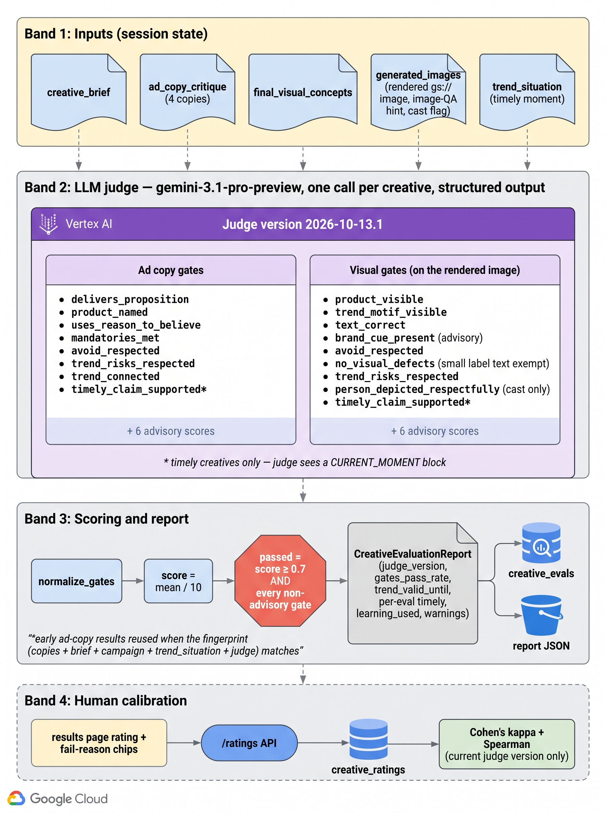 | `creative_eval/` | **Regenerated 2026-10-14** (judge version `2026-10-13.1`). Inputs from session state: `creative_brief`, `ad_copy_critique` (4 copies), `final_visual_concepts`, `generated_images` (rendered `gs://` image, image-QA hint, cast flag), `trend_situation` (timely moment) → LLM judge (`gemini-3.1-pro-preview`, one call per creative, structured output). Ad copy gates: `delivers_proposition`, `product_named`, `uses_reason_to_believe`, `mandatories_met`, `avoid_respected`, `trend_risks_respected`, `trend_connected`, `timely_claim_supported`\* + 6 advisory scores; visual gates (on the rendered image): `product_visible`, `trend_motif_visible`, `text_correct`, `brand_cue_present` (advisory), `avoid_respected`, `no_visual_defects` (small label text exempt), `trend_risks_respected`, `person_depicted_respectfully` (cast only), `timely_claim_supported`\* + 6 advisory scores (\* timely creatives only; the judge sees a `CURRENT_MOMENT` block). Scoring: `normalize_gates` → score = mean / 10 → passed = score ≥ 0.7 AND every non-advisory gate → `CreativeEvaluationReport` (`judge_version`, `gates_pass_rate`, `trend_valid_until`, per-eval `timely`, `learning_used`, warnings) → BigQuery `creative_evals` + Cloud Storage report JSON; early ad-copy results are reused when the fingerprint (copies + brief + campaign + `trend_situation` + judge) matches. Human calibration: results-page rating + fail-reason chips → `/ratings` API → `creative_ratings` → Cohen's kappa + Spearman (current judge version only). Previous (2026-10-12) version: [archive/creative_eval_architecture_2026-10-12.png](archive/creative_eval_architecture_2026-10-12.png) (2026-10-08: [archive/creative_eval_architecture_2026-10-08.png](archive/creative_eval_architecture_2026-10-08.png)) |

## Agent Workflow Diagrams

Companion diagrams to the architecture set above, also generated with PaperBanana
(2026-10-01; the three creative workflows regenerated 2026-10-08 and again 2026-10-12). Where the architecture diagrams show *how an agent is composed*, these
show *the order a run executes in*: phases, branches, human-review pauses, retries,
and where results are persisted.

| Diagram | Agent | Run order |
|---|---|---|
| 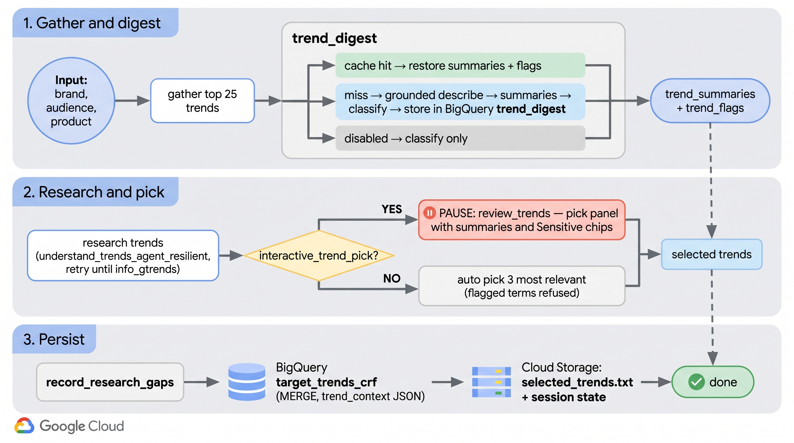 | `trend_scout/` | **Regenerated 2026-10-14.** 1. Gather and digest: input (brand, audience, product) → gather top 25 trends → `trend_digest` (cache hit → restore summaries + flags; miss → grounded describe → summaries → classify → store in BigQuery `trend_digest`; disabled → classify only) → `trend_summaries` + `trend_flags`. 2. Research and pick: research trends (`understand_trends_agent_resilient`, retry until `info_gtrends`) → `interactive_trend_pick?` → yes: pause at `review_trends` (pick panel with summaries and Sensitive chips); no: auto pick of the 3 most relevant (flagged terms refused) → selected trends. 3. Persist: `record_research_gaps` → BigQuery `target_trends_crf` (MERGE, `trend_context` JSON) → Cloud Storage (`selected_trends.txt` + session state) → done. Previous (2026-10-01) version: [archive/trend_scout_workflow_2026-10-01.png](archive/trend_scout_workflow_2026-10-01.png) |
| 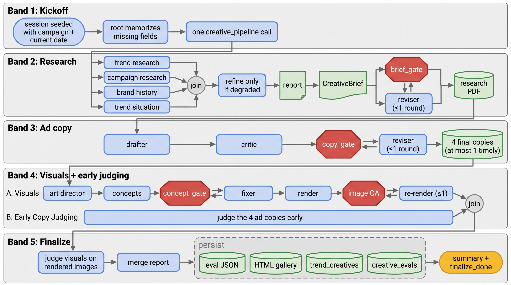 | `creative_agent/` | **Regenerated 2026-10-12.** Kickoff (session seeded with campaign + current date → root memorizes missing fields → one `creative_pipeline` call) → research (trend research, campaign research, brand history and trend situation in parallel → join → refine only if degraded → report → `CreativeBrief` → `brief_gate` ⇄ reviser, ≤1 round → research PDF) → ad copy (drafter → critic → `copy_gate` ⇄ reviser → 4 final copies, at most 1 timely) → visuals + early judging in parallel (art director → concepts → `concept_gate` ⇄ fixer → render ⇄ image QA re-render ≤1; the 4 ad copies judged early) → finalize (judge visuals on rendered images → merge report → persist eval JSON, HTML gallery, `trend_creatives`, `creative_evals` → summary + `finalize_done`). Previous (2026-10-08) version: [archive/creative_agent_workflow_2026-10-08.png](archive/creative_agent_workflow_2026-10-08.png) |
| 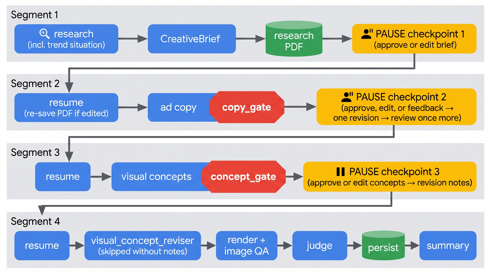 | `interactive_creative/` | **Regenerated 2026-10-12.** Four resumable segments: research (incl. trend situation) → `CreativeBrief` → research PDF → **pause, checkpoint 1** (approve or edit the brief); resume (re-save PDF if edited) → ad copy with `copy_gate` → **pause, checkpoint 2** (approve, edit, or feedback → one revision → review once more); resume → visual concepts with `concept_gate` → **pause, checkpoint 3** (approve or edit concepts → revision notes); resume → `visual_concept_reviser` (skipped without notes) → render + image QA → judge → persist → summary. Previous (2026-10-08) version: [archive/interactive_creative_workflow_2026-10-08.png](archive/interactive_creative_workflow_2026-10-08.png) |
| 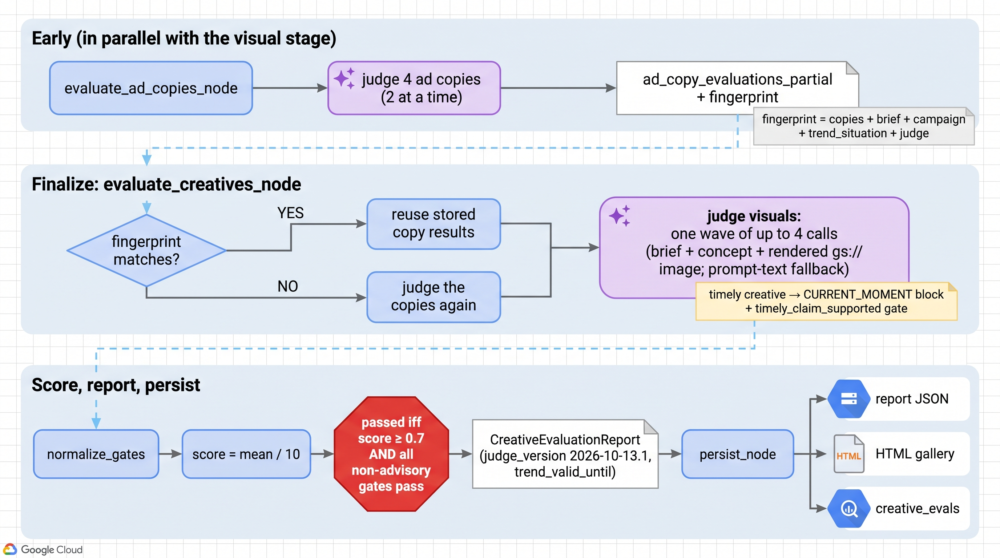 | `creative_eval/` | **Regenerated 2026-10-14.** Early, in parallel with the visual stage: `evaluate_ad_copies_node` judges the 4 ad copies (2 at a time) → `ad_copy_evaluations_partial` + fingerprint (copies + brief + campaign + `trend_situation` + judge). Finalize (`evaluate_creatives_node`): fingerprint matches? yes → reuse the stored copy results, no → judge the copies again; then judge the visuals in one wave of up to 4 calls (brief + concept + rendered `gs://` image; prompt-text fallback); a timely creative gets the `CURRENT_MOMENT` block + the `timely_claim_supported` gate. Score, report, persist: `normalize_gates` → score = mean / 10 → passed iff score ≥ 0.7 AND all non-advisory gates pass → `CreativeEvaluationReport` (`judge_version` 2026-10-13.1, `trend_valid_until`) → `persist_node` → report JSON (Cloud Storage), HTML gallery, BigQuery `creative_evals`. Previous (2026-10-12) version: [archive/creative_eval_workflow_2026-10-12.png](archive/creative_eval_workflow_2026-10-12.png) |

## Infrastructure Diagrams

Batch fan-out diagrams for the two Cloud Run services built from the one CRF image
(`cloud_functions/creative_fanout/`): the orchestrator is triggered by Pub/Sub via
Eventarc and reaches the worker through a Cloud Tasks queue (since the 2026-10-14
cutover; the worker no longer has an Eventarc trigger), and the worker runs the
deployed `creative_agent` on Vertex AI Agent Engine. Both diagrams were regenerated
2026-10-14 for the Cloud Tasks transport and the fenced row-state model.

| Diagram | Scope | Highlights |
|---|---|---|
|  | System (breadth) | **Regenerated 2026-10-14** for Cloud Tasks delivery. Dispatch: `trend_scout` rows in BigQuery `target_trends_crf` → Pub/Sub `creative-eventarc-topic` (with its dead-letter topic, now the only one in use) → Eventarc → orchestrator `creative-trawler-crf`: 1 reap stale `PROCESSING`, 2 select ≤ N non-sensitive rows (`CRF_MAX_ROWS_PER_RUN`, default 3), 3 mark `QUEUED` by row key (`uuid`, `target_trend`), 4 enqueue one HTTP task per row (deterministic task name) → create task. Run one row: Cloud Tasks queue `creative-worker-queue` (1 at a time, 30-min dispatch deadline, 5 attempts) → HTTP POST + OIDC → worker `creative-worker-crf` (`agent_worker_task`; engine from `CREATIVE_AGENT_ENGINE_ID`) → fenced lock `QUEUED → PROCESSING @n` → re-read row (sensitive → `FAILED`) → Vertex AI Agent Engine `creative_agent` (session → stream) → `finalize_done?` (poll; one retry message only on an end-of-invocation signal) → `PROCESSED` / `FAILED` / requeue (fenced) → delete session (best effort); the worker answers 200 = done, 503 = retry. Sinks: `target_trends_crf`, `trend_creatives`, `creative_evals`, Cloud Storage (images, reports, gallery). Previous (2026-09-29, Pub/Sub + Eventarc worker) version: [archive/crf_fanout_system_architecture_2026-09-29.png](archive/crf_fanout_system_architecture_2026-09-29.png) |
| 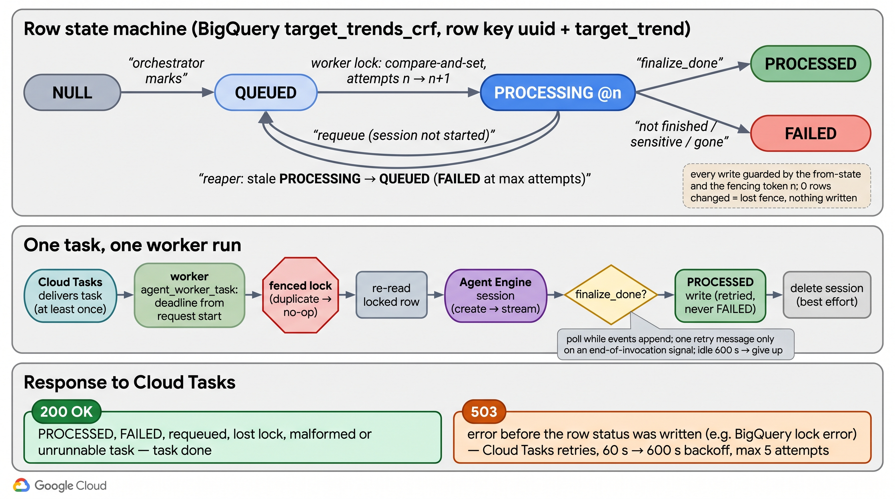 | Worker (depth) | **Regenerated 2026-10-14.** Row state machine (BigQuery `target_trends_crf`, row key `uuid` + `target_trend`): `NULL` → (orchestrator marks) `QUEUED` → (worker lock: compare-and-set, attempts n → n+1) `PROCESSING @n` → `PROCESSED` (`finalize_done`) or `FAILED` (not finished / sensitive / gone); back to `QUEUED` by requeue (session not started) or the reaper (stale `PROCESSING` → `QUEUED`, `FAILED` at max attempts); every write is guarded by the from-state and the fencing token n (0 rows changed = lost fence, nothing written). One task, one worker run: Cloud Tasks delivers the task (at least once) → worker `agent_worker_task` (deadline from request start) → fenced lock (duplicate → no-op) → re-read locked row → Agent Engine session (create → stream) → `finalize_done?` (poll while events append; one retry message only on an end-of-invocation signal; idle 600 s → give up) → `PROCESSED` write (retried, never `FAILED`) → delete session (best effort). Response to Cloud Tasks: **200 OK** for `PROCESSED`, `FAILED`, requeued, lost lock, malformed or unrunnable task (task done); **503** for an error before the row status was written (e.g. a BigQuery lock error), which Cloud Tasks retries (60 s → 600 s backoff, max 5 attempts). Previous (2026-07-13, Pub/Sub ACK/NACK) version: [archive/crf_worker_reliability_deepdive_2026-07-13.png](archive/crf_worker_reliability_deepdive_2026-07-13.png) |

## Frontend Diagrams

The Next.js web app (`frontend/`), how it connects to the ADK backend, and how it is served.

| Diagram | Scope | Highlights |
|---|---|---|
| 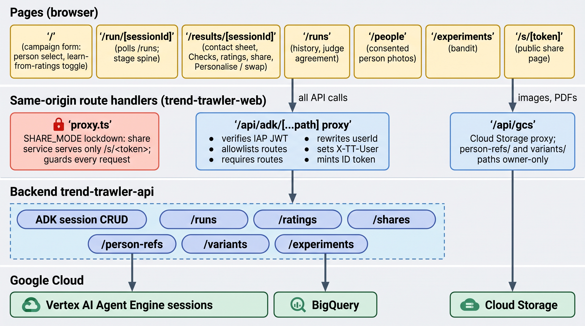 | App architecture + request flow | **Regenerated 2026-10-12.** Pages `/` (campaign form: person select, learn-from-ratings toggle), `/run/[sessionId]` (polls `/runs`; stage spine), `/results/[sessionId]` (contact sheet, Checks, ratings, share, Personalise / swap), `/runs` (history, judge agreement), `/people`, `/experiments`, `/s/[token]` call only same-origin route handlers: the `/api/adk/[...path]` proxy (verifies the IAP JWT, allowlists routes, rewrites `userId`, sets `X-TT-User`, mints an ID token) → private `trend-trawler-api` (ADK session CRUD, `/runs`, `/ratings`, `/shares`, `/person-refs`, `/variants`, `/experiments`) → Agent Engine sessions + BigQuery; `/api/gcs` streams Cloud Storage (`person-refs/` and `variants/` owner-only); `proxy.ts` locks the share service down to `/s/<token>`. Previous (2026-07-16) version: [archive/frontend_architecture_2026-07-16.png](archive/frontend_architecture_2026-07-16.png) |
| 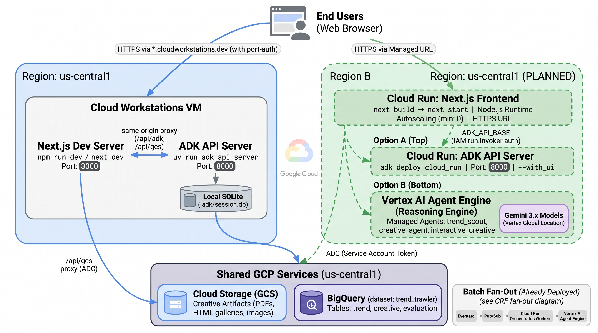 | Serving + Cloud Run deployment | **Current (dev):** one Cloud Workstations VM runs `next dev` (:3000) + the `deployment/async_app.py` launcher under uvicorn (:8000) side by side, bridged by the same-origin proxy. **Target (Cloud Run, implemented):** two Cloud Run services — a containerized Next.js frontend (`trend-trawler-web`) whose `ADK_API_BASE` points at a private backend (`trend-trawler-api`, the `async_app` launcher), reached via a metadata-server ID token (IAM `run.invoker`); `/api/gcs` uses ADC; shared GCS + BigQuery in `us-central1`. The backend runs `--no-cpu-throttling --min-instances 1` so detached runs keep CPU. Runbook in [`deployment/README.md`](../../deployment/README.md#frontend--api_server-on-cloud-run). The frontend is **IAP-gated** (domain-restricted). Includes a cross-reference to the batch fan-out (CRF) diagrams. (Drawn 2026-07-16, before the public `trend-trawler-share` service, the third service built from the same web image; the current three-service view is the topology diagram below.) |

### Live Cloud Run Deployment

The as-built Cloud Run deployment (web, api and the public share service) (project `<PROJECT_ID>`, `us-central1`),
captured from three angles (the build pipeline diagram predates the share service, which is built from the same web image). Complements `frontend_cloudrun_deployment.png` above (which
contrasts the dev workstation vs. the Cloud Run target) with the detail of the live system.

| Diagram | Scope | Highlights |
|---|---|---|
|  | Deployment topology (what runs where) | **Regenerated 2026-10-12.** Users → **IAP** (domain-restricted) → `trend-trawler-web` (Next.js standalone, SA `tt-web-sa`) → `roles/run.invoker` → private `trend-trawler-api` (`async_app.py` under uvicorn, SA `tt-api-sa`, `--no-cpu-throttling --min-instances 1`) → Vertex AI Gemini (`global`), the `trend-trawler-sessions` Agent Engine, BigQuery `trend_trawler`, Cloud Storage. Anyone with a link → the public `trend-trawler-share` (same image, `SHARE_MODE=1`, `--allow-unauthenticated`, SA `tt-share-sa` with `storage.objectViewer` on the `shares/` prefix only). Previous (2026-07-16) version: [archive/frontend_cloudrun_topology_2026-07-16.png](archive/frontend_cloudrun_topology_2026-07-16.png) |
| 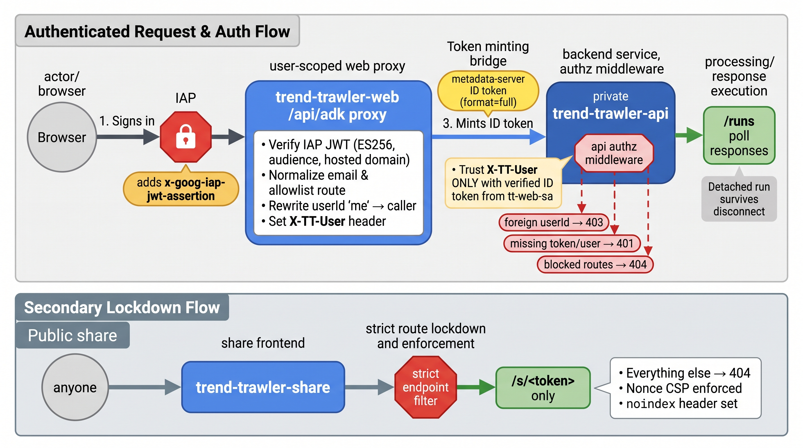 | Request & auth flow | **Regenerated 2026-10-12** for the P3 per-user trust model. Browser signs in → IAP adds `x-goog-iap-jwt-assertion` → the `trend-trawler-web` `/api/adk` proxy verifies the JWT (ES256, audience, hosted domain), normalizes the email, allowlists the route, rewrites `userId` `me` → caller and sets `X-TT-User` → mints a metadata-server ID token (`format=full`) → private `trend-trawler-api`, whose authz middleware trusts `X-TT-User` only with a verified token from `tt-web-sa` (foreign `userId` → 403, missing → 401, blocked routes → 404) → `/runs` poll responses (detached runs survive disconnect). Public share band: anyone → `trend-trawler-share` → only `/s/<token>`, everything else 404, nonce CSP, `noindex`. Previous (2026-07-16) version: [archive/frontend_cloudrun_auth_flow_2026-07-16.png](archive/frontend_cloudrun_auth_flow_2026-07-16.png) |
| 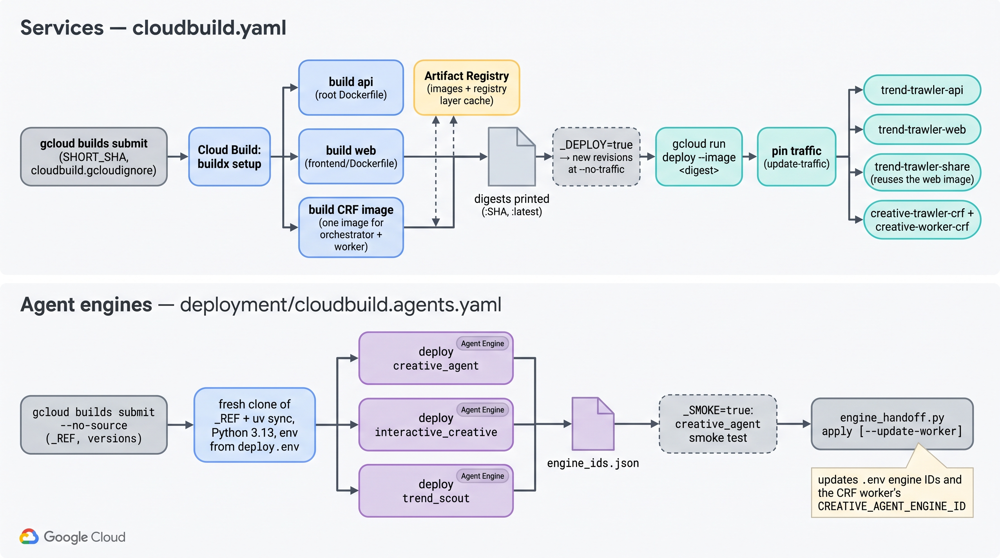 | Build & deploy pipeline | `gcloud run deploy --source` uploads source (filtered by **`.gcloudignore`** — excludes `.git`/`node_modules`/`tests`/`docs`, keeps `pyproject.toml`+`uv.lock`) → **Cloud Build** builds each image (`frontend/Dockerfile` → Next.js standalone; root `Dockerfile` → `uv` + the `deployment/async_app.py` launcher under uvicorn) → **Artifact Registry** → new 100%-traffic **Cloud Run** revision, with per-service deploy-time env vars |

Runbook: [`deployment/README.md` → Frontend + api_server on Cloud Run](../../deployment/README.md#frontend--api_server-on-cloud-run).

## Bandit creative experiments

| Diagram | Scope | Highlights |
|---|---|---|
| 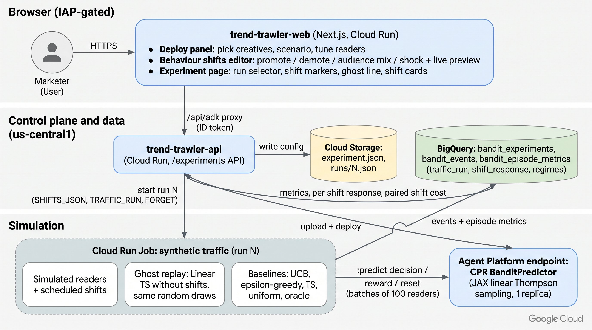 | Bandit experiments + scripted behaviour shifts | IAP-gated `trend-trawler-web` (Deploy panel, Behaviour shifts editor, run selector) → `/api/adk` proxy → `trend-trawler-api` `/experiments`, which writes `experiment.json` / `runs/N.json` to Cloud Storage, uploads + deploys the **CPR `BanditPredictor`** (JAX linear Thompson sampling, 1 replica) on Agent Platform, and starts **run N** of the synthetic-traffic **Cloud Run Job** (`SHIFTS_JSON`, `TRAFFIC_RUN`, `FORGET`). The job simulates readers with the scheduled shifts, calls the endpoint `:predict` in batches of 100, replays the baselines and the unshifted **ghost** Linear TS on the same random draws, and writes run-numbered events and episode metrics (`traffic_run`, `shift_response`, `regimes`) to **BigQuery**, which the api aggregates into per-shift responses and the paired shift cost |

Guide: [`docs/bandit/README.md`](../bandit/README.md).

## Regenerating

Diagrams are generated via the `paperbanana-figures` skill (PaperBanana uses the Gemini
Developer API, a separate quota pool from the pipeline's Vertex AI image quota). Superseded
versions are moved to [`archive/`](archive/) with their date, never deleted. To tweak a
label without a full regenerate, use `continue_diagram(run_id=..., feedback=...)`.
