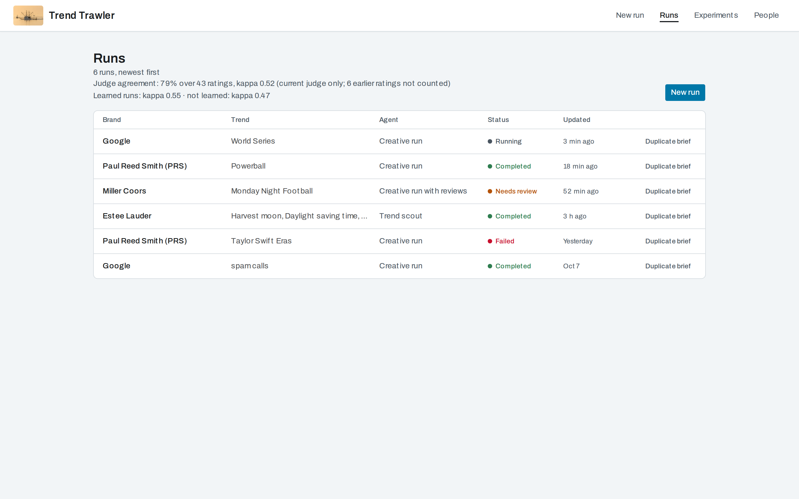
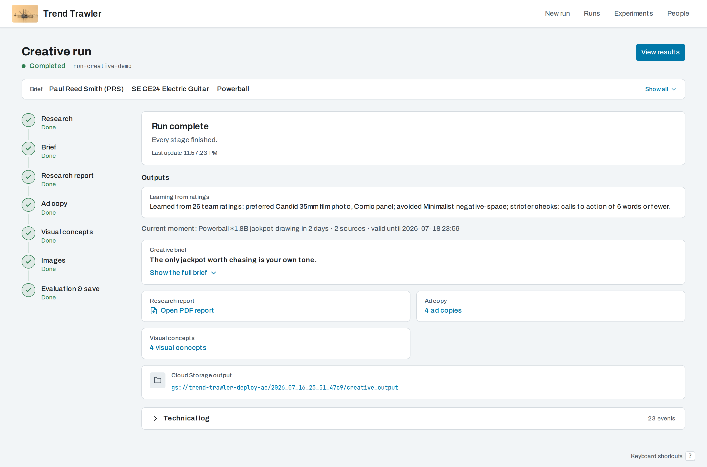
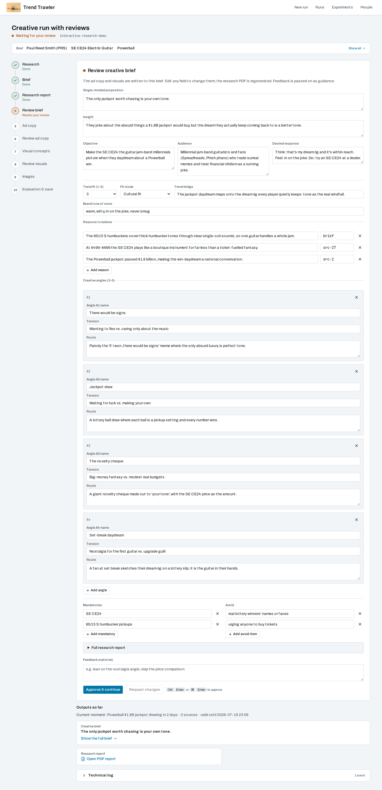
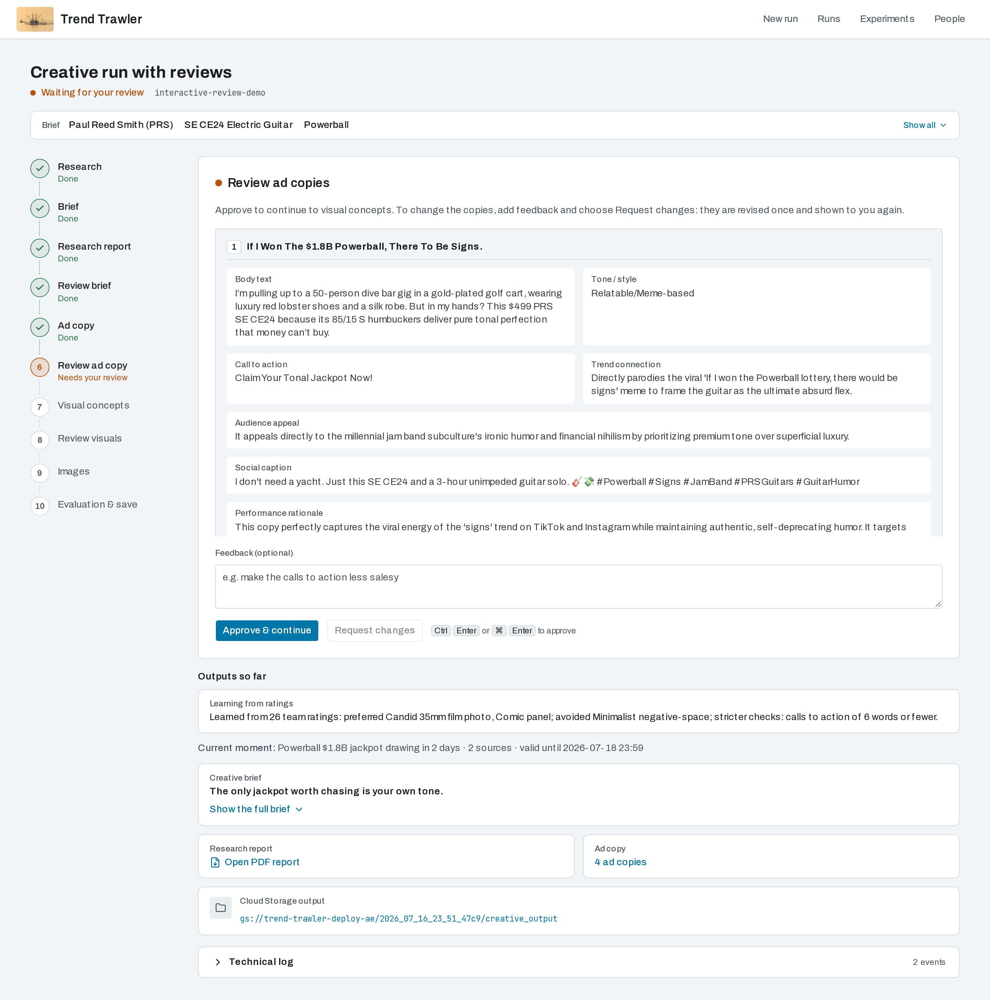
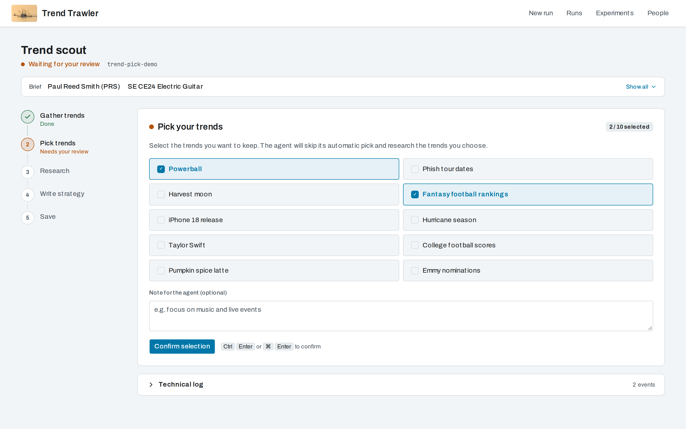
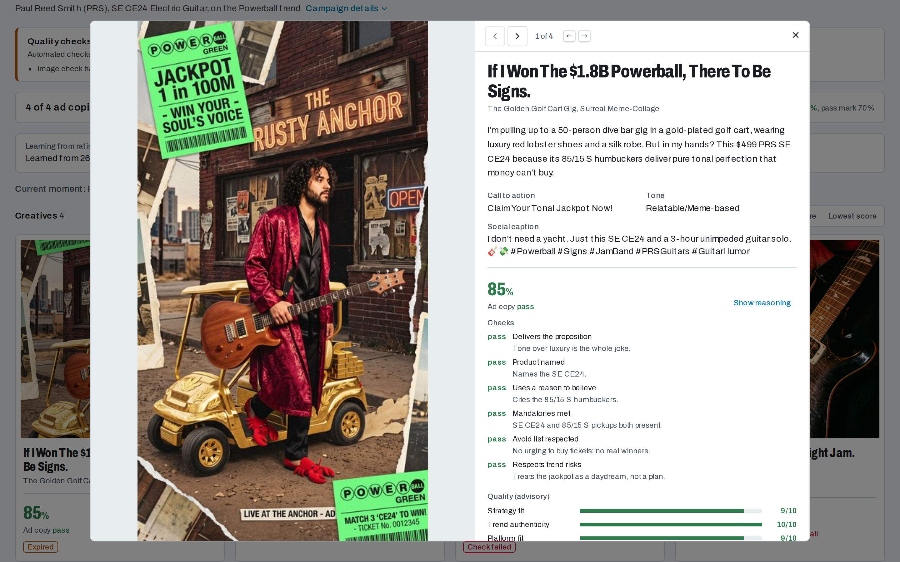
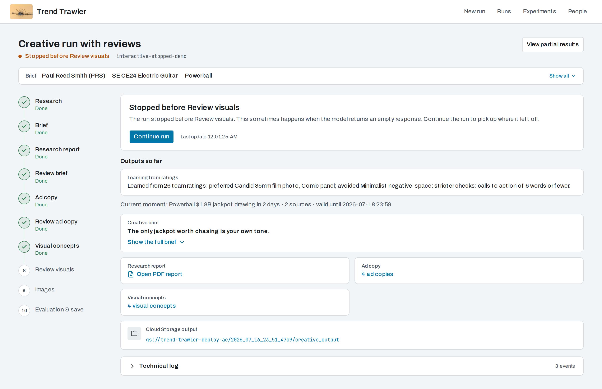
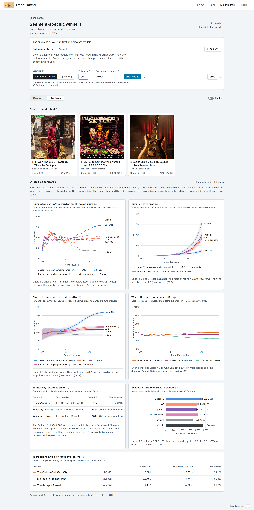
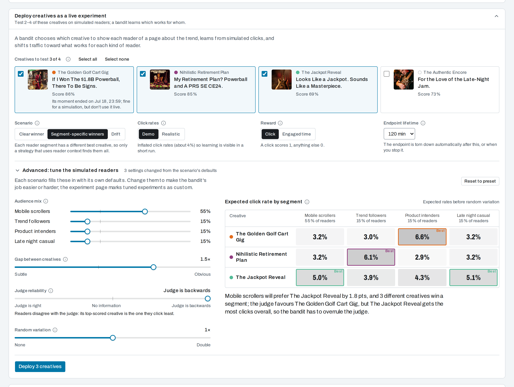

# Frontend UI Screenshots

Reference captures of the Next.js frontend (`frontend/`), used in the README and PRs.

| File | Page | Shows |
|---|---|---|
| `01-home-form.png` | `/` | Campaign input form: agent tiles, brief fields, reference image, the **Person (optional)** select (label-only demo people, left on "No person"), the **Learn from past ratings for this brand** opt-in (ticked), plus the recent-runs sidebar |
| `02-run-creative.png` | `/run/[sessionId]` | Completed `creative_agent` run. The page polls the async `/runs` job and shows a stage spine, the "Run complete" panel and outputs so far: the learning summary, the **Current moment** line, the creative brief, the report / ad copy / concept links, Cloud Storage output and a collapsed technical log |
| `03-results-creative.png` | `/results/[sessionId]` | Results contact sheet: run notes (an unresolved image check), pass-rate summary, learning summary, **Current moment** line, the four **real generated images** with ad-copy/visual scores, a **Check failed** chip on the creative with a failed blocking gate, "Rated" marks, **Share slate** and the **Shared links** list, plus the Deploy panel |
| `04-run-interactive-review.png` | `/run/[sessionId]` | `interactive_creative` paused at checkpoint 2, "Review ad copies" |
| `05-runs.png` | `/runs` | Run history with **Duplicate brief**, and the "Judge agreement" line (kappa over current-judge ratings, earlier ratings noted) with the learned / not-learned kappa line |
| `06-run-trend-pick.png` | `/run/[sessionId]` | `trend_scout` paused at the opt-in trend pick |
| `07-run-research-review.png` | `/run/[sessionId]` | `interactive_creative` paused at checkpoint 1: the editable structured **creative brief** form (proposition, insight, angles, mandatories, avoid; full research report collapsed underneath) |
| `08-run-stopped-early.png` | `/run/[sessionId]` | An interactive run that stopped early, with **Continue run** and partial outputs |
| `09-results-proof-detail.png` | `/results/[sessionId]` | Proof-detail dialog for creative 1: copy, then the ad-copy **Checks** (pass/fail per gate with the judge's note) above the advisory quality scores (viewport capture) |
| `10-deploy-panel.png` | `/results/[sessionId]` | **Deploy creatives as a live experiment** panel with three creatives picked (viewport capture) |
| `11-experiments.png` | `/experiments` | Experiments list: scenario, creatives, status, created, endpoint lifetime |
| `12-experiment-detail.png` | `/experiments/[experimentId]` | Experiment detail after 20 episodes: controls, arms, bandit charts (log-x reward vs oracle, regret and % optimal with 95% bands, arm share, per-segment winners, total reward ± std) |
| `13-experiment-help.png` | `/experiments/[experimentId]` | The Stop "ⓘ" help popover open (keyboard focus), explaining that stopping deletes the endpoint and keeps results (viewport capture) |
| `14-experiment-overview.png` | `/experiments/[experimentId]` | Overview tab of the first live experiment: the headline reading and the creative scoreboard |
| `15-experiment-explain.png` | `/experiments/[experimentId]` | Analysis tab with the **Explain** switch on (a "How to read this" note under each chart) |
| `16-experiment-creative-detail.png` | `/experiments/[experimentId]` | Creative detail drawer from the scoreboard: totals, lift, click rate by audience segment, click rate over time (viewport capture) |
| `17-experiment-custom.png` | `/experiments/[experimentId]` | A custom experiment: the "(custom)" badge and the tuned reader settings disclosure open (viewport capture) |
| `18-shift-timeline.png` | `/experiments/[experimentId]` | Behaviour shifts editor: two scripted shifts on the timeline and the "What readers will want, period by period" preview |
| `19-shift-results.png` | `/experiments/[experimentId]` | Shift results: per-shift result cards, scoreboard ticks and the period grid, then the charts with shift markers |
| `20-continuous-learning.png` | `/experiments/[experimentId]` | Continuous learning: the **Keep learning** control, the batch-means headline and the one-stream charts with segment ticks |
| `21-people.png` | `/people` | People page: photo guidance, the copyable upload prefix, the consent text, the register form, and two label-only demo people (neutral silhouette placeholders, no real photos; one with the low-resolution notice) |
| `22-share-dialog.png` | `/results/[sessionId]` | **Share slate** dialog after **Create link** with judge checks included: the read-only URL with Copy / Open (viewport capture) |
| `23-share-card.png` | `/s/[token]` | Public share viewer, **Card** view: brand × trend heading, Card / Feed / Story switcher, each creative with its copy and the judge "Checks" block (first two of four creatives) |
| `24-share-feed.png` | `/s/[token]?view=feed` | Public share viewer, **Feed** view: link-ad mock posts (caption above the image, link bar with headline and CTA) with their checks (first row) |
| `25-proof-checks.png` | `/results/[sessionId]` | Proof detail of the creative with a failed blocking gate: visual **Checks** with "Trend motif visible" failed (advisory gates labelled), then the quality scores (viewport capture) |
| `26-proof-rating-personalise.png` | `/results/[sessionId]` | The same proof scrolled down: **Your rating** for the ad copy and the visual (a saved fail with fail-reason chips), the **Personalise** panel with its castability note (this creative's style isn't person-safe, so Render preview is disabled) and **Share this creative** (viewport capture) |
| `user-journey.gif` | all | Annotated walkthrough of an interactive run: brief → research → review the creative brief and edit it → review ad copy → shape the visuals → images rendered and judged → results (pass rate, a failed check) → proof checks → your rating → share a link → research report → history. Amber spotlight + callout on the key UI per step, a phase progress strip, and a step title + one-line explanation |
| `experiments-journey.gif` | results → `/experiments/[id]` | Annotated walkthrough of the **first live bandit experiment** (`0693ea62bb7144ef`, 2026-10-02): pick creatives and options in the Deploy panel → deploying → ready → traffic running → reward vs oracle, regret, per-segment winners and traffic share (the real final metrics after 20 episodes) → Stop with its help open. Phase strip Deploy → Endpoint → Traffic → Results → Stop |

`experiments-journey.gif` instead uses the real export of the first live experiment
(`live-experiment.json` = its ExperimentSummary, `live-experiment-metrics.json` = its
ExperimentMetrics after 20 episodes × 40,000 rounds, `images/live/` = its three creatives
downscaled to JPEG; only `userId` was replaced). Every chart frame shows those final metrics and
says "after 20 episodes"; the deploying / ready / running frames show only the status header and
controls (no partial charts are invented; the running frame shows "episode 1 of 20" with an empty
results area), with the endpoint timer derived from the measured timings (ready ~11 min after the
deploy request, traffic finished ~47 min in, 120-minute TTL). Its two Deploy-panel frames reuse
the PRS results fixtures below (the live run's results session wasn't harvested), so those
creatives differ from the three under test.

The current-feature data on the PRS run is synthetic but contract-shaped and consistent
with the harvested run (added 2026-10-12): the eval report carries gates
(`gates`, `gates_passed`, `summary.gates_pass_rate`, `judge_version` `2026-10-10`,
`brief_used`, `image_judged`; The Jackpot Reveal fails the blocking `trend_motif_visible`
gate, The Authentic Encore the advisory `brand_cue_present`), and the session state carries
`generated_images` (with image-check results), a validated `trend_situation` (upcoming
Powerball drawing, timely, with The Golden Golf Cart Gig as the timely concept),
`rating_signals_applied`, `finalize_done` and the per-run date keys.
`feature-mocks.json` holds the ratings (with fail-reason chips), judge calibration, share
links and People responses. `share-fixture.json` (the public share snapshot) and
`variants-listing.json` (each concept's castability) are derived from the run fixtures by
the real backend code: `GOOGLE_CLOUD_PROJECT=test-project uv run python
frontend/scripts/build_share_fixture.py`. **No person is cast and no real person's photo is
used:** the two People entries are label-only, and their thumbnails are a neutral silhouette
served by the capture mock.

The experiment captures (10–12) use synthetic, contract-shaped bandit fixtures
(`experiments-list.json`, `experiment-detail.json`, `experiment-metrics.json`) over three of the
same PRS creatives. All captures reflect one consistent campaign — **Paul Reed Smith (PRS) / SE CE24 Electric
Guitar / Powerball trend** — harvested from a single real `creative_agent` run.

## Regenerating

These are captured with Playwright against a local Next server with **all backend
calls route-mocked** — no live Agent Engine, GCP creds, or model quota needed at
capture time. The mocks are hydrated from committed fixtures in
`frontend/scripts/screenshot-fixtures/`, which were harvested from ONE real
`creative_agent` run (session state, curated event log, eval report, and the four
concept images). The captures read `creative-state.current.json` and
`creative-eval-report.current.json` (the harvested state/report plus the current fields: gates,
judge version, trend situation, rating learning); the original `creative-state.json` /
`creative-eval-report.json` stay unchanged because the Python tests use them as pre-gates fixtures. So `03-results-creative.png` shows the **actual
`gemini-3.1-flash-image` renders** (downscaled to lightweight JPEG fixtures), not
placeholders.

To refresh (against a production build, so no Next dev badge):

```bash
cd frontend
npm run build
cp -r .next/static .next/standalone/.next/static && cp -r public .next/standalone/public
# terminal 1: the share-gcs-mock preload serves the /s/<token> snapshot + images the
# public share page reads server side (captures 23–24); everything else is unaffected
GOOGLE_CLOUD_STORAGE_BUCKET=trend-trawler-deploy-ae NODE_OPTIONS="--import ./scripts/share-gcs-mock.mjs" \
  HOSTNAME=127.0.0.1 PORT=3600 node .next/standalone/server.js
SCREENSHOT_BASE_URL=http://localhost:3600 npm run screenshots              # terminal 2 → 01–26 PNGs
SHOTS=features SCREENSHOT_BASE_URL=http://localhost:3600 npm run screenshots  # only 21–26 (also SHOTS=shifts / continuous)
JOURNEY=1 SCREENSHOT_BASE_URL=http://localhost:3600 npm run screenshots    # journey frames + journey-frames.json → /tmp/tt-journey-frames
uv run --no-project --with pillow python scripts/build-journey-gif.py      # → user-journey.gif
JOURNEY=experiments SCREENSHOT_BASE_URL=http://localhost:3600 npm run screenshots  # → /tmp/tt-experiments-journey-frames
uv run --no-project --with pillow python scripts/build-journey-gif.py \
  --frames /tmp/tt-experiments-journey-frames --out ../docs/screenshots/experiments-journey.gif
```

(If the standalone server binds a non-local hostname, start it with `HOSTNAME=127.0.0.1`.)

The capture script (`frontend/scripts/capture-screenshots.mjs`) route-mocks
`/api/adk/**` (sessions, `/runs`, experiments, ratings, shares, person-refs, variants) and
`/api/gcs?**` from the fixtures, seeds `sessionStorage`, and writes the PNGs (viewport
1440×900 @2×; full page except the viewport captures noted in the table, and 23–24, which
are clipped to the first two creatives). The `/s/<token>` page is server-rendered from Cloud
Storage, so it can't be route-mocked from the browser; `scripts/share-gcs-mock.mjs`, preloaded
into the Next server, answers its metadata-server token and `storage.googleapis.com` reads
from `share-fixture.json` and passes every other request through.

In journey mode each frame's entry in `journey-frames.json` is
`{file, step, phase, title, caption, hold_ms, highlights: [{x, y, w, h, label, place?}]}`:
the highlight boxes are Playwright `boundingBox()`es of the key element(s) for that step
(1440-wide viewport CSS px, max 2 per frame; a locator that isn't found is logged and
skipped). `build-journey-gif.py` scales them to the GIF width and draws the spotlight
(dimmed surroundings, amber `#F59E0B` outline), a callout pill per box (numbered when
there are two; `place` is an optional above/below/right/left hint), the phase strip
(Brief → Research → Reviews → Images & eval → Results → History) and the caption bar.
A manifest may instead be `{phases: [...], frames: [...]}` to bring its own phase strip
(`JOURNEY=experiments` writes Deploy → Endpoint → Traffic → Results → Stop); the builder's
`--frames` / `--manifest` / `--out` flags select which journey to assemble (defaults: the
interactive-run journey → `user-journey.gif`).
Each annotated frame is preceded by a 0.6 s un-annotated beat (`GIF_TRANSITION_MS=0`
disables it); `GIF_EXPORT_DIR=/tmp/x` also writes the annotated frames as PNGs for review. To harvest a fresh run's fixtures (new campaign
or trend), re-run `creative_agent` headless and dump `session.state` + curated
`session.events` + the eval report + the concept images into `screenshot-fixtures/`.

## Gallery

Moved from the root README (2026-10-16), which now shows two of these. Click for full size.

<table>
  <tr>
    <td align="center"><a href="01-home-form.png"></a><br><sub>New run: agent tiles, brief and recent runs</sub></td>
    <td align="center"><a href="05-runs.png"></a><br><sub>Run history with duplicate brief</sub></td>
  </tr>
  <tr>
    <td align="center"><a href="02-run-creative.png"></a><br><sub>Completed run with the stage spine and outputs</sub></td>
    <td align="center"><a href="07-run-research-review.png"></a><br><sub>Review 1: cited research report</sub></td>
  </tr>
  <tr>
    <td align="center"><a href="04-run-interactive-review.png"></a><br><sub>Review 2: ad copy</sub></td>
    <td align="center"><a href="06-run-trend-pick.png"></a><br><sub>Trend scout: pick your trends</sub></td>
  </tr>
  <tr>
    <td align="center"><a href="03-results-creative.png"></a><br><sub>Results contact sheet with judge scores</sub></td>
    <td align="center"><a href="09-results-proof-detail.png"></a><br><sub>Proof detail for one creative</sub></td>
  </tr>
  <tr>
    <td align="center"><a href="08-run-stopped-early.png"></a><br><sub>A run that stopped early, with continue run</sub></td>
    <td></td>
  </tr>
  <tr>
    <td align="center"><a href="12-experiment-detail.png"></a><br><sub>Experiment detail: controls, arms and bandit charts</sub></td>
    <td align="center"><a href="10-deploy-panel.png"></a><br><sub>Deploy creatives as a live experiment</sub></td>
  </tr>
</table>
